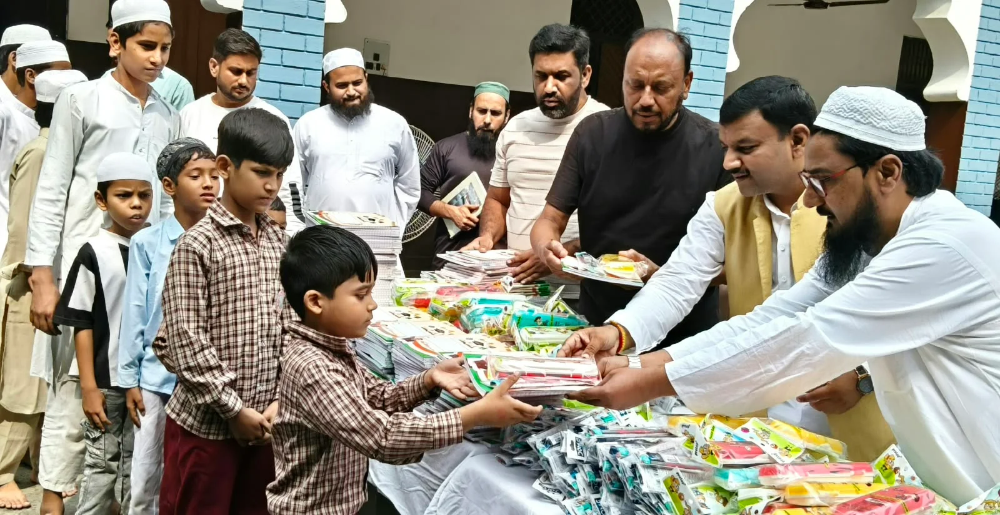
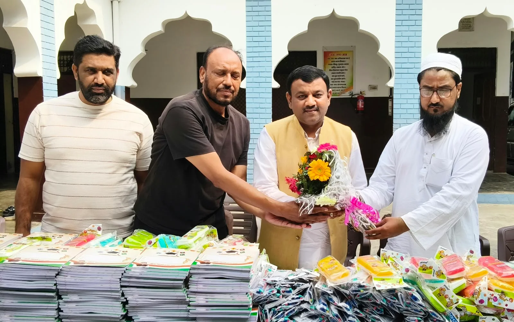
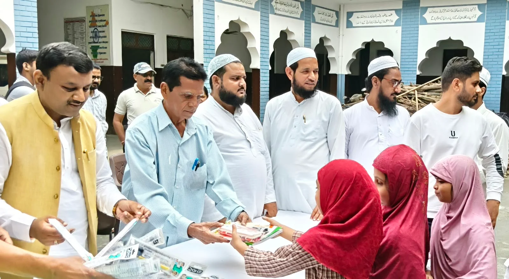

**रुड़की संवाददाता | आसिफ खान** 

बच्चों के हाथों में किताबें और आंखों में सुनहरे भविष्य के सपने—इसी संकल्प के साथ पूर्व मेयर गौरव गोयल ने सत्ती मोहल्ला स्थित मखदूम बख्श जूनियर स्कूल में सैकड़ों विद्यार्थियों को निःशुल्क पाठ्य सामग्री वितरित कर शिक्षा के महत्व का संदेश दिया। इस पहल के माध्यम से उन्होंने जरूरतमंद विद्यार्थियों का उत्साह बढ़ाते हुए उन्हें मेहनत, लगन और अच्छी तालीम के दम पर जीवन में आगे बढ़ने के लिए प्रेरित किया।

कार्यक्रम को संबोधित करते हुए पूर्व मेयर गौरव गोयल ने कहा कि शिक्षा ही तरक्की की सबसे मजबूत बुनियाद है। प्रत्येक बच्चे को अच्छी शिक्षा हासिल कर अपने परिवार, समाज और देश का नाम रोशन करने का प्रयास करना चाहिए। उन्होंने कहा कि जब बच्चे शिक्षित होंगे, तभी परिवार मजबूत होगा और समाज भी विकास की राह पर आगे बढ़ेगा।

गौरव गोयल ने विद्यार्थियों का उत्साहवर्धन करते हुए कहा कि पढ़ाई के साथ-साथ अच्छे संस्कार और अनुशासन भी जीवन में बेहद जरूरी हैं। उन्होंने बच्चों को अपने घर, विद्यालय और आसपास के वातावरण को साफ-सुथरा रखने के लिए प्रेरित किया। साथ ही नशे के दुष्प्रभावों के प्रति जागरूक करते हुए नशे से दूर रहने और स्वस्थ जीवनशैली अपनाने का आह्वान किया।

उन्होंने विद्यार्थियों को संदेश दिया कि जीवन में सफलता हासिल करने के लिए मेहनत, अनुशासन और शिक्षा को अपना मूल मंत्र बनाएं। समाज के प्रत्येक सक्षम व्यक्ति को भी आगे आकर जरूरतमंद बच्चों की शिक्षा में सहयोग करना चाहिए, ताकि आर्थिक अभाव किसी भी बच्चे की पढ़ाई और उसके सपनों के रास्ते में बाधा न बने।

**प्रधानाचार्य ने जताया आभार**

विद्यालय के प्रधानाचार्य मोहम्मद शमशाद ने पूर्व मेयर गौरव गोयल का आभार व्यक्त करते हुए कहा कि विद्यालय पहुंचकर उन्होंने सेवा, समर्पण और सामाजिक जिम्मेदारी का जो संदेश दिया है, वह सभी के लिए अनुकरणीय है। उन्होंने कहा कि विद्यार्थियों को निःशुल्क पाठ्य सामग्री उपलब्ध कराने से बच्चों का उत्साह बढ़ता है और उन्हें पढ़ाई के प्रति प्रोत्साहन मिलता है।

कार्यक्रम के दौरान विद्यार्थियों में उत्साह देखने को मिला। उपस्थित लोगों ने भी बच्चों की शिक्षा को बढ़ावा देने और जरूरतमंद विद्यार्थियों की मदद के लिए इस तरह की पहल को महत्वपूर्ण बताया।

ये रहे मौजूद: कार्यक्रम में आबिद हुसैन, उम्मेद गाजी, मकसूद हसन, मोहम्मद इंतजार, मोहम्मद नोमान, मोहम्मद सुहैल, मोहम्मद उवैस, नजमा, सामिया, शाजिया, इकरा, रियाज अहमद, कारी यूनुस, हाफिज नसीम, मोहम्मद जावेद, मौलाना इफ्तिखार सहित अन्य लोग मौजूद रहे।
