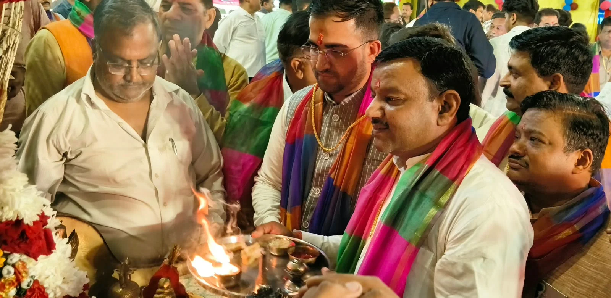
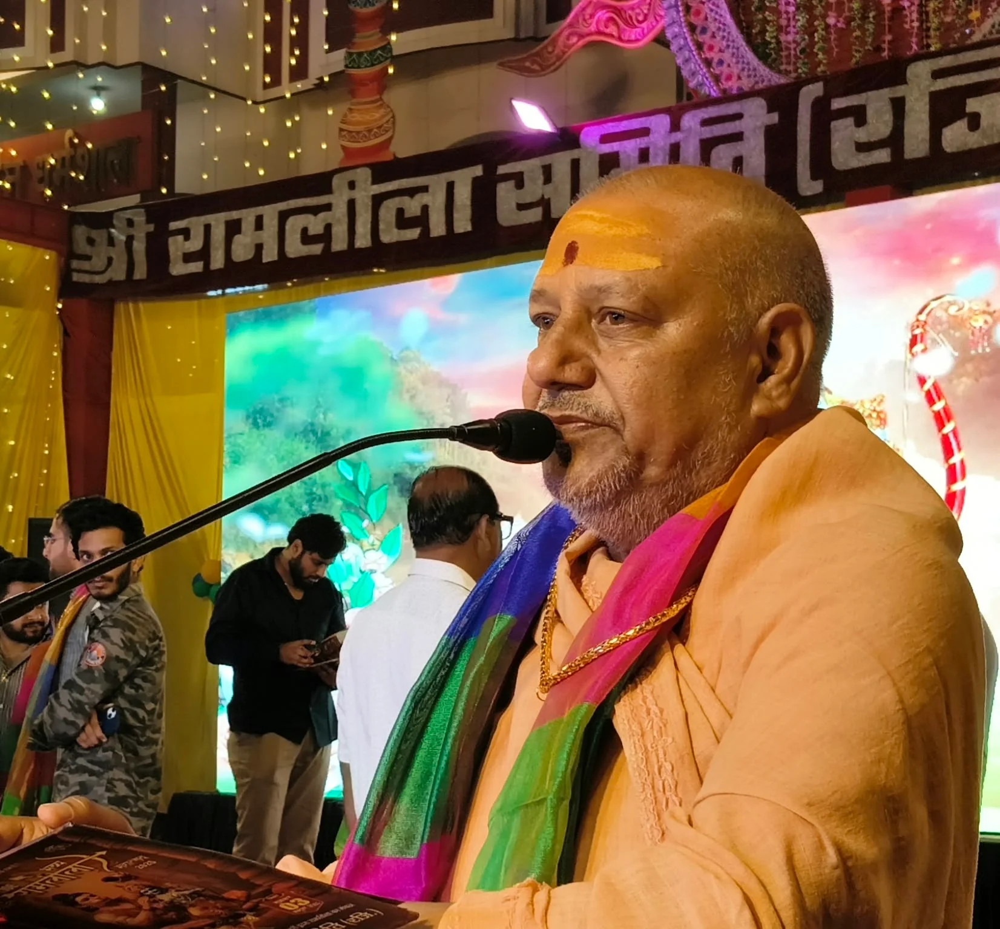
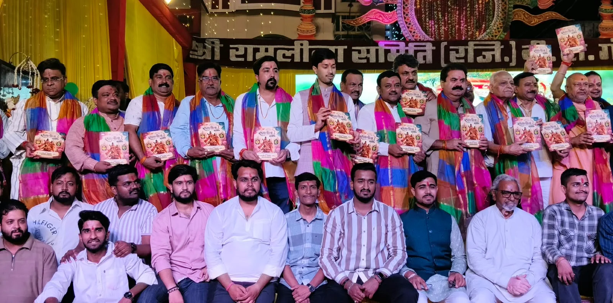

**रूडकी संवाददाता | आसिफ खान** 

रुड़की। धर्म आस्था और भारतीय संस्कृति के अद्भुत संगम के बीच रुड़की के ऐतिहासिक बीटी गंज में ‘जय श्रीराम’ के जयघोष से पूरा वातावरण भक्तिमय हो उठा। नगर की सबसे पुरानी ऐतिहासिक बीटी गंज रामलीला समिति के तत्वावधान में आयोजित 107वें श्री रामलीला महोत्सव का धार्मिक विधि-विधान, मंत्रोच्चारण और पूजा-अर्चना के साथ भव्य शुभारंभ हुआ। रामलीला स्थल पर श्रद्धालुओं और क्षेत्रवासियों की भारी मौजूदगी ने आयोजन की धार्मिक और सांस्कृतिक महत्ता को दर्शाया।

कार्यक्रम के मुख्य अतिथि जीवनदीप आश्रम के महामंडलेश्वर स्वामी यतीन्द्रानंद गिरि जी महाराज ने रामलीला मंच का विधिवत उद्घाटन किया। उन्होंने पूजा-अर्चना में शामिल होकर भगवान श्रीराम का आशीर्वाद लिया और आयोजन समिति को 107वें रामलीला महोत्सव के सफल आयोजन के लिए शुभकामनाएं दीं।

**पूर्व मेयर गौरव गोयल ने पूजा-अर्चना कर लिया भगवान श्रीराम का आशीर्वाद**

उद्घाटन समारोह में रुड़की के पूर्व मेयर गौरव गोयल की विशेष मौजूदगी रही। उन्होंने रामलीला मंच पर पहुंचकर पूजा-अर्चना की और भगवान श्रीराम की आरती में शामिल होकर आशीर्वाद प्राप्त किया। गौरव गोयल ने इस ऐतिहासिक धार्मिक आयोजन में सहभागिता कर नगर की समृद्ध धार्मिक परंपराओं और सांस्कृतिक विरासत के प्रति अपनी आस्था व्यक्त की।

बीटी गंज की ऐतिहासिक रामलीला केवल मनोरंजन का मंच नहीं, बल्कि भगवान श्रीराम के आदर्शों, भारतीय संस्कृति और सामाजिक एकता का प्रतीक है। ऐसे आयोजनों में जनप्रतिनिधियों और समाज के विभिन्न वर्गों की भागीदारी धार्मिक परंपराओं को आगे बढ़ाने के साथ ही नई पीढ़ी को अपनी सांस्कृतिक जड़ों से जोड़ने का संदेश देती है।

**सत्य, मर्यादा और कर्तव्य का संदेश देती है रामलीला: स्वामी यतीन्द्रानंद गिरि**

महामंडलेश्वर स्वामी यतीन्द्रानंद गिरि जी महाराज ने कहा कि रामलीला केवल धार्मिक आयोजन नहीं, बल्कि हमारी समृद्ध संस्कृति, परंपरा और संस्कारों को नई पीढ़ी तक पहुंचाने का महत्वपूर्ण माध्यम है। भगवान श्रीराम का जीवन सत्य, मर्यादा, त्याग और कर्तव्य के मार्ग पर चलने की प्रेरणा देता है।

उन्होंने कहा कि धार्मिक एवं सांस्कृतिक आयोजनों से समाज में सकारात्मक चेतना मजबूत होती है और युवा पीढ़ी भारतीय संस्कृति के मूल्यों से परिचित होती है। उन्होंने रामलीला समिति के पदाधिकारियों और क्षेत्रवासियों को 107वें रामलीला महोत्सव के शुभारंभ पर बधाई देते हुए आयोजन की सफलता की कामना की।

**विधायक उमेश कुमार शर्मा समेत कई गणमान्य लोग रहे मौजूद**

कार्यक्रम में खानपुर विधायक उमेश कुमार शर्मा, पूर्व मेयर यशपाल राणा, राज्य मंत्री शोभाराम प्रजापति, मेयर प्रतिनिधि ललित मोहन अग्रवाल, व्यापार मंडल अध्यक्ष अरविंद कश्यप, समाजसेवी अक्षय प्रताप सिंह, महेंद्र काला और युवा नेता विभोर सेठी विशिष्ट अतिथि के रूप में शामिल हुए। नगर के अनेक गणमान्य नागरिकों ने भी कार्यक्रम में पहुंचकर धार्मिक आयोजन की गरिमा बढ़ाई।

रामलीला समिति के पदाधिकारियों एवं सदस्यों ने सभी अतिथियों का पटका पहनाकर स्वागत एवं सम्मान किया। इसके बाद पदाधिकारियों, अतिथियों और श्रद्धालुओं ने रामलीला मंच पर पहुंचकर भगवान श्रीराम की आरती की और तिलक लगाकर आशीर्वाद लिया।

**रामलीला पुस्तिका का विमोचन, भक्तिमय हुआ बीटी गंज**

रामलीला मंचन के शुभारंभ से पूर्व 107वीं भव्य रामलीला पुस्तिका का विमोचन किया गया। पुस्तिका विमोचन और वैदिक मंत्रोच्चारण के बीच बीटी गंज का माहौल पूरी तरह भक्तिमय नजर आया। ऐतिहासिक रामलीला महोत्सव के शुभारंभ ने नगर में धार्मिक उत्साह का संचार किया।

कार्यक्रम का संचालन समिति के महामंत्री सौरभ सिंघल ने किया। इस अवसर पर समिति अध्यक्ष सुबोध गुप्ता सहित हरिमोहन कपूर, सागर गोयल, ध्रुव गुप्ता, दीपक शर्मा, शरद गुप्ता, नवीन कुमार जैन एडवोकेट, नितिन गोयल, मनोज अग्रवाल, शशिकांत अग्रवाल, विशाल गुप्ता, नवनीत गर्ग, प्रदीप परूथी, दीपक शुक्ला, अभिषेक मित्तल, अमन अग्रवाल, शोभित कुच्छल, सीके गर्ग, शेखर सिंघल, आशीष अग्रवाल, वरुण गोयल, विपिन सिंघल, पंकज सिंघल, सुमित चौहान, पीयूष जैन, अंशुल साहनी, वरुण जैन, गौरव मेंहदीरत्ता, सुधीर कालरा, देशबंधु गुप्ता, पंकज जैन, संजीव गोयल, शौर्य प्रताप सिंह, कुशाग्र गर्ग, साहिल सैनी, सतीश सैनी, पार्षद शिवम अग्रवाल, दीपक तायल, डॉ. टेक बल्लभ और तुषार गोयल समेत अनेक गणमान्य लोग मौजूद रहे।

107 वर्षों की ऐतिहासिक परंपरा के साथ बीटी गंज रामलीला महोत्सव ने एक बार फिर रुड़की की धार्मिक आस्था, सांस्कृतिक विरासत और सामाजिक एकजुटता का संदेश दिया। भगवान श्रीराम के आदर्शों को जन-जन तक पहुंचाने वाला यह आयोजन नगर की पहचान और परंपरा का महत्वपूर्ण हिस्सा बना हुआ है।
