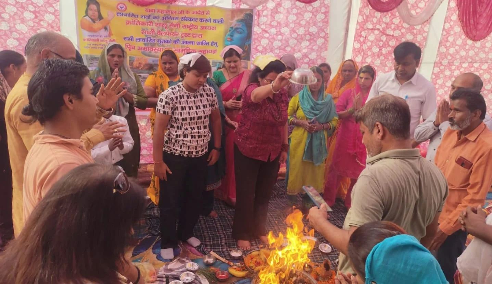

हरिद्वार विशेष संवाददाता | आसिफ खान 

रुड़की/मुजफ्फरनगर। जिनका इस दुनिया में कोई अपना नहीं, जिनकी अंतिम विदाई के लिए परिवार का कोई सदस्य मौजूद नहीं होता, ऐसी पुण्य आत्माओं को भी सम्मान और श्रद्धा के साथ याद किया गया। पितृ अमावस्या के पावन अवसर पर क्रांतिकारी शालू सैनी ने लावारिस एवं बेसहारा दिवंगत आत्माओं की शांति और मोक्ष की कामना के लिए तर्पण और शांति पाठ का आयोजन कर मानवता की मिसाल पेश की।

मुजफ्फरनगर के दक्षिणी कृष्णापुरी स्थित क्रांतिकारी शालू सैनी वृद्धाश्रम में आयोजित इस कार्यक्रम में श्रद्धा, सेवा और संवेदना का भाव देखने को मिला। हर वर्ष की भांति इस वर्ष भी उन पुण्य आत्माओं की आत्मिक शांति के लिए धार्मिक अनुष्ठान किया गया, जिनका दुनिया में कोई अपना नहीं था।

क्रांतिकारी शालू सैनी अब तक लगभग छह हजार लावारिस शवों का सम्मानजनक अंतिम संस्कार करा चुकी हैं। उनकी यह पहल समाज में मानवीय संवेदनाओं और सामाजिक जिम्मेदारी की एक प्रेरणादायक मिसाल बनकर सामने आई है।

कार्यक्रम में उत्तर प्रदेश सरकार के मंत्री कपिल देव अग्रवाल मुख्य अतिथि के रूप में उपस्थित रहे। इस दौरान दिवंगत आत्माओं की शांति के लिए प्रार्थना की गई और तर्पण एवं शांति पाठ के माध्यम से उन्हें श्रद्धांजलि अर्पित की गई।

**'जिनका कोई नहीं, उनके लिए हम परिवार बनकर खड़े होते हैं'**

इस अवसर पर क्रांतिकारी शालू सैनी ने कहा कि प्रत्येक इंसान सम्मान के साथ जीने और सम्मान के साथ दुनिया से विदा होने का अधिकारी है। जिन लोगों का इस दुनिया में कोई नहीं होता, उनके लिए हम परिवार बनकर खड़े होते हैं। यह केवल सेवा का कार्य नहीं, बल्कि हमारा नैतिक कर्तव्य है।

उन्होंने कहा कि लावारिस शवों का सम्मानजनक अंतिम संस्कार कराने के साथ-साथ उनकी आत्मिक शांति के लिए प्रार्थना करना भी मानवीय संवेदना का हिस्सा है। समाज को ऐसे लोगों के प्रति संवेदनशील होना चाहिए, जो जीवन के अंतिम पड़ाव पर अकेले रह जाते हैं और जिनकी सुध लेने वाला कोई नहीं होता।

कार्यक्रम का समापन सभी दिवंगत आत्माओं की शांति एवं मोक्ष की कामना के साथ हुआ। इसके बाद श्रद्धालुओं को प्रसाद वितरित किया गया।

इस अवसर पर पंडित अरविंद शर्मा, जितेंद्र मिश्रा भूपखेड़ी, श्रीराज जी आश्रम के आचार्य मनोज सैनी, डॉ. योगेंद्र शर्मा, राजू सैनी, मंगलेश कुमार मनोचा, काजल, सुधा, रेणु चौधरी, मीनाक्षी सैनी सहित सैकड़ों लोग उपस्थित रहे।

मानवता को समर्पित इस आयोजन ने संदेश दिया कि इंसानियत का रिश्ता केवल अपनों तक सीमित नहीं होता, बल्कि उन लोगों के प्रति भी जिम्मेदारी निभाना है, जिनके लिए दुनिया में कोई अपना नहीं है।
