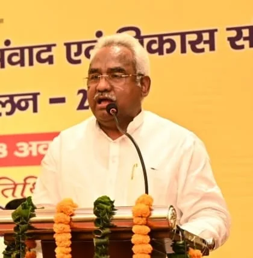

**हरिद्वार संवाददाता | आसिफ खान**

हरिद्वार। प्रदेश में 09 अक्टूबर 2026 को हुई भारी बारिश और ओलावृष्टि से किसानों की फसलों को हुए नुकसान का मामला गंभीर हो गया है। प्राकृतिक आपदा से प्रभावित किसानों और अन्य पीड़ितों को राहत दिलाने के लिए पंचायती राज एवं आपदा प्रबंधन मंत्री मदन कौशिक ने अधिकारियों को तत्काल कार्रवाई के निर्देश दिए हैं। उन्होंने आपदा एवं पुनर्वास विभाग के सचिव से कहा है कि प्रदेशभर में नुकसान का स्थलीय सर्वेक्षण कराकर वास्तविक स्थिति का आकलन किया जाए, ताकि प्रभावितों को नियमानुसार मुआवजा और आर्थिक सहायता उपलब्ध कराने की प्रक्रिया में देरी न हो।

**फसल से लेकर मकान तक, हर नुकसान का होगा आकलन**

मंत्री मदन कौशिक ने स्पष्ट निर्देश दिए कि प्रदेश के सभी जनपदों में संबंधित विभागीय अधिकारियों के माध्यम से तत्काल सर्वेक्षण कराया जाए। इसमें केवल कृषि फसलों को हुए नुकसान तक सीमित न रहते हुए पशुधन, आवास और अन्य परिसंपत्तियों की क्षति का भी आकलन किया जाएगा। सर्वेक्षण के जरिए प्रभावित परिवारों की वास्तविक स्थिति सामने लाकर राहत उपलब्ध कराने के लिए आवश्यक कदम उठाए जाएंगे।

**किसानों को राहत देने में देरी बर्दाश्त नहीं**

मदन कौशिक ने कहा कि प्राकृतिक आपदा के कारण किसानों और अन्य प्रभावित लोगों के सामने आर्थिक संकट खड़ा हो सकता है। ऐसे में अधिकारियों की जिम्मेदारी है कि वे प्रभावित क्षेत्रों में पहुंचकर संवेदनशीलता के साथ काम करें और नुकसान का सही आकलन सुनिश्चित करें। उन्होंने सर्वेक्षण एवं आकलन की प्रक्रिया में अनावश्यक विलंब नहीं करने पर जोर दिया, ताकि पात्र लोगों को समय पर सहायता मिल सके।

**नियमानुसार मिलेगा मुआवजा, पारदर्शिता पर जोर**

मंत्री ने अधिकारियों को निर्देशित किया कि प्रभावित किसानों एवं अन्य पात्र व्यक्तियों को शासन के प्रचलित नियमों और निर्धारित मानकों के अनुसार अनुमन्य मुआवजा एवं आर्थिक सहायता उपलब्ध कराने की कार्रवाई प्राथमिकता के आधार पर पूरी की जाए। उन्होंने राहत वितरण में पारदर्शिता बनाए रखने और यह सुनिश्चित करने को कहा कि सहायता वास्तविक प्रभावितों तक पहुंचे।

**अधिकारियों को आपसी समन्वय से काम करने के निर्देश**

मदन कौशिक ने संबंधित विभागों के अधिकारियों को आपसी समन्वय के साथ राहत एवं सहायता से जुड़ी सभी आवश्यक प्रक्रियाएं शीघ्र पूरी करने को कहा। अब निगाहें सर्वेक्षण की गति, नुकसान के वास्तविक आकलन और पात्र किसानों व पीड़ित परिवारों तक राहत पहुंचने पर रहेंगी। प्रभावितों को राहत दिलाने के लिए समयबद्ध कार्रवाई इस पूरी प्रक्रिया की सबसे बड़ी प्राथमिकता होगी।
