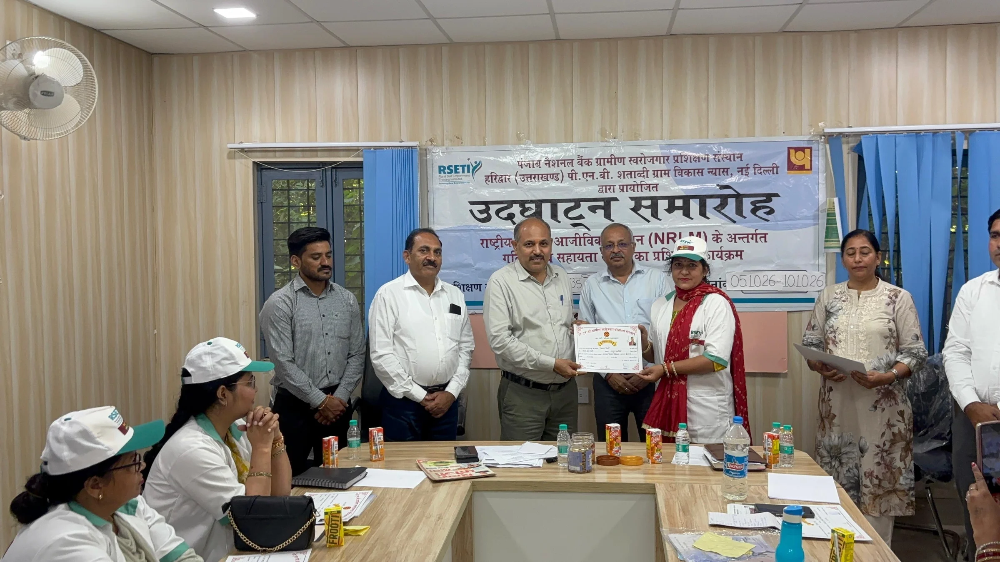
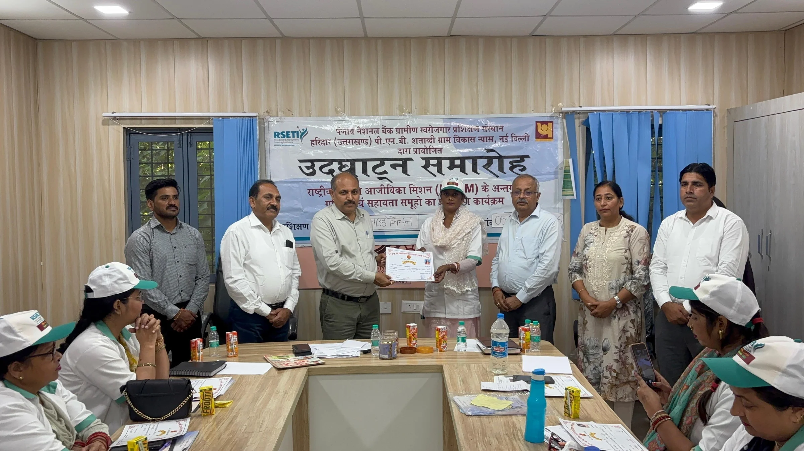
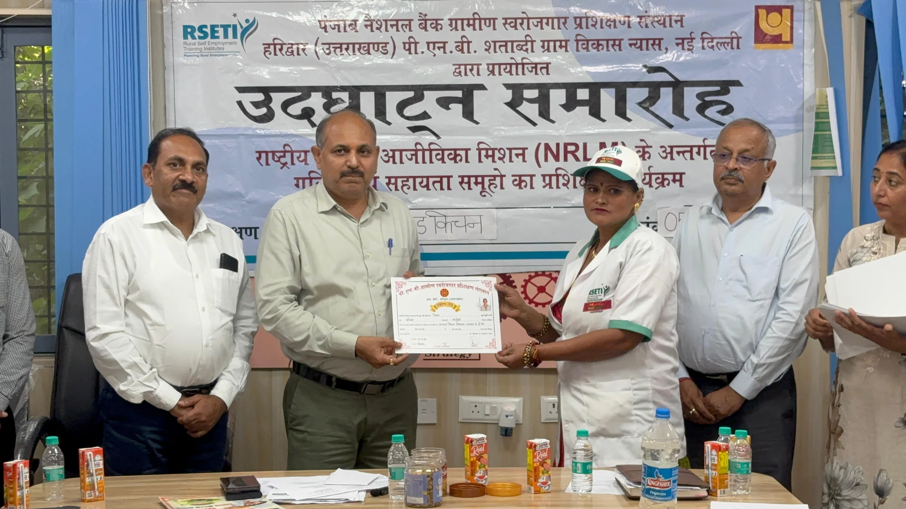
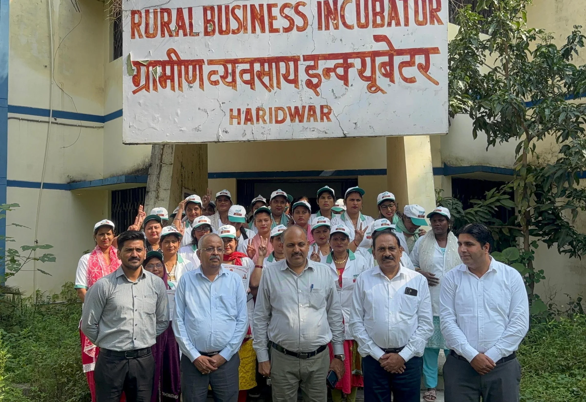

**हरिद्वार संवाददाता | आसिफ खान**

हरिद्वार। घर की रसोई को कारोबार में बदलकर महिलाएं अब आत्मनिर्भरता की नई उड़ान भर सकेंगी। कम लागत में अपना खाद्य व्यवसाय शुरू करने और डिजिटल प्लेटफॉर्म के जरिए ग्राहकों तक पहुंच बनाने के उद्देश्य से मुख्यमंत्री उद्यमशाला योजना के तहत महिलाओं को क्लाउड किचन संचालन का प्रशिक्षण दिया गया। शनिवार को मुख्यमंत्री उद्यमशाला योजना (आरबीआई) स्पोक सेंटर, हरिद्वार में आयोजित छह दिवसीय क्लाउड किचन उद्यमिता प्रशिक्षण कार्यक्रम का मुख्य विकास अधिकारी डॉ. ललित नारायण मिश्र ने समापन किया।

राष्ट्रीय ग्रामीण आजीविका मिशन (एनआरएलएम), मुख्यमंत्री उद्यमशाला योजना (एमयूवाई) और रीप (REAP) टीम के संयुक्त सहयोग से आयोजित इस कार्यक्रम का उद्देश्य महिलाओं को स्वरोजगार से जोड़ना और उन्हें आधुनिक डिजिटल तकनीक के माध्यम से अपना व्यवसाय स्थापित करने के लिए तैयार करना है। प्रशिक्षण का आयोजन आरसेटी द्वारा किया गया।

**कम लागत में कारोबार, डिजिटल प्लेटफॉर्म से बढ़ेगा बाजार**

समापन कार्यक्रम में मुख्य विकास अधिकारी डॉ. ललित नारायण मिश्र ने प्रशिक्षण प्राप्त करने वाली महिलाओं को शुभकामनाएं देते हुए कहा कि वर्तमान दौर में डिजिटल तकनीक स्वरोजगार और उद्यमिता के नए अवसर खोल रही है। क्लाउड किचन महिलाओं के लिए ऐसा विकल्प है, जिसके माध्यम से वे घर की रसोई से ही खाद्य व्यवसाय शुरू कर सकती हैं। इसके लिए बड़े रेस्टोरेंट या महंगे व्यावसायिक प्रतिष्ठान की अनिवार्यता नहीं है।

उन्होंने कहा कि महिलाओं को केवल खाना बनाने तक सीमित रखने के बजाय उन्हें अपने उत्पादों की ब्रांडिंग, ऑनलाइन मार्केटिंग और बिक्री के लिए भी प्रोत्साहित करना जरूरी है, ताकि वे सफल उद्यमी बनकर आर्थिक रूप से आत्मनिर्भर हो सकें।

**गूगल से लेकर स्विगी और जोमैटो तक की दी गई जानकारी**

छह दिवसीय प्रशिक्षण के दौरान महिलाओं को पारंपरिक पाक-कला के साथ आधुनिक डिजिटल कौशल की जानकारी दी गई। प्रतिभागियों को गूगल बिजनेस प्रोफाइल बनाने और अपने व्यवसाय को गूगल सर्च तथा गूगल मैप्स पर सूचीबद्ध कराने की प्रक्रिया समझाई गई, जिससे स्थानीय ग्राहक उनके कारोबार तक आसानी से पहुंच सकें।

इसके साथ ही स्विगी और जोमैटो जैसे ऑनलाइन फूड डिलीवरी प्लेटफॉर्म पर पंजीकरण और ऑनबोर्डिंग की प्रक्रिया के बारे में भी बताया गया। महिलाओं को इंस्टाग्राम, फेसबुक और व्हाट्सएप बिजनेस के माध्यम से अपने व्यंजनों का प्रचार करने, ग्राहकों से संपर्क बढ़ाने और ऑनलाइन ऑर्डर प्राप्त करने के तरीके सिखाए गए।

**प्रशिक्षण के बाद भी नहीं छूटेगा महिलाओं का साथ**

मुख्य विकास अधिकारी ने आश्वस्त किया कि प्रशिक्षण पूरा होने के बाद भी योजना की टीम महिलाओं को उद्यम स्थापित करने की प्रक्रिया में सहयोग प्रदान करेगी। उद्यम पंजीकरण, बीएमसी तथा आवश्यक खाद्य लाइसेंस सहित जरूरी औपचारिकताओं को पूरा कराने के लिए मार्गदर्शन उपलब्ध कराया जाएगा।

उन्होंने बताया कि इच्छुक महिलाओं को कारोबार शुरू करने के लिए वित्तीय संसाधनों तक पहुंच बनाने में भी मदद की जाएगी। इसके लिए सीसीएल, सीआईएफ और वीओ जैसे माध्यमों से उपलब्ध प्रावधानों के अनुसार ऋण एवं वित्तीय सहायता प्राप्त करने की प्रक्रिया में सहयोग किया जाएगा। इसका उद्देश्य महिलाओं के प्रशिक्षण को वास्तविक स्वरोजगार और स्थायी आजीविका में बदलना है।

**अधिकारियों की मौजूदगी में संपन्न हुआ कार्यक्रम**

कार्यक्रम में आरसेटी के निदेशक शिव कुमार, एलडीएम दिनेश कुमार गुप्ता, मुख्यमंत्री उद्यमशाला योजना से बीपीडीई राव आशकर, इंक्यूबेशन मैनेजर योगेन्द्र सिंह, राव साकीब, गीता सहित प्रशिक्षण प्राप्त करने वाली महिलाएं तथा संबंधित विभागों के अधिकारी और कर्मचारी उपस्थित रहे।

कुल मिलाकर, क्लाउड किचन प्रशिक्षण महिलाओं को घर से व्यवसाय शुरू करने, डिजिटल बाजार से जुड़ने और आर्थिक आत्मनिर्भरता की दिशा में आगे बढ़ने का अवसर उपलब्ध कराने की पहल है।
