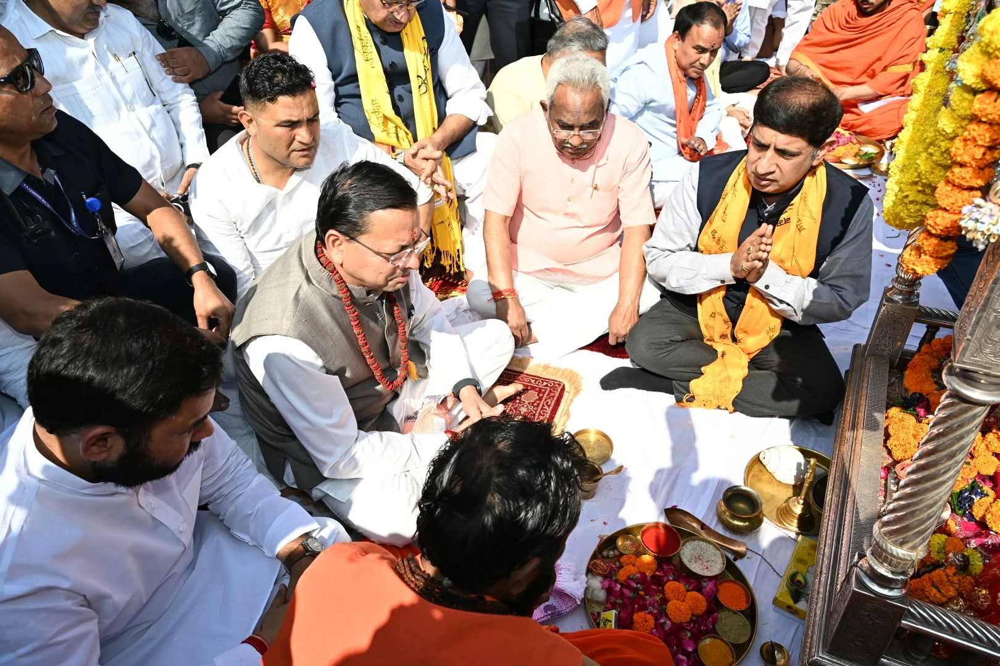
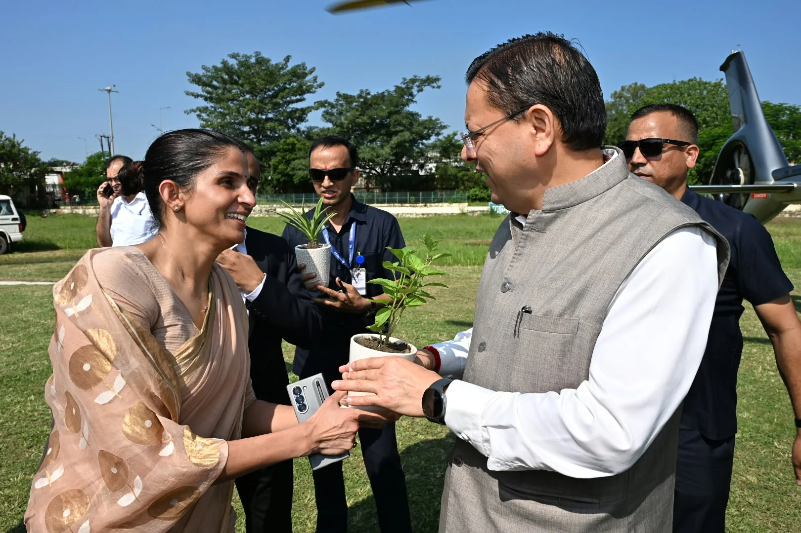
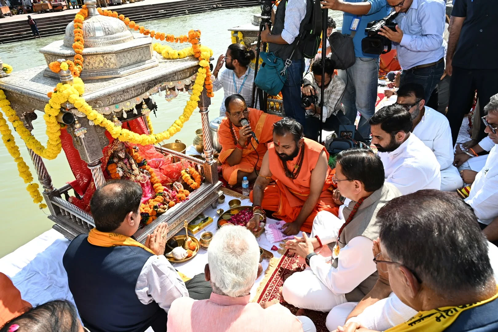

**हरिद्वार संवाददाता | आसिफ खान**

हरिद्वार। प्रधानमंत्री नरेंद्र मोदी के सरकार प्रमुख के रूप में 25 वर्ष की सार्वजनिक सेवा पूरी होने के अवसर पर धर्मनगरी हरिद्वार में सोमवार को आस्था और जनकल्याण का संदेश देखने को मिला। मुख्यमंत्री पुष्कर सिंह धामी ने मंत्रिमंडल के सहयोगियों के साथ विश्व प्रसिद्ध हरकी पैड़ी पर माँ गंगा का विधि-विधान से पूजन किया और भव्य आरती में प्रतिभाग किया। इस दौरान मुख्यमंत्री ने माँ गंगा से प्रधानमंत्री नरेंद्र मोदी के उत्तम स्वास्थ्य, दीर्घायु जीवन तथा देश और उत्तराखंड की सुख-समृद्धि, खुशहाली और निरंतर प्रगति की कामना की।

कैबिनेट बैठक से पहले हुए इस धार्मिक अनुष्ठान ने कार्यक्रम को विशेष महत्व दिया। मुख्यमंत्री और मंत्रिमंडल के सहयोगियों ने माँ गंगा का आशीर्वाद लेकर राष्ट्र की उन्नति, जनकल्याण और विकसित भारत के संकल्प की सिद्धि की कामना की। इस अवसर पर हरिद्वार की आध्यात्मिक परंपरा और राज्य सरकार की प्रशासनिक गतिविधियां एक साथ नजर आईं।

**25 साल की सार्वजनिक सेवा के उपलक्ष्य में गंगा पूजन**

प्रधानमंत्री नरेंद्र मोदी ने 7 अक्टूबर 2001 को गुजरात के मुख्यमंत्री के रूप में शपथ ली थी। गुजरात के मुख्यमंत्री और फिर देश के प्रधानमंत्री के रूप में उन्होंने सरकार प्रमुख के तौर पर 25 वर्षों की सार्वजनिक सेवा पूरी की है। इसी अवसर पर मुख्यमंत्री धामी ने हरकी पैड़ी पहुंचकर माँ गंगा की पूजा-अर्चना की।

गंगा पूजन के दौरान प्रधानमंत्री के स्वस्थ एवं दीर्घायु जीवन के साथ देश की उन्नति और प्रदेश की खुशहाली की कामना की गई। कार्यक्रम ने धार्मिक नगरी हरिद्वार में आयोजित कैबिनेट बैठक से पहले विशेष चर्चा बटोरी।

**मेलाधिकारी सोनिका मीणा ने पौधा भेंट कर किया स्वागत**

हरिद्वार में आयोजित कार्यक्रम के दौरान मेलाधिकारी सोनिका मीणा ने मुख्यमंत्री पुष्कर सिंह धामी को पौधा भेंट कर स्वागत किया। हरिद्वार में कैबिनेट बैठक का आयोजन प्रशासनिक दृष्टि से भी महत्वपूर्ण माना जा रहा है, क्योंकि राज्य सरकार प्रदेश के अलग-अलग जनपदों में मंत्रिमंडल की बैठकें आयोजित कर शासन को राजधानी से बाहर विभिन्न क्षेत्रों तक पहुंचाने की पहल को आगे बढ़ा रही है।

**बनबसा के बाद अब हरिद्वार में कैबिनेट बैठक**

मुख्यमंत्री धामी के नेतृत्व में राज्य सरकार का जोर स्थानीय जरूरतों, क्षेत्रीय विकास और जनहित से जुड़े मुद्दों को शासन की प्राथमिकताओं में शामिल करने पर है। इसी उद्देश्य से प्रदेश के विभिन्न जनपदों में मंत्रिमंडल की बैठकें आयोजित की जा रही हैं।

इससे पहले 4 अक्टूबर को चम्पावत जनपद के बनबसा में मंत्रिमंडल की बैठक आयोजित की गई थी, जिसमें राज्यहित से जुड़े कई महत्वपूर्ण निर्णय लिए गए थे। अब हरिद्वार में कैबिनेट बैठक के आयोजन को इसी पहल की अगली कड़ी के रूप में देखा जा रहा है।

सरकार की इस रणनीति का उद्देश्य क्षेत्रीय आवश्यकताओं को करीब से समझना, स्थानीय समस्याओं पर चर्चा करना और विकास योजनाओं को गति देना है। हरिद्वार में आयोजित बैठक से भी प्रदेश के विकास और जनहित से जुड़े विषयों पर महत्वपूर्ण फैसलों की अपेक्षा की जा रही है।

अब निगाहें कैबिनेट बैठक के फैसलों पर: गंगा पूजन और आरती के साथ शुरू हुआ मुख्यमंत्री धामी का हरिद्वार दौरा धार्मिक आस्था के साथ प्रशासनिक गतिविधियों के लिहाज से भी अहम है। प्रदेश के अलग-अलग जनपदों में कैबिनेट बैठकें आयोजित करने की पहल से सरकार शासन को जनता के और करीब लाने का प्रयास कर रही है।
