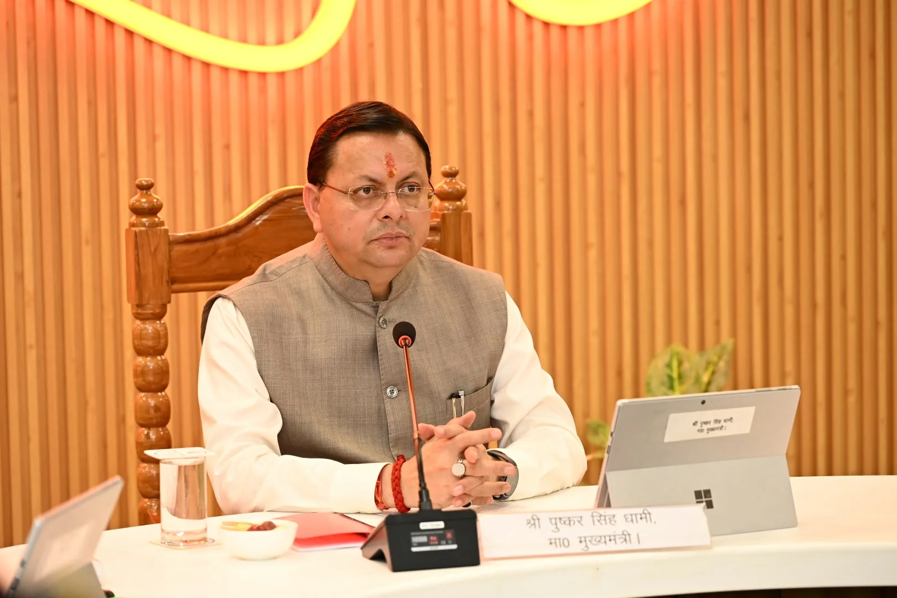
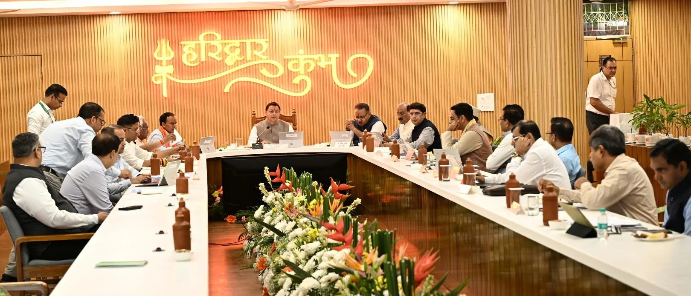
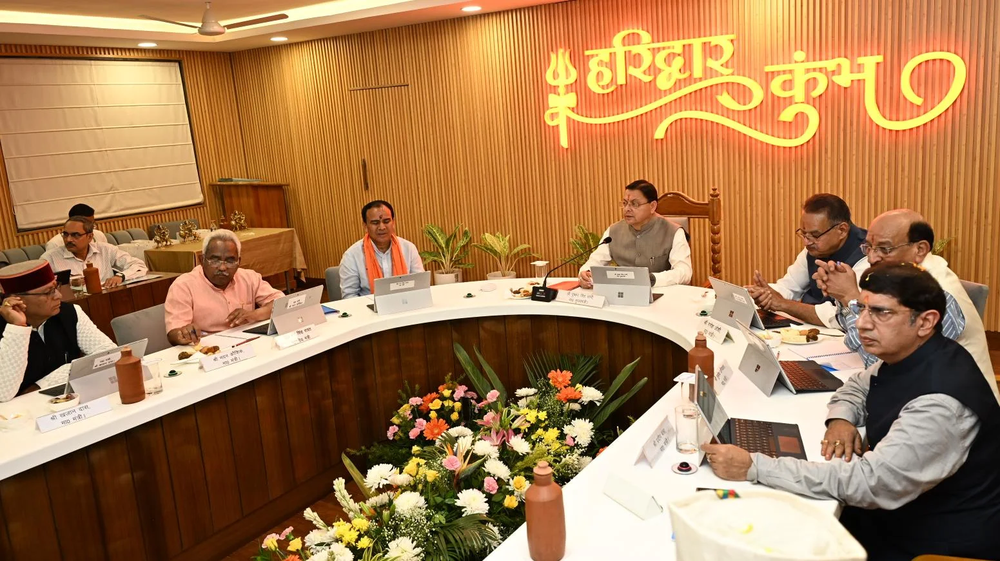

**हरिद्वार संवाददाता | आसिफ खान**

हरिद्वार। मुख्यमंत्री पुष्कर सिंह धामी की अध्यक्षता में सोमवार को हरिद्वार स्थित मेला नियंत्रण सभागार (सीसीआर) में आयोजित उत्तराखंड मंत्रिमंडल की बैठक में राज्य के विकास, युवाओं के रोजगार, प्रशासनिक सुधार और जनहित से जुड़े 13 महत्वपूर्ण प्रस्तावों पर मुहर लगाई गई। बैठक में सेवामुक्त अग्निवीरों के लिए समूह ‘ग’ के वर्दीधारी पदों पर भर्ती संबंधी नई नियमावली, बाढ़ संभावित क्षेत्रों के नियमन, अग्निशमन सेवाओं के लिए नए कानून और मुख्यमंत्री राज्य बाल वीरता पुरस्कार योजना को मंजूरी दी गई।

कैबिनेट के फैसलों में हरिद्वार के लिए भी महत्वपूर्ण निर्णय शामिल रहे। ऋषिकुल स्थित श्री मदन मोहन मालवीय प्राच्य शोध संस्थान के विकास एवं विस्तार के लिए सोसायटी गठन को सैद्धांतिक मंजूरी दी गई। वहीं, भगवानपुर तहसील के सिसौना गांव में प्रस्तावित किफायती आवासीय परियोजना के पहुंच मार्ग की चौड़ाई में निर्धारित मानकों के तहत शिथिलता देने का निर्णय लिया गया।

बैठक में कैबिनेट मंत्रियों, मुख्य सचिव आनंद वर्द्धन तथा शासन के वरिष्ठ अधिकारियों ने प्रतिभाग किया। बैठक के बाद महानिदेशक सूचना बंशीधर तिवारी ने मीडिया को कैबिनेट के निर्णयों की जानकारी दी।

**युवाओं के लिए बड़ा फैसला: सेवामुक्त अग्निवीरों को भर्ती में राहत**

कैबिनेट ने राज्याधीन सेवाओं में समूह ‘ग’ के सीधी भर्ती वाले वर्दीधारी पदों पर सेवामुक्त अग्निवीरों के सेवायोजन के लिए क्षैतिज आरक्षण नियमावली, 2026 को मंजूरी दी। केंद्र सरकार के नवीन दिशा-निर्देशों के अनुरूप नई व्यवस्था में लिखित परीक्षा और शारीरिक मानक परीक्षा में छूट के प्रावधान शामिल किए गए हैं। इससे पूर्व की नियमावली को अधिक्रमित कर नई व्यवस्था लागू करने का रास्ता साफ हुआ है।

**बाढ़ संभावित क्षेत्रों में निर्माण और भूमि उपयोग पर नियंत्रण**

प्रदेश में बाढ़ के खतरे को देखते हुए उत्तराखण्ड बाढ़ मैदान परिक्षेत्रण नियमावली, 2026 को मंजूरी दी गई। इसके तहत बाढ़ मैदानों में भूमि के उपयोग और विकास गतिविधियों को नियंत्रित करने के लिए विस्तृत प्रक्रिया एवं मानक निर्धारित किए जाएंगे। उद्देश्य बाढ़ के प्राकृतिक प्रवाह को बनाए रखना तथा लोगों, संपत्तियों और महत्वपूर्ण आधारभूत ढांचे को संभावित नुकसान से बचाना है।

**हरिद्वार के ऋषिकुल में विकसित होगा प्राच्य शोध संस्थान**

हरिद्वार के ऋषिकुल स्थित श्री मदन मोहन मालवीय प्राच्य शोध संस्थान को योग एवं ध्यान केंद्र, आयुर्वेद अध्ययन एवं अनुसंधान केंद्र, ज्योतिष एवं प्राच्य अध्ययन केंद्र, ललित कला केंद्र, हिंदू अध्ययन एवं दर्शन केंद्र तथा आध्यात्मिक पर्यटन केंद्र के रूप में विकसित करने की योजना है। इसके लिए सोसायटी गठन को सैद्धांतिक मंजूरी दी गई है। इस पहल का उद्देश्य भारतीय ज्ञान परंपरा, प्राचीन विज्ञान, संस्कृति और आधुनिक शोध को प्रोत्साहन देना है।

**सिसौना में किफायती आवासीय परियोजना को राहत**

जनपद हरिद्वार की भगवानपुर तहसील के ग्राम सिसौना में लगभग 8.1169 हेक्टेयर भूमि पर प्रस्तावित किफायती आवासीय परियोजना के लिए पहुंच मार्ग की चौड़ाई में शिथिलता को मंजूरी दी गई। परियोजना के तलपट मानचित्र की स्वीकृति के लिए निर्धारित 9 मीटर चौड़े मार्ग के स्थान पर उपलब्ध 6 मीटर चौड़े मार्ग को देखते हुए 3 मीटर की शिथिलता प्रदान की गई है। यह परियोजना प्रधानमंत्री आवास योजना तथा केंद्र एवं राज्य सरकार की आवास नीति के अनुरूप प्रस्तावित है।

**छोटे अपराधों के प्रावधानों में बदलाव की तैयारी**

कैबिनेट ने द्वितीय उत्तराखण्ड जन विश्वास (प्रावधानों में संशोधन) विधेयक, 2026 को विधानसभा में प्रस्तुत करने की मंजूरी दी। प्रस्ताव का उद्देश्य व्यापारिक गतिविधियों को सरल बनाना, ईज ऑफ डूइंग बिजनेस को बढ़ावा देना तथा छोटे अपराधों और मामूली तकनीकी एवं प्रक्रियात्मक त्रुटियों से जुड़े प्रावधानों में सुधार करना है। इसके तहत अप्रचलित और अनावश्यक कानूनी प्रावधानों को हटाने की दिशा में भी कदम उठाए जाएंगे।

**अग्निशमन सेवाओं के लिए नया कानून**

प्रदेश में बढ़ते शहरीकरण, औद्योगिक गतिविधियों और संभावित अग्नि दुर्घटनाओं से निपटने के लिए उत्तराखण्ड अग्निशमन एवं आपात सेवा विधेयक, 2026 को विधानसभा में पेश करने की मंजूरी दी गई। प्रस्तावित विधेयक भारत सरकार के मॉडल फायर सर्विस बिल, 2019 के अनुरूप तैयार किया गया है। इसका उद्देश्य अग्निशमन एवं आपात सेवाओं को अधिक प्रभावी बनाना और मौजूदा कानूनी व्यवस्था को समय की जरूरतों के अनुसार संशोधित करना है।

**बाल वीरता पुरस्कार योजना को हरी झंडी**

कैबिनेट ने मुख्यमंत्री राज्य बाल वीरता पुरस्कार योजना को मंजूरी दी। इसके तहत विपरीत परिस्थितियों में असाधारण साहस, पराक्रम, धैर्य, मानवीय संवेदना और वीरता का परिचय देने वाले बच्चों को सम्मानित किया जाएगा। योजना का उद्देश्य साहसी बच्चों का उत्साह बढ़ाना और उन्हें दूसरे बच्चों के लिए प्रेरणास्रोत बनाना है।

**केंद्र सरकार के सहयोग के लिए प्रधानमंत्री का आभार**

कैबिनेट ने उत्तराखंड के समग्र विकास में केंद्र सरकार की ओर से मिल रहे सहयोग के लिए प्रधानमंत्री नरेंद्र मोदी और भारत सरकार का आभार व्यक्त किया। राज्य की पर्वतीय, सीमावर्ती और सामरिक परिस्थितियों को देखते हुए भविष्य में भी विकास कार्यों के लिए निरंतर केंद्रीय सहयोग की अपेक्षा जताई गई।

**परिसंपत्तियों के मुद्रीकरण से मिलने वाली आय पर फैसला**

उत्तराखण्ड निवेश और आधारिक संरचना (विकास और विनियम) अधिनियम, 2023 की अनुसूची-3 में संशोधन को मंजूरी दी गई। इसके अंतर्गत सार्वजनिक अभिकरणों, स्थानीय निकायों, राज्य के सार्वजनिक उपक्रमों और वित्तीय रूप से स्वायत्त संस्थाओं की परिसंपत्तियों के विनिवेश एवं मुद्रीकरण से प्राप्त आय का 92 प्रतिशत संबंधित सार्वजनिक अभिकरणों को दिए जाने का प्रावधान किया गया है।

**विधानसभा का तृतीय सत्र बुलाने की मंजूरी**

मंत्रिमंडल ने उत्तराखण्ड की पंचम विधानसभा के वर्ष 2026 के तृतीय सत्र को आहूत करने की मंजूरी दी। सत्र की तिथि और स्थान निर्धारित करने के लिए मुख्यमंत्री पुष्कर सिंह धामी को अधिकृत किया गया है।

**स्वजल और जल-स्वच्छता मिशन के 215 पदों को निरंतरता**

स्वच्छ भारत मिशन (ग्रामीण) के अंतर्गत परियोजना प्रबंधन इकाई, स्वजल और राज्य जल एवं स्वच्छता मिशन के कुल 215 पदों की निरंतरता को 1 मार्च 2026 से 28 फरवरी 2027 तक बढ़ाने की मंजूरी दी गई। इनमें स्वजल के 189 और राज्य जल एवं स्वच्छता मिशन के 26 पद शामिल हैं। संबंधित कार्मिकों को पूर्व की भांति वेतन एवं मानदेय का भुगतान राज्य जल एवं स्वच्छता मिशन द्वारा किया जाएगा।

**अन्य महत्वपूर्ण फैसले**

ऊधमसिंह नगर: बाजपुर तहसील के ग्राम भौना इस्लामनगर में 24,280 वर्गमीटर भूमि के औद्योगिक से आवासीय भू-उपयोग परिवर्तन संबंधी शासनादेश में खसरा संख्या की त्रुटि सुधार को मंजूरी दी गई।
संस्कृति विभाग: वित्तीय अधिकारों से संबंधित व्यवस्था में संशोधन कर विभागाध्यक्ष के रूप में महानिदेशक, संस्कृति निदेशालय, उत्तराखण्ड को प्रतिस्थापित करने की मंजूरी दी गई।

कैबिनेट की बैठक में लिए गए इन फैसलों के जरिए सरकार ने युवाओं, आधारभूत ढांचे, प्रशासनिक सुधारों, सांस्कृतिक विरासत और जनकल्याण से जुड़े विषयों को प्राथमिकता दी है। अब इनमें से विधेयक संबंधी प्रस्तावों पर विधानसभा की प्रक्रिया तथा अन्य निर्णयों पर संबंधित विभागों की आगे की कार्रवाई महत्वपूर्ण होगी।
