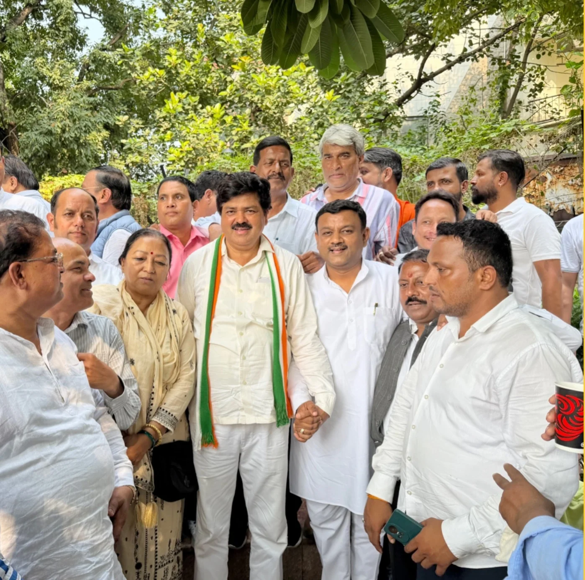
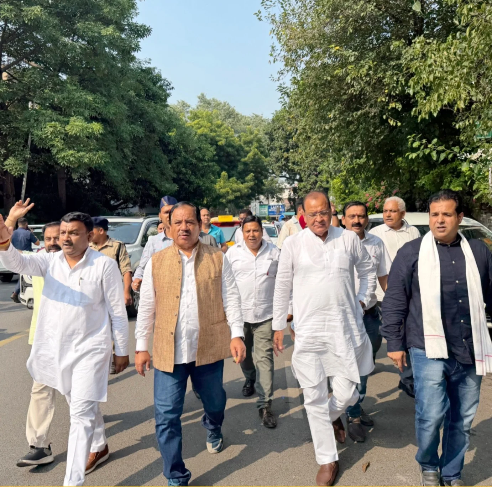

**रुड़की संवाददाता | आसिफ खान**

रुड़की। केंद्र की भाजपा सरकार के खिलाफ कांग्रेस ने अपने विरोध को धार देते हुए दिल्ली कूच किया। राष्ट्रीय नेतृत्व के आह्वान पर चलाए जा रहे ‘दिल्ली चलो अभियान’ के अंतर्गत महानगर कांग्रेस जिलाध्यक्ष एडवोकेट राजेंद्र चौधरी के नेतृत्व में पूर्व मेयर गौरव गोयल समेत बड़ी संख्या में कांग्रेसी कार्यकर्ता दिल्ली के लिए रवाना हुए। सिविल लाइंस स्थित जिलाध्यक्ष के कैंप कार्यालय पर एकत्रित हुए कार्यकर्ताओं ने केंद्र सरकार के खिलाफ जमकर नारेबाजी की और अपने विरोध का खुलकर इजहार किया।

कांग्रेस कार्यकर्ताओं का काफिला दिल्ली में जंतर-मंतर पर चल रहे धरने में शामिल होने के लिए रवाना हुआ। अभियान के जरिए कांग्रेस ने लोकतंत्र, संविधान और नागरिकों के मताधिकार से जुड़े मुद्दों को प्रमुखता से उठाते हुए केंद्र सरकार के खिलाफ अपनी आवाज बुलंद की।

**‘लोकतंत्र की आवाज दबाने का प्रयास बर्दाश्त नहीं’**

महानगर कांग्रेस जिलाध्यक्ष एडवोकेट राजेंद्र चौधरी और पूर्व मेयर गौरव गोयल ने केंद्र की भाजपा सरकार पर निशाना साधते हुए आरोप लगाया कि सरकार तानाशाही रवैया अपना रही है। उन्होंने कहा कि लोकतंत्र और संविधान की रक्षा करना प्रत्येक नागरिक का अधिकार है। जनता को अपनी बात रखने और अपने मताधिकार का इस्तेमाल करने की स्वतंत्रता मिलनी चाहिए।

उन्होंने कहा कि लोकतंत्र में असहमति की आवाज को सम्मान मिलना चाहिए, लेकिन जनता की आवाज दबाने के प्रयास लोकतांत्रिक व्यवस्था के लिए चिंता का विषय हैं। कांग्रेस नेताओं ने स्पष्ट किया कि पार्टी जनता के अधिकारों, संविधान की रक्षा और लोकतांत्रिक मूल्यों के लिए अपना संघर्ष जारी रखेगी।

**दिल्ली कूच से कार्यकर्ताओं ने दिखाई एकजुटता**

दिल्ली चलो अभियान के तहत रुड़की से बड़ी संख्या में कांग्रेस कार्यकर्ताओं का दिल्ली पहुंचना पार्टी की एकजुटता और विरोध प्रदर्शन में भागीदारी का संदेश माना जा रहा है। कार्यकर्ताओं ने केंद्र सरकार के खिलाफ नारेबाजी करते हुए जंतर-मंतर पर चल रहे धरने में शामिल होने के लिए कूच किया।

इस दौरान राव शेर मोहम्मद, नीरज सैनी, राजेश कुमार, सरदार जसवीर सिंह, शमशाद चेयरमैन, प्रधान मीर हसन, अक्षय गौतम, नूर आलम, अमित चौधरी और सुभाष शर्मा सहित बड़ी संख्या में कांग्रेस कार्यकर्ता मौजूद रहे।

कांग्रेस नेताओं ने दोहराया कि लोकतंत्र, संविधान और नागरिकों के अधिकारों से जुड़े मुद्दों पर पार्टी जनता के बीच अपनी आवाज उठाती रहेगी।
