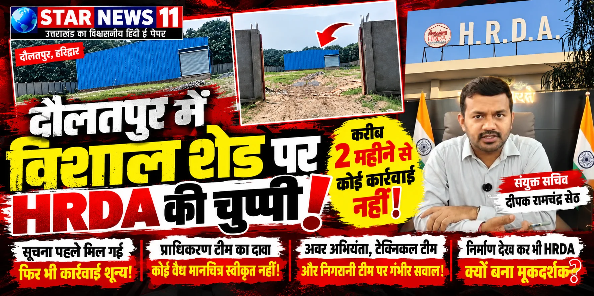
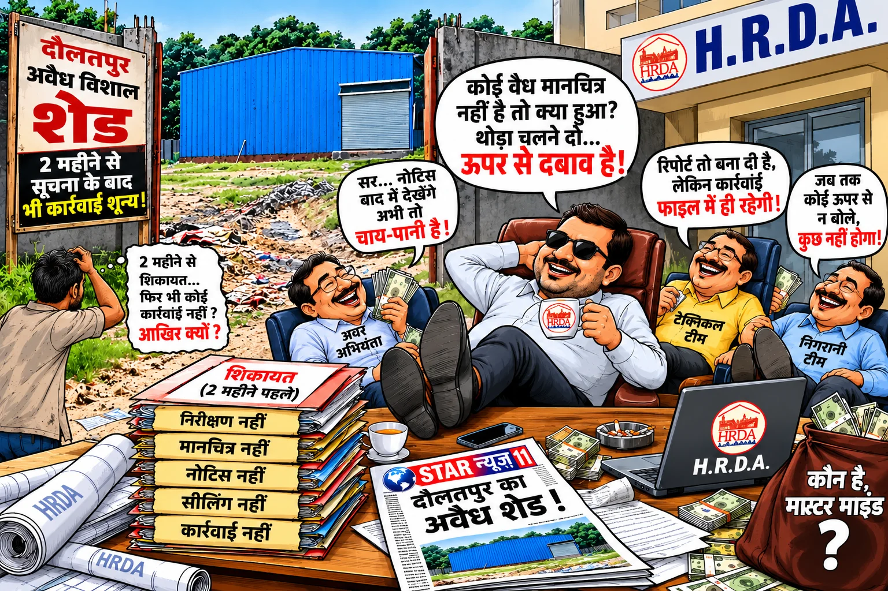
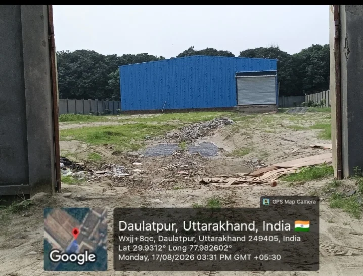

**STAR NEWS 11 | रुड़की संवाददाता | आसिफ खान**

दौलतपुर (हरिद्वार)। हरिद्वार-रुड़की विकास प्राधिकरण (HRDA) की कार्यप्रणाली पर दौलतपुर का विशाल नीला शेड एक बड़ा सवाल बनकर खड़ा है। निर्माण स्थल की तस्वीरें सामने हैं, मामले की जानकारी करीब दो महीने पहले प्राधिकरण तक पहुंचने का दावा किया जा रहा है और प्राधिकरण की टीम की ओर से शेड का कोई वैध मानचित्र स्वीकृत नहीं होने की बात भी कही गई बताई जा रही है। इसके बावजूद कार्रवाई की स्थिति स्पष्ट नहीं होना विभागीय जवाबदेही पर गंभीर सवाल खड़े करता है।

**सबसे बड़ा सवाल—जब जानकारी भी थी और मानचित्र पर सवाल भी, तो फिर कार्रवाई कहां अटक गई?**

क्या संबंधित अधिकारियों ने मामले को गंभीरता से लिया? क्या मौके का निरीक्षण हुआ? क्या निर्माण की वैधता की जांच की गई? क्या नोटिस जारी किया गया? और यदि अब तक कार्रवाई नहीं हुई, तो इसके पीछे वजह क्या है? इन सवालों का जवाब अब प्राधिकरण को देना चाहिए।

**संयुक्त सचिव दीपक रामचंद्र सेठ बताएं—मामले की समीक्षा हुई या नहीं?**

इस प्रकरण में HRDA के संयुक्त सचिव दीपक रामचंद्र सेठ की प्रशासनिक निगरानी और कार्यप्रणाली पर भी सवाल उठ रहे हैं। यदि संबंधित निर्माण की सूचना विभाग को पहले ही मिल गई थी, तो उच्चाधिकारियों के स्तर पर उसकी समीक्षा की गई या नहीं? क्या संबंधित अवर अभियंता और टेक्निकल टीम से रिपोर्ट मांगी गई? क्या निगरानी टीम से जवाब लिया गया? यदि निर्माण की स्वीकृति को लेकर स्थिति संदिग्ध थी, तो उसकी जांच आगे बढ़ाने के लिए क्या कदम उठाए गए?

संयुक्त सचिव के स्तर पर मामले की वर्तमान स्थिति स्पष्ट होना जरूरी है। आखिर विभागीय तंत्र में शिकायत या सूचना पहुंचने के बाद कार्रवाई की जिम्मेदारी किसकी है? यदि संबंधित अधिकारी समय पर कार्रवाई नहीं करते, तो उनकी जवाबदेही तय करने की व्यवस्था क्या है?

यह सवाल किसी अधिकारी को बिना जांच दोषी ठहराने का नहीं, बल्कि यह जानने का है कि विभागीय स्तर पर जिम्मेदारी निभाई गई या नहीं।

**अवर अभियंता की निगरानी पर सवाल—निरीक्षण हुआ तो रिपोर्ट कहां?**

निर्माण संबंधी मामलों में संबंधित अवर अभियंता की भूमिका महत्वपूर्ण होती है। दौलतपुर के शेड को लेकर यह स्पष्ट होना चाहिए कि संबंधित अवर अभियंता ने स्थल का निरीक्षण कब किया, क्या रिपोर्ट तैयार की और निर्माण की अनुमति के संबंध में क्या तथ्य सामने आए।

यदि करीब दो महीने पहले सूचना मिलने का दावा सही है, तो इस दौरान की गई कार्रवाई का रिकॉर्ड सामने आना चाहिए। यदि निरीक्षण नहीं हुआ, तो उसकी वजह बताई जाए। यदि निरीक्षण हुआ, तो रिपोर्ट और उस पर की गई कार्रवाई का विवरण सार्वजनिक किया जाए।

सूचना मिलने के बाद भी कार्रवाई की स्थिति अस्पष्ट रहना विभागीय निगरानी पर सवाल खड़े करता है।

**टेक्निकल टीम का दावा सही तो कार्रवाई आगे क्यों नहीं बढ़ी?**

प्राधिकरण की टीम की ओर से कथित तौर पर कहा गया कि शेड का कोई वैध मानचित्र स्वीकृत नहीं है। यदि यह बात विभागीय रिकॉर्ड से पुष्ट होती है, तो प्राधिकरण को बताना चाहिए कि इसके बाद क्या प्रक्रिया अपनाई गई।

क्या मानचित्र और निर्माण की तकनीकी जांच की गई? क्या संबंधित पक्ष से स्वीकृति संबंधी दस्तावेज मांगे गए? क्या नियमानुसार नोटिस जारी हुआ? क्या मामले में आगे की कार्रवाई की संस्तुति की गई?

यदि कोई वैध मानचित्र स्वीकृत नहीं है, तो नियमानुसार कार्रवाई की स्थिति स्पष्ट होनी चाहिए। वहीं, यदि कोई अनुमति मौजूद है, तो उसके दस्तावेज सामने रखे जाने चाहिए। एक तरफ मानचित्र स्वीकृत नहीं होने का दावा और दूसरी तरफ कार्रवाई की स्थिति पर सन्नाटा—आखिर इस विरोधाभास का जवाब कौन देगा?

**निगरानी टीम की जिम्मेदारी भी तय हो**

इस मामले में निगरानी टीम की भूमिका को भी नजरअंदाज नहीं किया जा सकता। यदि निर्माण की सूचना पहले से उपलब्ध थी, तो क्या स्थल की नियमित निगरानी हुई? क्या निर्माण की प्रगति की रिपोर्ट उच्चाधिकारियों को भेजी गई? क्या किसी अधिकारी ने कार्रवाई में हो रही देरी पर संज्ञान लिया?

यदि विभागीय रिकॉर्ड में सूचना और निरीक्षण का विवरण मौजूद है, तो उसकी समीक्षा होनी चाहिए। यदि किसी स्तर पर लापरवाही सामने आती है, तो जिम्मेदारी तय कर नियमानुसार कार्रवाई की जानी चाहिए।

**लापरवाही या कथित सांठगांठ? जांच से सामने आएगा सच**

कार्रवाई में कथित देरी को लेकर अब सवाल उठना स्वाभाविक है कि मामला विभागीय लापरवाही का है या कहीं प्रक्रिया में कोई अन्य बाधा है। हालांकि, किसी अधिकारी या कर्मचारी की सांठगांठ का आरोप बिना ठोस सबूत के साबित नहीं माना जा सकता। इसलिए जरूरी है कि प्राधिकरण मामले की निष्पक्ष जांच कराए और तथ्यों के आधार पर स्थिति स्पष्ट करे।

जांच में यह देखा जाना चाहिए कि सूचना कब मिली, किस अधिकारी को दी गई, स्थल निरीक्षण कब हुआ, मानचित्र संबंधी रिकॉर्ड क्या कहता है और कार्रवाई किस स्तर पर लंबित रही। इससे यह भी स्पष्ट हो सकेगा कि देरी प्रशासनिक प्रक्रिया के कारण हुई या किसी स्तर पर जिम्मेदारी निभाने में कमी रही।

**HRDA के सामने सात सीधे सवाल**

दौलतपुर के शेड की सूचना प्राधिकरण को किस तारीख को मिली?
क्या शेड का कोई वैध मानचित्र स्वीकृत है? विभागीय रिकॉर्ड क्या कहता है?
संबंधित अवर अभियंता ने स्थल का निरीक्षण कब किया?
टेक्निकल टीम ने जांच के बाद क्या रिपोर्ट दी?
निगरानी टीम ने निर्माण की स्थिति पर क्या कार्रवाई की?
संयुक्त सचिव दीपक रामचंद्र सेठ के स्तर पर मामले की समीक्षा और रिपोर्ट तलब की गई या नहीं?
यदि नियमों का उल्लंघन पाया गया है, तो नियमानुसार कार्रवाई की वर्तमान स्थिति क्या है और देरी की जिम्मेदारी किसकी है?
अब बहाने नहीं, रिकॉर्ड के आधार पर जवाब चाहिए

दौलतपुर का शेड HRDA की निगरानी व्यवस्था और प्रशासनिक जवाबदेही की परीक्षा बन गया है। करीब दो महीने पहले सूचना मिलने का दावा, वैध मानचित्र स्वीकृत नहीं होने की कथित जानकारी और कार्रवाई की स्थिति स्पष्ट न होना—इन तीनों पहलुओं की निष्पक्ष जांच जरूरी है।

संयुक्त सचिव दीपक रामचंद्र सेठ सहित संबंधित अवर अभियंता, टेक्निकल टीम और निगरानी टीम को लेकर उठ रहे सवालों का जवाब विभागीय रिकॉर्ड के आधार पर सामने आना चाहिए। यदि कार्रवाई हुई है, तो उसका विवरण दिया जाए। यदि कार्रवाई लंबित है, तो देरी का कारण बताया जाए। और यदि किसी स्तर पर लापरवाही प्रमाणित होती है, तो नियमानुसार जवाबदेही तय की जाए।

दौलतपुर के शेड पर अब सबसे बड़ा सवाल यही है—क्या HRDA नियमों के मुताबिक कार्रवाई करेगा, या फिर इस मामले में विभागीय जवाबदेही तय होने का इंतजार जारी रहेगा?

**STAR NEWS 11 इस मामले में प्राधिकरण के आधिकारिक पक्ष, विभागीय रिकॉर्ड और आगे की कार्रवाई पर नजर बनाए रखेगा।**
