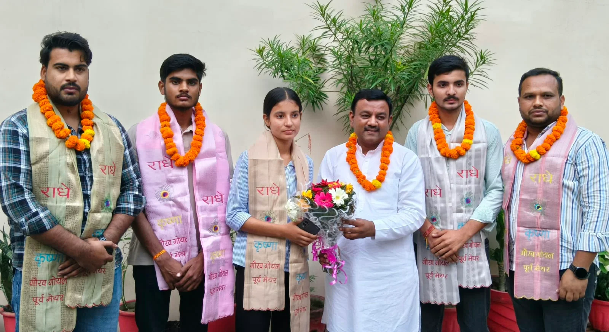
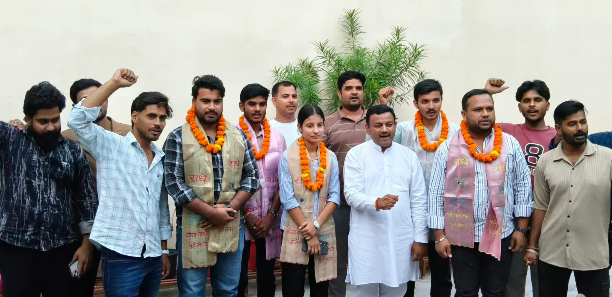
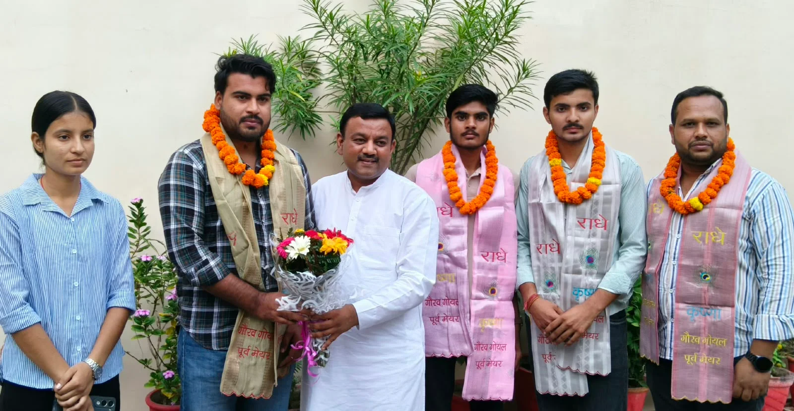

**रुड़की संवाददाता | आसिफ खान**

रुड़की। एनएसयूआई के नवनिर्वाचित पदाधिकारियों की जीत को कांग्रेस के लिए मजबूती का संकेत बताते हुए पूर्व मेयर गौरव गोयल ने अपने कैंप कार्यालय पर उनका स्वागत एवं सम्मान किया। इस दौरान उन्होंने विजेता छात्र नेताओं को बधाई देते हुए कहा कि विद्यार्थियों की यह सफलता संगठन के प्रति बढ़ते विश्वास को दर्शाती है। उन्होंने विश्वास जताया कि नवनिर्वाचित पदाधिकारियों की सक्रियता से कांग्रेस को नई ऊर्जा और मजबूती मिलेगी।

पूर्व मेयर गौरव गोयल ने कहा कि जीवन में सफलता हासिल करने के लिए निरंतर मेहनत, आत्मविश्वास और लगन बेहद जरूरी हैं। एनएसयूआई के विद्यार्थियों ने विभिन्न पदों पर जीत दर्ज कर अपनी क्षमता साबित की है। उनकी इस उपलब्धि से दूसरे विद्यार्थियों में भी संगठन के प्रति विश्वास बढ़ेगा और छात्र हितों से जुड़े मुद्दों को मजबूती से उठाने का अवसर मिलेगा।

उन्होंने कहा कि छात्र राजनीति किसी भी राजनीतिक संगठन की मजबूत नींव होती है। युवा शक्ति की सक्रिय भागीदारी संगठन को आगे बढ़ाने में अहम भूमिका निभाती है। ऐसे में नवनिर्वाचित पदाधिकारियों की जिम्मेदारी भी बढ़ गई है कि वे विद्यार्थियों की समस्याओं को प्राथमिकता दें और उनके हितों के लिए लगातार काम करें।

**पटका और फूल-मालाओं से किया सम्मान**

सम्मान समारोह के दौरान पूर्व मेयर गौरव गोयल ने एनएसयूआई जिलाध्यक्ष मनीष परमार, डीएवी कॉलेज रुड़की के अध्यक्ष आर्यन चौधरी, उपाध्यक्ष मयंक कर्नवाल, सहसचिव खुशी धीमान, कोषाध्यक्ष अंजली शर्मा सहित शानवीर, उदय, अनिल परमार, शिवकुमार, दीपक सैनी, शिवम कुमार, मोहित वशिष्ठ और ताल्हा आदि का पटका पहनाकर तथा फूल-मालाओं से स्वागत किया।

कार्यक्रम के दौरान नवनिर्वाचित पदाधिकारियों की जीत पर खुशी जताई गई और उनके उज्ज्वल भविष्य की कामना की गई। समारोह ने छात्र राजनीति में युवाओं की भूमिका और संगठनात्मक मजबूती के महत्व को भी रेखांकित किया।

**कांग्रेस को युवाओं से बड़ी उम्मीदें**

एनएसयूआई के नवनिर्वाचित पदाधिकारियों के सम्मान को कांग्रेस के युवा नेतृत्व को प्रोत्साहित करने की दिशा में महत्वपूर्ण कदम माना जा रहा है। अब इन पदाधिकारियों के सामने अपनी जीत को छात्र हितों से जुड़े कार्यों में बदलने की चुनौती होगी। वहीं, पूर्व मेयर गौरव गोयल ने उम्मीद जताई कि युवा नेता अपनी जिम्मेदारियों का निर्वहन करते हुए संगठन को मजबूत बनाने में अहम योगदान देंगे।

