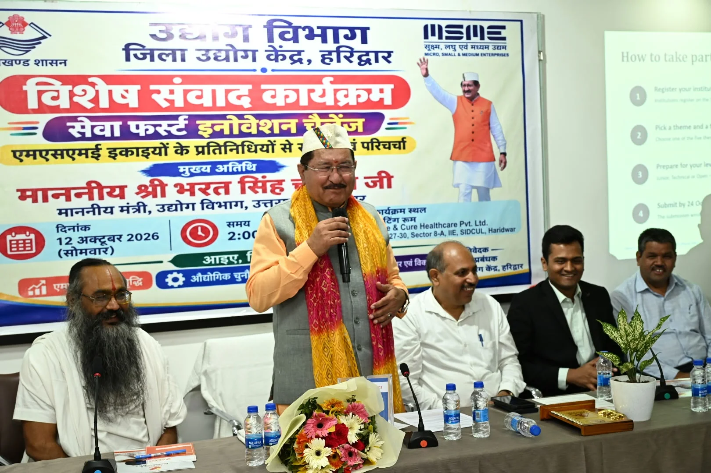
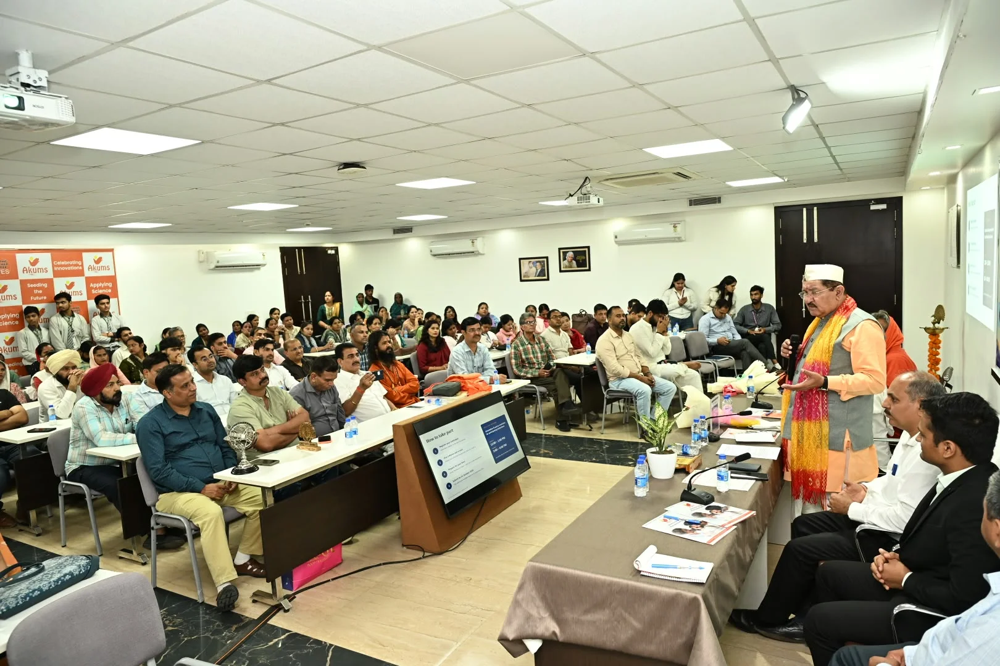
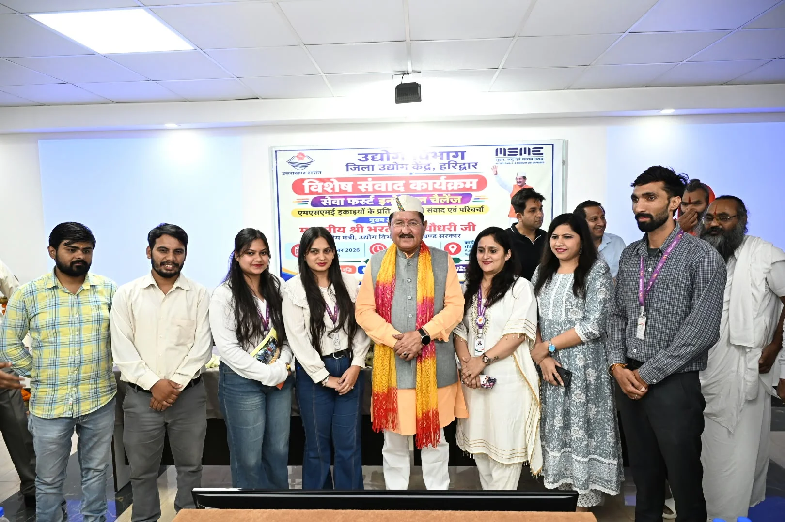
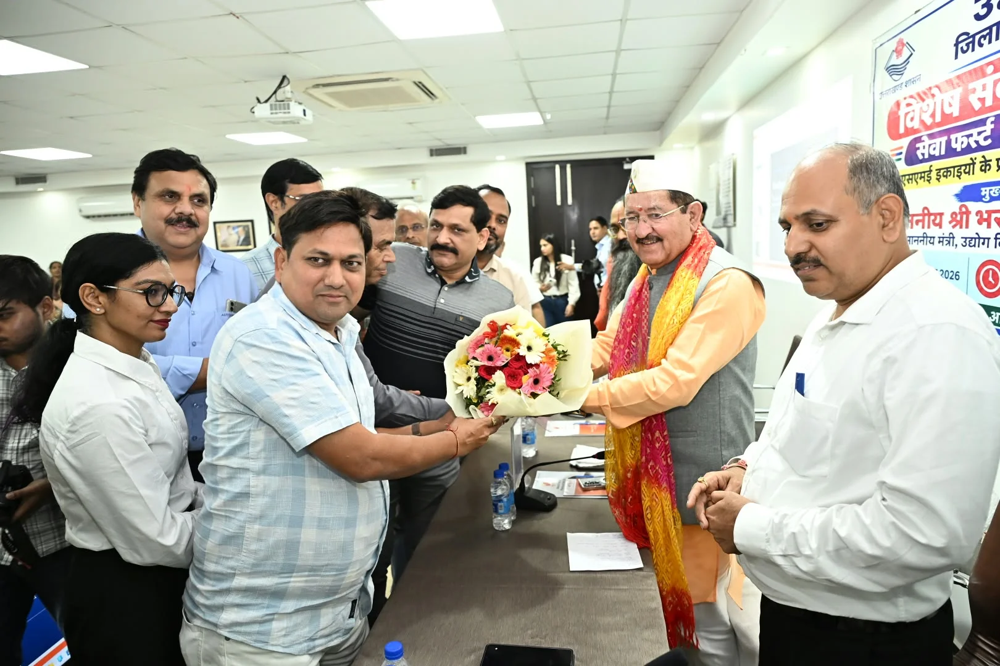

**हरिद्वार संवाददाता | आसिफ खान**

हरिद्वार। औद्योगिक विकास की बड़ी-बड़ी योजनाओं के बीच जमीनी स्तर पर उद्यमियों को किन चुनौतियों का सामना करना पड़ रहा है, इसकी तस्वीर हरिद्वार में आयोजित विशेष संवाद कार्यक्रम में सामने आई। सिडकुल स्थित मेसर्स प्योर एंड केयर हेल्थकेयर प्राइवेट लिमिटेड में आयोजित कार्यक्रम के दौरान औद्योगिक संगठनों ने जलापूर्ति, सड़क, बिजली, सब्सिडी और भूमि क्रय से जुड़े लंबित मामलों को प्रमुखता से उठाया। ग्राम्य विकास एवं सूक्ष्म, लघु एवं मध्यम उद्यम (एमएसएमई) मंत्री भरत सिंह चौधरी ने समस्याओं को गंभीरता से सुनते हुए उनके समाधान के लिए नियमानुसार और नीतिगत स्तर पर आवश्यक प्रयासों का आश्वासन दिया।

जिला उद्योग केंद्र, हरिद्वार के तत्वावधान में सेवा फर्स्ट इनोवेशन चैलेंज के अंतर्गत आयोजित इस कार्यक्रम में उद्योग जगत, प्रशासन, स्थानीय उद्यमियों और विद्यार्थियों को एक मंच पर आने का अवसर मिला। कार्यक्रम में मुख्य विकास अधिकारी डॉ. ललित नारायण मिश्र सहित विभिन्न औद्योगिक संगठनों के प्रतिनिधि मौजूद रहे।

**औद्योगिक समस्याओं पर उद्यमियों ने रखी दो टूक बात**

संवाद के दौरान जिले के विभिन्न औद्योगिक संगठनों के प्रतिनिधियों ने औद्योगिक क्षेत्रों में बुनियादी सुविधाओं से जुड़ी समस्याओं को मंत्री के समक्ष रखा। प्रतिनिधियों ने जलापूर्ति, सड़क और विद्युत व्यवस्था को बेहतर बनाने की जरूरत बताई। इसके साथ ही एमएसएमई नीति-2023 के अंतर्गत अनुमन्य सब्सिडी और प्रोत्साहन राशि का लाभ प्राप्त करने में आ रही कठिनाइयों तथा भूमि क्रय से जुड़े लंबित प्रकरणों पर भी ध्यान आकर्षित किया।

उद्योग प्रतिनिधियों ने कहा कि औद्योगिक विकास और नए निवेश को गति देने के लिए नीतियों के प्रभावी क्रियान्वयन के साथ आधारभूत सुविधाओं और विभागीय प्रक्रियाओं में व्यावहारिक सुधार जरूरी हैं। इन मुद्दों पर मंत्री ने प्रतिनिधियों की बात सुनी और संबंधित विषयों पर नियमानुसार विचार करने तथा समाधान के लिए आवश्यक प्रयास किए जाने का भरोसा दिलाया।

**बच्चों के स्टार्टअप आइडिया ने दिखाई भविष्य की नई राह**

कार्यक्रम का सबसे आकर्षक पहलू विभिन्न विद्यालयों से आए विद्यार्थियों द्वारा अपने स्टार्टअप, नवाचार आधारित विचारों और उद्यमशीलता से जुड़े प्रयासों का प्रदर्शन रहा। विद्यार्थियों ने मंत्री भरत सिंह चौधरी और मुख्य विकास अधिकारी डॉ. ललित नारायण मिश्र के समक्ष अपने विचार प्रस्तुत किए।

कम उम्र में स्वरोजगार और रोजगार सृजन की संभावनाओं पर विद्यार्थियों की सोच देखकर अतिथियों ने उनके प्रयासों की सराहना की। विद्यार्थियों को अपने विचारों को विकसित करने, नवाचार को आगे बढ़ाने और भविष्य में सफल उद्यम स्थापित करने के लिए प्रोत्साहित किया गया। कार्यक्रम ने विद्यार्थियों को प्रशासन और उद्योग जगत के प्रतिनिधियों के सामने अपनी प्रतिभा प्रदर्शित करने का अवसर भी दिया।

**छोटे उद्यमों से रोजगार सृजन की पहल**

कार्यक्रम में ग्राम्य विकास विभाग के अंतर्गत स्वरोजगार और स्थानीय उद्यमिता से जुड़े उद्यमियों का भी परिचय कराया गया। क्लाउड किचन, मशरूम उत्पादन, मुर्गी पालन, सॉफ्ट टॉय निर्माण और हस्तशिल्प जैसे क्षेत्रों में काम कर रहे उद्यमियों ने अपनी गतिविधियों, उपलब्धियों और स्थानीय स्तर पर रोजगार उपलब्ध कराने के प्रयासों की जानकारी साझा की।

इन उदाहरणों के माध्यम से स्थानीय संसाधनों, कौशल और छोटे व्यवसायों के सहारे आत्मनिर्भरता बढ़ाने की संभावनाओं पर भी चर्चा हुई।

**महिला उद्यमियों को मिला प्रोत्साहन**

कार्यक्रम के समापन पर मंत्री भरत सिंह चौधरी ने जिले में स्वरोजगार की दिशा में कार्य कर रही महिलाओं को प्रशिक्षण संबंधी प्रमाण पत्र वितरित किए। उन्होंने महिलाओं के कौशल विकास, आत्मनिर्भरता और स्वरोजगार के प्रयासों की सराहना करते हुए उन्हें अपने हुनर को व्यवसाय में बदलने के लिए प्रेरित किया।

**ये औद्योगिक प्रतिनिधि रहे मौजूद**

कार्यक्रम में लघु उद्योग भारती, रुड़की नगर के जिलाध्यक्ष केतन भारद्वाज, लघु उद्योग भारती सिडकुल के जिलाध्यक्ष मनोज गौतम, लघु उद्योग भारती भगवानपुर के जिलाध्यक्ष प्रवीण गर्ग, रुड़की स्मॉल स्केल इंडस्ट्रियल एसोसिएशन के उपाध्यक्ष राकेश मित्तल, सिडकुल मैन्युफैक्चरर्स एसोसिएशन के अध्यक्ष डॉ. हरेंद्र गर्ग एवं पंकज गर्ग, सिडकुल एंटरप्रेन्योर्स वेलफेयर एसोसिएशन के अध्यक्ष हिमेश कपूर तथा आयुष एसोसिएशन के अध्यक्ष डॉ. मोहिंदर आहूजा सहित अन्य औद्योगिक प्रतिनिधि उपस्थित रहे।

इस अवसर पर कृष्णायन गौशाला के आत्मानंद जी महाराज, महाराज स्वामी अनंतानंद, अकम्स प्योर एंड केयर हेल्थकेयर के सीईओ मनन जैन, प्रबंधक उद्योग चन्द्र मोहन, क्षेत्रीय प्रबंधक सिडकुल कमल किशोर, खंड विकास अधिकारी मानस मित्तल, सहायक प्रबंधक उद्योग दिनेश चन्द्र आर्य, संबंधित विभागों के अधिकारी और विभिन्न महिला समूहों की महिलाएं भी मौजूद रहीं।

अब निगाहें समाधान पर: संवाद कार्यक्रम में औद्योगिक समस्याओं और सुझावों को सामने रखने का अवसर मिला है। ऐसे में उद्यमियों की वास्तविक अपेक्षा इन मुद्दों पर प्रभावी कार्रवाई और लंबित समस्याओं के समयबद्ध समाधान की है, ताकि हरिद्वार में एमएसएमई इकाइयों, स्थानीय निवेश और रोजगार सृजन को नई गति मिल सके।
