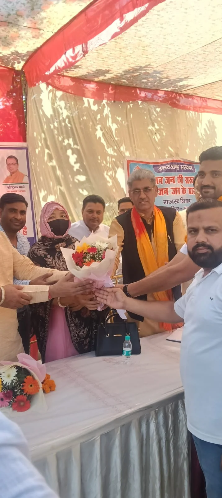
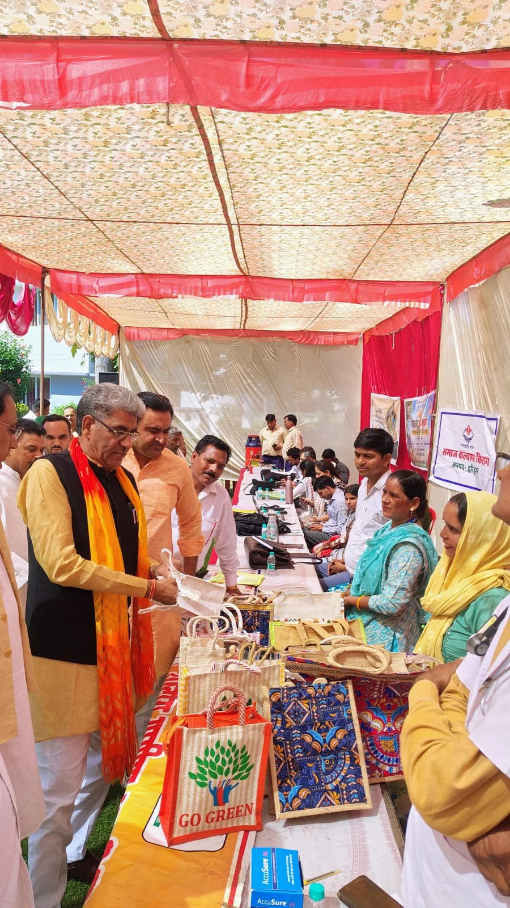
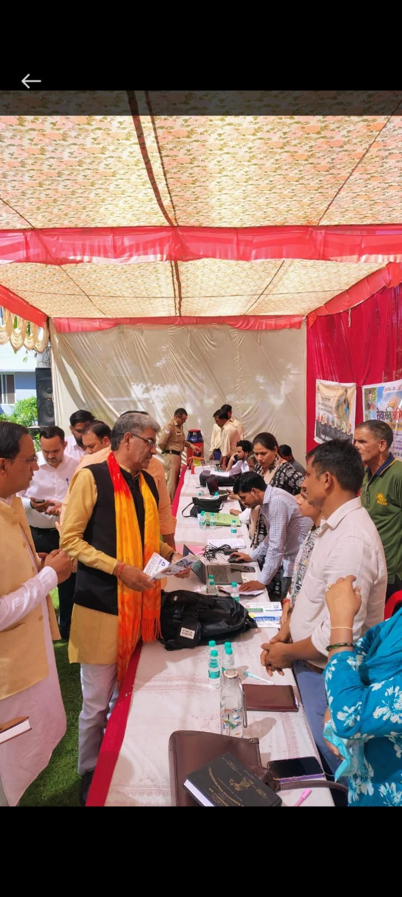

**हरिद्वार संवाददाता | आसिफ खान**

पिरान कलियर। जनता की समस्याओं के समाधान और सरकारी योजनाओं का लाभ पात्र लोगों तक पहुंचाने के उद्देश्य से मंगलवार को नगर पंचायत पिरान कलियर में ‘जन-जन की सरकार, जन-जन के द्वार’ सेवा संकल्प अभियान के तहत बहुद्देशीय शिविर आयोजित किया गया। राज्य मंत्री (स्वतंत्र प्रभार) शोभाराम प्रजापति की अध्यक्षता में आयोजित शिविर में 25 विभागों ने स्टॉल लगाकर लोगों को सरकारी योजनाओं की जानकारी दी। शिविर में 11 शिकायतें एवं आवेदन प्राप्त हुए, जिनमें से पांच का मौके पर ही निस्तारण किया गया, जबकि शेष छह को कार्रवाई के लिए संबंधित विभागों के पास भेजा गया।

**जनता के बीच पहुंची सरकार, समस्याओं के समाधान पर जोर**

मुख्यमंत्री के निर्देशों और जिलाधिकारी मयूर दीक्षित के निर्देशन में आयोजित शिविर में राज्य मंत्री शोभाराम प्रजापति ने कहा कि प्रदेश सरकार का उद्देश्य सरकारी योजनाओं का लाभ पात्र व्यक्तियों तक पहुंचाना और आमजन की समस्याओं का त्वरित समाधान सुनिश्चित करना है। उन्होंने कहा कि ‘जन-जन की सरकार, जन-जन के द्वार’ कार्यक्रम के माध्यम से सरकार जनता के बीच पहुंचकर उनकी शिकायतें सुन रही है, ताकि लोगों को छोटे-छोटे कार्यों के लिए सरकारी कार्यालयों के चक्कर न काटने पड़ें।

उन्होंने कहा कि जनसेवा के संकल्प के साथ संचालित इस अभियान में पारदर्शिता और त्वरित कार्रवाई पर विशेष जोर दिया जा रहा है। अधिकारियों की जिम्मेदारी है कि पात्र लोगों को योजनाओं का लाभ दिलाने के साथ उनकी समस्याओं का समयबद्ध निस्तारण भी सुनिश्चित किया जाए।

**25 विभागों के स्टॉल, योजनाओं की दी गई जानकारी**

शिविर में राजस्व, ग्राम विकास, शहरी विकास, समाज कल्याण, खाद्य एवं आपूर्ति, महिला सशक्तिकरण एवं बाल विकास, कृषि एवं कृषक कल्याण, चिकित्सा एवं स्वास्थ्य, पशुपालन, डेयरी एवं मत्स्य, कौशल विकास एवं सेवायोजन, गृह, आयुष, श्रम तथा ऊर्जा समेत विभिन्न विभागों ने भाग लिया।

विभागीय अधिकारियों और कर्मचारियों ने स्टॉल के माध्यम से क्षेत्रवासियों को सरकारी योजनाओं, पात्रता की शर्तों और आवेदन प्रक्रिया की जानकारी दी। लोगों को उपलब्ध सुविधाओं से अवगत कराते हुए पात्र लाभार्थियों को योजनाओं से जोड़ने की कार्रवाई की गई।

**11 शिकायतें आईं, छह पर कार्रवाई बाकी**

शिविर के दौरान आमजन की समस्याओं और शिकायतों को सुना गया। कुल 11 शिकायतें एवं आवेदन दर्ज किए गए, जिनमें से पांच का मौके पर निस्तारण कर दिया गया। बाकी छह शिकायतों एवं आवेदनों को आवश्यक कार्रवाई के लिए संबंधित विभागों को भेजा गया।

यह आंकड़ा शिविर में तत्काल समाधान की दिशा में हुई कार्रवाई को दर्शाता है। हालांकि, शेष शिकायतों का अंतिम निस्तारण संबंधित विभागों की आगे की कार्रवाई पर निर्भर करेगा।

**450 लोगों की भागीदारी, 117 लाभार्थियों को मिला फायदा**

आयोजकों के अनुसार, शिविर में लगभग 450 लोगों ने प्रतिभाग किया। विभिन्न विभागों के माध्यम से 117 पात्र व्यक्तियों को जनकल्याणकारी योजनाओं का लाभ दिया गया। अभियान का उद्देश्य लोगों को सरकारी सुविधाओं तक आसान पहुंच उपलब्ध कराना, अनावश्यक भागदौड़ कम करना और जरूरतमंदों को योजनाओं से जोड़ना रहा।

**ये अधिकारी और जनप्रतिनिधि रहे मौजूद**

शिविर में संयुक्त मजिस्ट्रेट एवं नोडल अधिकारी रुड़की दीपक रामचंद्र सेठ, अधिशासी अधिकारी एवं सहायक नोडल अधिकारी नगर पंचायत पिरान कलियर कुलदीप सिंह चौहान उपस्थित रहे। इस अवसर पर विधानसभा पिरान कलियर के संयोजक मुनीश सैनी, प्रदेश उपाध्यक्ष अल्पसंख्यक मोर्चा अफजाल अहमद, नगर पंचायत अध्यक्ष समीना, प्रतिनिधि सलीम प्रधान, मंडल अध्यक्ष गौरव सैनी तथा नगर पंचायत के समस्त सभासद मौजूद रहे।

अब निगाहें शेष छह शिकायतों पर: शिविर में समस्याएं सुनने और योजनाओं का लाभ पहुंचाने की पहल के बीच अब संबंधित विभागों की जिम्मेदारी होगी कि लंबित छह शिकायतों पर प्रभावी कार्रवाई कर उनका निस्तारण सुनिश्चित करें, ताकि शिविर में पहुंचे लोगों को वास्तविक राहत मिल सके।
