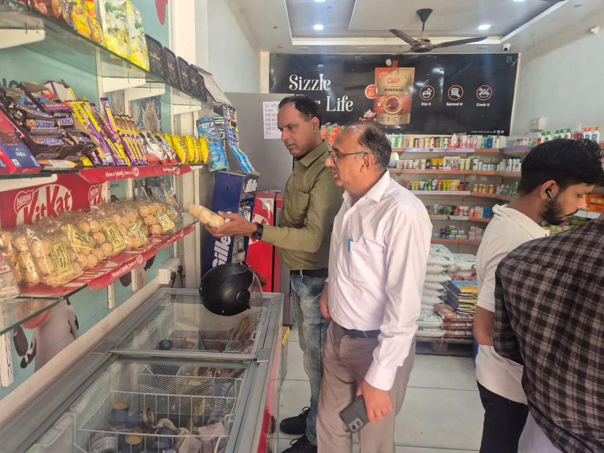

**हरिद्वार संवाददाता | आसिफ खान**

हरिद्वार। सिडकुल क्षेत्र में खाद्य सुरक्षा नियमों की अनदेखी का मामला सामने आने के बाद खाद्य सुरक्षा विभाग ने मंगलवार, 13 अक्टूबर 2026 को बड़ी कार्रवाई की। गुप्त सूचना के आधार पर की गई छापेमारी में दो प्रतिष्ठानों पर खुला कुट्टू का आटा बिक्री और सप्लाई के लिए रखा मिला। हैरानी की बात यह रही कि आटे के बैग पर निर्माण तिथि और एक्सपायरी तिथि तक अंकित नहीं थी। विभागीय टीम ने दोनों प्रतिष्ठानों से कुट्टू के आटे के नमूने लेकर जांच के लिए भेजने की प्रक्रिया शुरू की और कुल 13 किलो आटा मौके पर नष्ट कराया।

**बिना लाइसेंस कारोबार, तारीखों का भी अता-पता नहीं!**

आयुक्त खाद्य सुरक्षा उत्तराखंड विनय शंकर पाण्डेय तथा जिलाधिकारी हरिद्वार मयूर दीक्षित के निर्देशों के अनुपालन में सहायक आयुक्त महिमानंद जोशी के नेतृत्व में वरिष्ठ खाद्य सुरक्षा अधिकारी दिलीप जैन ने टीम के साथ सिडकुल क्षेत्र के महादेवपुरम और शिवम विहार कॉलोनी, काला गेट में खाद्य कारोबारियों, थोक प्रतिष्ठानों और सप्लाई वाहनों का निरीक्षण किया।

कार्रवाई के दौरान महादेवपुरम स्थित शैलेष प्रोविजन स्टोर में खुला कुट्टू का आटा बिक्री के लिए संग्रहित मिला। जांच में आटे के बैग पर निर्माण तिथि और एक्सपायरी तिथि अंकित नहीं पाई गई। टीम ने मौके से एक नमूना लिया और शेष 5 किलो आटा नष्ट करा दिया।

**ई-रिक्शा से हो रही थी खुले आटे की सप्लाई**

निरीक्षण के दौरान टीम ने महादेवपुरम क्षेत्र में ई-रिक्शा चालक हर्षित अवस्थी को प्लास्टिक बैग में रखा 10 किलो खुला कुट्टू का आटा सप्लाई करते हुए पकड़ा। पूछताछ में चालक ने बताया कि ई-रिक्शा के मालिक और कुट्टू आटे के सप्लायर शिवम विहार कॉलोनी, काला गेट, सिडकुल स्थित महादेव ट्रेडर्स के मालिक पंकज कुमार पुत्र रोहिताश हैं।

इसके बाद खाद्य सुरक्षा विभाग की टीम चालक को साथ लेकर महादेव ट्रेडर्स पहुंची और प्रतिष्ठान का निरीक्षण किया। यहां भी खुला कुट्टू का आटा पाया गया। विभाग ने मौके से एक और नमूना लिया तथा शेष 8 किलो आटे को गड्ढे में दबाकर नष्ट कराया।

इस तरह दोनों स्थानों से कुल 13 किलो कुट्टू का आटा नष्ट कराया गया और दो नमूने जांच के लिए लिए गए।

**दो कारोबारियों पर न्यायालय में मुकदमे की तैयारी**

खाद्य सुरक्षा विभाग के अनुसार, बिना लाइसेंस खाद्य कारोबार करने और निर्माण एवं एक्सपायरी तिथि अंकित किए बिना खुले कुट्टू के आटे की बिक्री के मामले में शैलेष प्रोविजन स्टोर के मालिक शैलेष कुमार पुत्र राम ईश्वर तथा महादेव ट्रेडर्स के मालिक पंकज कुमार के विरुद्ध न्यायालय में वाद दायर कराने की तैयारी की जा रही है।

खाद्य पदार्थों की बिक्री में लाइसेंस, उचित लेबलिंग और निर्धारित मानकों का पालन करना अनिवार्य है। ऐसे में इस कार्रवाई ने खाद्य कारोबारियों की जवाबदेही और उपभोक्ताओं को सुरक्षित खाद्य पदार्थ उपलब्ध कराने की व्यवस्था पर सवाल खड़े किए हैं।

**विभाग का सख्त संदेश—नियमों से खिलवाड़ बर्दाश्त नहीं**

खाद्य सुरक्षा विभाग ने स्पष्ट किया कि खाद्य पदार्थों की गुणवत्ता और सुरक्षा से जुड़े नियमों का उल्लंघन करने वाले कारोबारियों के खिलाफ नियमानुसार कार्रवाई जारी रहेगी। विभागीय कार्रवाई के बाद अब दोनों नमूनों की जांच और न्यायालय में प्रस्तावित वाद की प्रक्रिया पर नजर रहेगी।
