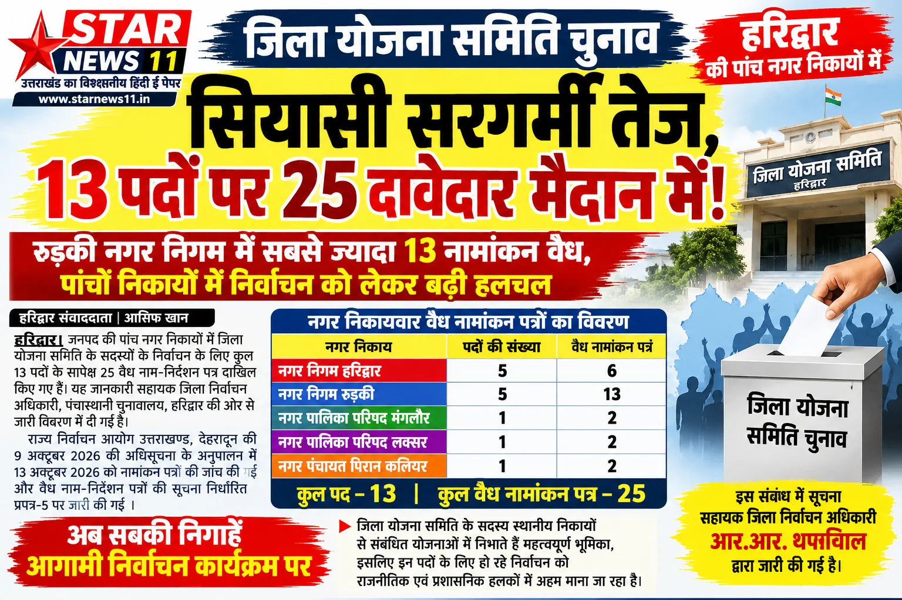

**हरिद्वार संवाददाता | आसिफ खान**

हरिद्वार। जनपद में जिला योजना समिति के सदस्यों के निर्वाचन को लेकर सियासी हलचल तेज हो गई है। जिले की पांच नगर निकायों में कुल 13 पदों के लिए दाखिल नामांकन पत्रों की जांच के बाद 25 नाम-निर्देशन पत्र वैध पाए गए हैं। आंकड़े स्पष्ट संकेत दे रहे हैं कि कई पदों पर दावेदारों के बीच मुकाबला दिलचस्प होने वाला है। खास तौर पर रुड़की नगर निगम में सबसे अधिक 13 वैध नामांकन सामने आए हैं, जिससे यहां चुनावी गतिविधियां तेज होने की संभावना है।

राज्य निर्वाचन आयोग, उत्तराखण्ड, देहरादून की ओर से 9 अक्टूबर 2026 को जारी अधिसूचना के अनुपालन में निर्वाचन प्रक्रिया संचालित की जा रही है। निर्धारित कार्यक्रम के तहत 13 अक्टूबर 2026 को नामांकन पत्रों की जांच की गई। इसके बाद सहायक जिला निर्वाचन अधिकारी, पंचास्थानि चुनावालय, हरिद्वार की ओर से वैध नामांकन पत्रों का विवरण निर्धारित प्रपत्र-5 में जारी किया गया।

**रुड़की नगर निगम में सबसे ज्यादा दावेदार**

जारी विवरण के अनुसार, नगर निगम रुड़की में जिला योजना समिति के सदस्यों के पांच पदों के सापेक्ष 13 नामांकन पत्र वैध पाए गए हैं। वहीं, नगर निगम हरिद्वार में पांच पदों के लिए छह वैध नामांकन पत्र सामने आए हैं। दोनों नगर निगमों में पदों के मुकाबले अधिक दावेदार होने से निर्वाचन प्रक्रिया पर सबकी निगाहें टिकी हैं।

**तीन अन्य निकायों में भी मुकाबले की तैयारी**

नगर पालिका परिषद मंगलौर में एक पद के सापेक्ष दो नामांकन पत्र वैध पाए गए हैं। इसी तरह नगर पालिका परिषद लक्सर में एक पद के लिए दो तथा नगर पंचायत पिरान कलियर में एक पद के सापेक्ष दो नामांकन पत्र वैध घोषित किए गए हैं।

इस प्रकार हरिद्वार, रुड़की, मंगलौर, लक्सर और पिरान कलियर के पांच नगर निकायों में कुल 13 पदों के लिए 25 वैध नामांकन पत्र सामने आए हैं।

**निर्वाचन प्रक्रिया पर टिकी निगाहें**

जिला योजना समिति के सदस्य स्थानीय निकायों से संबंधित योजना प्रक्रिया में महत्वपूर्ण भूमिका निभाते हैं। ऐसे में इन पदों के लिए हो रहा निर्वाचन नगर निकायों के जनप्रतिनिधियों के लिहाज से अहम माना जा रहा है। नामांकन पत्रों की जांच पूरी होने के बाद अब आगामी निर्वाचन कार्यक्रम और उम्मीदवारों के बीच होने वाले मुकाबले पर राजनीतिक एवं प्रशासनिक हलकों की निगाहें रहेंगी।

यह विवरण सहायक जिला निर्वाचन अधिकारी, पंचास्थानि चुनावालय, हरिद्वार आर.आर. थपलियाल की ओर से जारी किया गया है।
