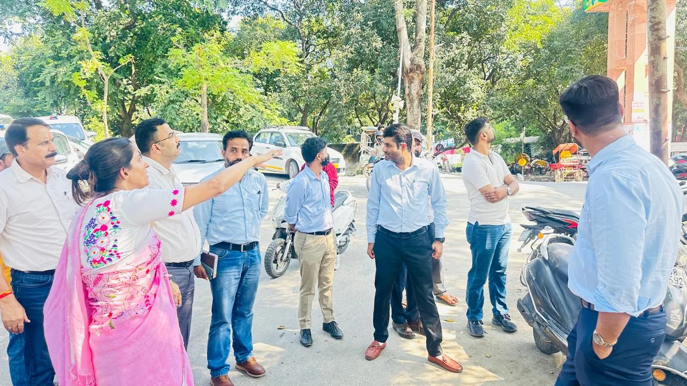
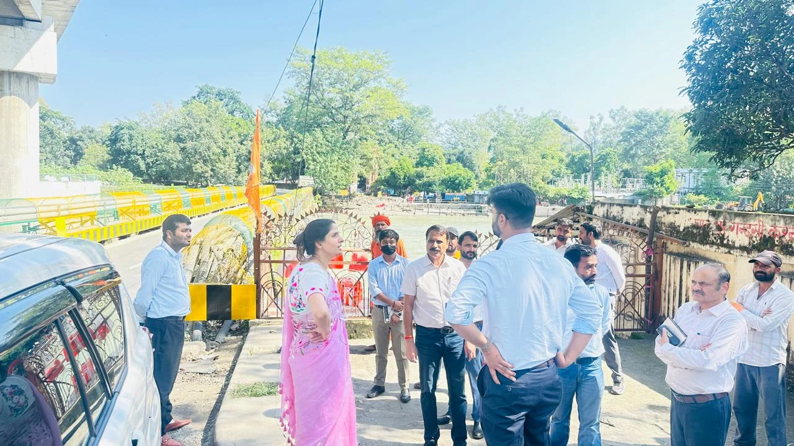

**हरिद्वार संवाददाता | आसिफ खान**

हरिद्वार। कुंभ मेला-2027 के आयोजन को लेकर मेला प्रशासन ने तैयारियों की रफ्तार तेज कर दी है। श्रद्धालुओं के आगमन से पहले हरिद्वार के प्रमुख प्रवेश मार्गों, पुलों, चौराहों और सार्वजनिक स्थलों को व्यवस्थित एवं आकर्षक बनाने की कवायद शुरू हो गई है। इसी क्रम में मंगलवार को मेलाधिकारी श्रीमती सोनिका ने बैरागी कैंप से शंकराचार्य चौक तक विभिन्न स्थलों का स्थलीय निरीक्षण कर निर्माण कार्यों की प्रगति और व्यवस्थाओं का जायजा लिया। निरीक्षण के दौरान उन्होंने संबंधित अधिकारियों को स्पष्ट निर्देश दिए कि सफाई, मलबा हटाने, सड़क सुधार, सुरक्षा, प्रकाश व्यवस्था और सौंदर्यीकरण के कार्यों में लापरवाही न बरती जाए तथा सभी काम निर्धारित समयसीमा में पूरे किए जाएं।

**प्रवेश द्वार से फ्लाईओवर तक व्यवस्थाओं को दुरुस्त करने के निर्देश**

मेलाधिकारी सोनिका ने बैरागी कैंप के प्रवेश द्वार, आईरिस पुल के आसपास और फ्लाईओवर के नीचे के क्षेत्रों का निरीक्षण किया। इन स्थानों पर व्यवस्थाओं को बेहतर बनाने के लिए उन्होंने पीआईयू के अधिकारियों को जमा मलबा हटाने, साफ-सफाई सुनिश्चित करने और सौंदर्यीकरण के कार्य प्राथमिकता से कराने के निर्देश दिए। सुरक्षा की दृष्टि से जहां आवश्यक हो, वहां दीवार का निर्माण कराने को भी कहा गया।

निरीक्षण के दौरान साफ संदेश दिया गया कि कुंभ जैसे विशाल धार्मिक आयोजन से पहले शहर के प्रमुख प्रवेश क्षेत्रों और सार्वजनिक स्थलों को अव्यवस्थित नहीं छोड़ा जा सकता। संबंधित विभागों को मौके की जरूरत के अनुसार कार्ययोजना बनाकर तेजी से काम करने और व्यवस्थाओं को दुरुस्त करने के निर्देश दिए गए।

**आईरिस पुल और प्रमुख मार्गों पर सुरक्षा सर्वोपरि**

आईरिस पुल का निरीक्षण करते हुए मेलाधिकारी ने श्रद्धालुओं की संभावित भारी आवाजाही को देखते हुए प्रमुख मार्गों और पुलों के आसपास सुरक्षा एवं आवागमन की व्यवस्था बेहतर रखने पर जोर दिया। उन्होंने अधिकारियों से कहा कि स्थलीय जरूरतों के अनुरूप कार्यों को प्राथमिकता दी जाए, ताकि कुंभ के दौरान श्रद्धालुओं को आवाजाही में अनावश्यक परेशानी का सामना न करना पड़े।

सार्वजनिक स्थलों के विकास में केवल बाहरी सजावट ही नहीं, बल्कि सुरक्षा, स्वच्छता और सुचारु यातायात को भी समान महत्व देने के निर्देश दिए गए।

**शंकराचार्य चौक को आकर्षक स्वरूप देने की तैयारी**

निरीक्षण का महत्वपूर्ण केंद्र शंकराचार्य चौक रहा, जहां मेलाधिकारी ने सौंदर्यीकरण और फसाड संबंधी कार्यों की प्रगति की समीक्षा की। उन्होंने निर्देश दिए कि चौक और आसपास के क्षेत्र को व्यवस्थित एवं आकर्षक स्वरूप देने के लिए आवश्यक कार्य समयबद्ध तरीके से पूरे किए जाएं। इसके साथ ही डाम कोठी मार्ग के चौड़ीकरण कार्य की स्थिति भी परखी गई।

मेलाधिकारी ने कहा कि उपलब्ध स्थान और सड़क की वास्तविक स्थिति को ध्यान में रखते हुए साज-सज्जा की योजना तैयार की जाए। सड़क किनारे लगे विद्युत एवं अन्य पोल यदि यातायात या आवागमन में बाधा बनते हैं, तो उन्हें सड़क क्षेत्र से बाहर उपयुक्त स्थानों पर स्थापित करने के लिए आवश्यक कार्रवाई की जाए।

**एचआरडीए और नगर निगम की जिम्मेदारी तय, समन्वय से होंगे काम**

सड़क, पोलों के स्थानांतरण और सौंदर्यीकरण से जुड़े कार्यों को लेकर मेलाधिकारी ने हरिद्वार-रुड़की विकास प्राधिकरण (एचआरडीए) और नगर निगम के अधिकारियों को आपसी समन्वय से आवश्यक कार्रवाई सुनिश्चित करने के निर्देश दिए। उद्देश्य साफ है कि अलग-अलग विभागों के बीच तालमेल की कमी के कारण कुंभ की तैयारियों से जुड़े कार्य प्रभावित न हों।

उन्होंने निर्माण कार्यों की गुणवत्ता पर विशेष जोर देते हुए नियमित निगरानी करने और निर्धारित समयसीमा का पालन सुनिश्चित करने को कहा। निर्देशों के अनुसार, प्रमुख मार्गों, चौराहों और प्रवेश क्षेत्रों का विकास इस तरह किया जाना है कि शहर का स्वरूप बेहतर होने के साथ श्रद्धालुओं की आवाजाही भी सुगम बनी रहे।

**कुंभ से पहले हरिद्वार को व्यवस्थित बनाने की चुनौती**

कुंभ मेला-2027 के मद्देनजर हरिद्वार में बुनियादी सुविधाओं और सार्वजनिक स्थलों को बेहतर बनाना मेला प्रशासन के लिए महत्वपूर्ण जिम्मेदारी है। श्रद्धालुओं की सुविधा, सुरक्षित यातायात, स्वच्छ वातावरण और शहर की आकर्षक छवि तैयारियों के प्रमुख केंद्र में हैं।

मेलाधिकारी सोनिका ने अधिकारियों को स्पष्ट किया कि विकास कार्यों में गुणवत्ता, सुरक्षा और समयबद्धता से समझौता नहीं होना चाहिए। अब इन निर्देशों के बाद संबंधित विभागों की जिम्मेदारी है कि निरीक्षण में सामने आई जरूरतों के अनुरूप कार्यों को जमीन पर उतारें और प्रगति की नियमित निगरानी करें।

निरीक्षण में नगर आयुक्त नंदन कुमार, एचआरडीए सचिव प्रत्यूष सिंह, उद्यान अधिकारी ए.आर. जोशी, पीआईयू के अभियंता सरीन कुमार सहित संबंधित विभागों के अन्य अधिकारी उपस्थित रहे।
