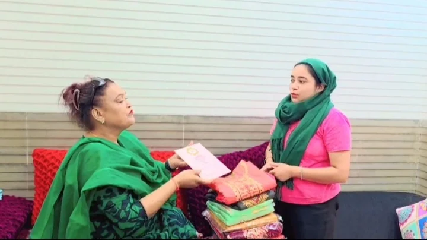
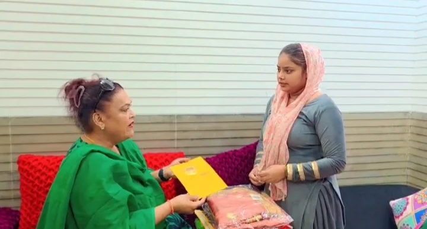
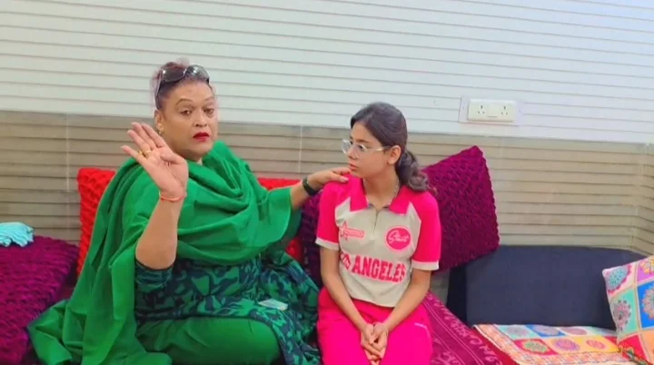

**देहरादून संवाददाता | आसिफ खान**

देहरादून। बेटियों के चेहरे पर मुस्कान, उनके सपनों को नई उड़ान और जरूरतमंद परिवारों को सहारा देने की पहल के तहत उत्तराखंड सरकार की राज्यमंत्री, समाज कल्याण विभाग, मैडम रजनी रावत ने सामाजिक संवेदनशीलता और सेवा भावना का परिचय दिया। उन्होंने अलग-अलग परिस्थितियों से गुजर रही तीन बेटियों को सहयोग प्रदान कर उनके सुखद भविष्य, शिक्षा और खुशहाल जीवन की कामना की। उनकी इस पहल में जरूरतमंदों की सहायता के साथ बेटियों के सम्मान और आत्मनिर्भरता का संदेश भी दिखाई दिया।

**नेहा को कपड़े और आर्थिक सहायता देकर बढ़ाया हौसला**

काठ बंगला, राजपुर रोड, देहरादून से आई नेहा को राज्यमंत्री मैडम रजनी रावत ने सहयोग स्वरूप 11 जोड़े कपड़े एवं धनराशि प्रदान की। इस दौरान उन्होंने अपनी कुलदेवी बहुचरा मुर्गे वाली माता जी से नेहा के सुखद भविष्य, जीवन में सुख-समृद्धि और खुशहाली के लिए आशीर्वाद एवं दुआ की। इस सहयोग से नेहा के प्रति अपनत्व और सहायता की भावना व्यक्त की गई।

**विवाह की तैयारी कर रही अंजलि को मिला स्नेह और संबल**

वहीं, अधोईवाला, देहरादून से आई कु. अंजलि, जिनका विवाह 28 अक्टूबर 2026 को निर्धारित है, को भी मैडम रजनी रावत ने सहयोग एवं स्नेह प्रदान किया। उन्होंने अंजलि के आने वाले वैवाहिक जीवन की खुशहाली, उज्ज्वल भविष्य और परिवार की सुख-समृद्धि के लिए अपनी कुलदेवी बहुचरा मुर्गे वाली माता जी से आशीर्वाद और दुआ की। इस अवसर पर अंजलि के नए जीवन की शुरुआत के लिए शुभकामनाएं व्यक्त की गईं।

**शगुन की पढ़ाई नहीं रुकने देंगी रजनी रावत, ₹5,000 की आर्थिक मदद**

सामाजिक सहयोग की इस पहल में खुड़बुड़ा मोहल्ला, देहरादून की रहने वाली कक्षा 10वीं की छात्रा बेटी शगुन की शिक्षा को भी प्राथमिकता दी गई। उसकी पढ़ाई में सहयोग के लिए राज्यमंत्री मैडम रजनी रावत ने ₹5,000 की आर्थिक सहायता प्रदान की।

बताया गया कि मैडम रजनी रावत बचपन से ही शगुन की स्कूल फीस में सहयोग करती आ रही हैं। इतना ही नहीं, उन्होंने शगुन की आगे की पढ़ाई में भी निरंतर सहयोग करने की जिम्मेदारी ली है, ताकि आर्थिक कठिनाइयों के कारण उसकी शिक्षा बाधित न हो और वह अपने सपनों को साकार कर सके।

**सेवा का संकल्प, बेटियों के उज्ज्वल भविष्य का संदेश**

मैडम रजनी रावत ने बेटी शगुन की शैक्षणिक सफलता और उज्ज्वल भविष्य की कामना की। इन तीनों बेटियों के प्रति सहयोग और स्नेह की इस पहल ने यह संदेश दिया कि समाज में जरूरतमंदों का साथ देना और बेटियों की शिक्षा एवं सम्मान को बढ़ावा देना बेहद महत्वपूर्ण है।

बेटियों को संबल, शिक्षा को प्रोत्साहन और जरूरतमंदों की मदद—यही सच्ची सामाजिक सेवा है। ऐसी पहलें बेटियों के आत्मविश्वास को मजबूत करने और उनके भविष्य को बेहतर बनाने की दिशा में प्रेरणादायी भूमिका निभा सकती हैं।
