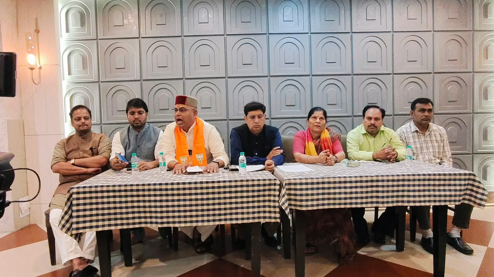
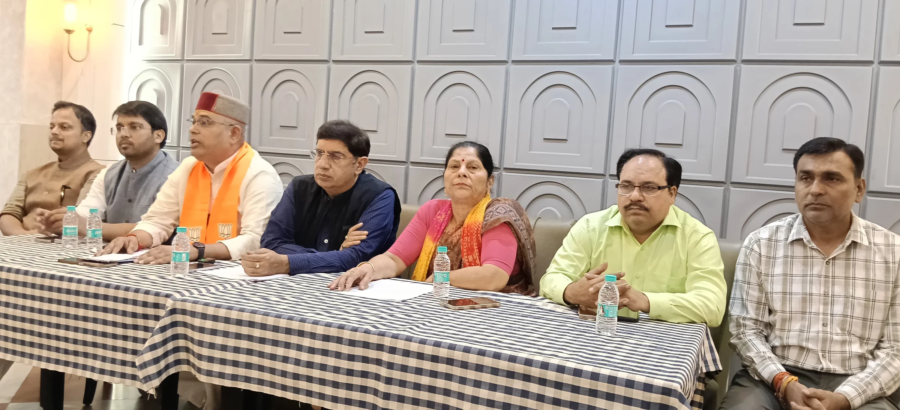

**रूडकी संवाददाता | आसिफ खान** 

**रुड़की।** राष्ट्रीय सुरक्षा सलाहकार अजीत डोभाल को लेकर कांग्रेस नेता राहुल गांधी की टिप्पणी पर भाजपा ने कड़ी नाराजगी जताई है। भाजपा प्रदेश प्रवक्ता मनोज जख्मोला और भाजपा जिलाध्यक्ष डॉ. मधु सिंह ने टिप्पणी की आलोचना करते हुए इसे राष्ट्रीय सुरक्षा, उत्तराखंड के स्वाभिमान और राष्ट्रसेवा से जुड़े व्यक्तित्वों के सम्मान का विषय बताया। भाजपा नेताओं ने कांग्रेस नेतृत्व से इस मामले में अपना रुख स्पष्ट करने की मांग करते हुए कहा कि राष्ट्रीय सुरक्षा जैसे संवेदनशील मुद्दों पर राजनीतिक विरोध के बावजूद भाषा की मर्यादा बनाए रखना जरूरी है।

भाजपा नेताओं ने कहा कि अजीत डोभाल ने अपना जीवन देश की सुरक्षा, अखंडता और संप्रभुता की रक्षा के लिए समर्पित किया है। ऐसे अनुभवी सुरक्षा विशेषज्ञ पर व्यक्तिगत कटाक्ष करना राजनीतिक मर्यादा और जिम्मेदार विपक्ष की भूमिका पर सवाल खड़े करता है। उनका कहना था कि राष्ट्रीय सुरक्षा से जुड़े विषयों पर राजनीतिक मतभेद हो सकते हैं, लेकिन देशहित को सर्वोपरि रखना सभी राजनीतिक दलों की जिम्मेदारी है।

**उत्तराखंड के स्वाभिमान से जुड़ा है वीर सपूतों का सम्मान**

भाजपा नेताओं ने कहा कि उत्तराखंड की पहचान उसकी सैन्य परंपरा, राष्ट्रभक्ति और वीर सपूतों के बलिदान से है। प्रदेश के अनेक जवानों और राष्ट्रसेवकों ने देश की रक्षा के लिए अपना सर्वस्व न्योछावर किया है। ऐसे में राष्ट्रीय सुरक्षा से जुड़े प्रमुख व्यक्तित्वों के सम्मान का विषय उत्तराखंड की जनता की भावनाओं से भी जुड़ जाता है।

भाजपा प्रदेश प्रवक्ता मनोज जख्मोला ने कहा कि राष्ट्रीय सुरक्षा के प्रहरी पर अमर्यादित टिप्पणी करना कांग्रेस की राजनीतिक सोच को दर्शाता है। उन्होंने वर्ष 2017 में तत्कालीन सेना प्रमुख और उत्तराखंड के गौरव रहे स्वर्गीय जनरल बिपिन रावत को लेकर हुए विवाद का उल्लेख करते हुए कहा कि राष्ट्रसेवा में समर्पित व्यक्तित्वों को राजनीतिक विवादों में घसीटना उचित नहीं है।

**सर्जिकल स्ट्राइक और बालाकोट एयरस्ट्राइक का किया उल्लेख**

प्रेसवार्ता के दौरान भाजपा नेताओं ने सर्जिकल स्ट्राइक, बालाकोट एयरस्ट्राइक और अन्य सुरक्षा अभियानों का उल्लेख करते हुए कहा कि राष्ट्रीय सुरक्षा से जुड़े मामलों में जिम्मेदारी और गंभीरता के साथ बात की जानी चाहिए। उन्होंने कहा कि लोकतंत्र में सरकार की आलोचना और राजनीतिक विरोध का अधिकार सभी को है, लेकिन देश की सुरक्षा के लिए काम करने वाले व्यक्तियों के सम्मान और मर्यादा का ध्यान रखना भी उतना ही आवश्यक है।

भाजपा जिलाध्यक्ष डॉ. मधु सिंह ने कहा कि अजीत डोभाल और स्वर्गीय जनरल बिपिन रावत जैसे व्यक्तित्व उत्तराखंड की गौरवशाली परंपरा के प्रतीक हैं। उन्होंने कहा कि प्रदेश की जनता राष्ट्रहित और अपने वीर सपूतों के सम्मान को सर्वोपरि रखती है। ऐसे व्यक्तित्वों के योगदान को लेकर की जाने वाली राजनीतिक टिप्पणियों से जनभावनाएं प्रभावित हो सकती हैं।

**कांग्रेस नेतृत्व से मांगा स्पष्टीकरण**

भाजपा नेताओं ने कांग्रेस नेतृत्व से राहुल गांधी की टिप्पणी के औचित्य को स्पष्ट करने की मांग की। उन्होंने कहा कि राष्ट्रीय सुरक्षा जैसे गंभीर विषयों पर राजनीतिक बयानबाजी करते समय शब्दों के चयन और उनके प्रभाव को ध्यान में रखा जाना चाहिए। देश की सुरक्षा, संप्रभुता और राष्ट्रसेवा से जुड़े मुद्दों पर सभी राजनीतिक दलों को जिम्मेदार आचरण करना चाहिए।

प्रेसवार्ता का संचालन भाजपा जिला मीडिया प्रभारी पंकज नंदा ने किया। इस अवसर पर जिला महामंत्री अक्षय प्रताप सिंह, सागर गोयल, मंडल अध्यक्ष बृजमोहन सैनी, अंकित गौतम, अमित प्रजापति सहित भाजपा के कई पदाधिकारी मौजूद रहे।
