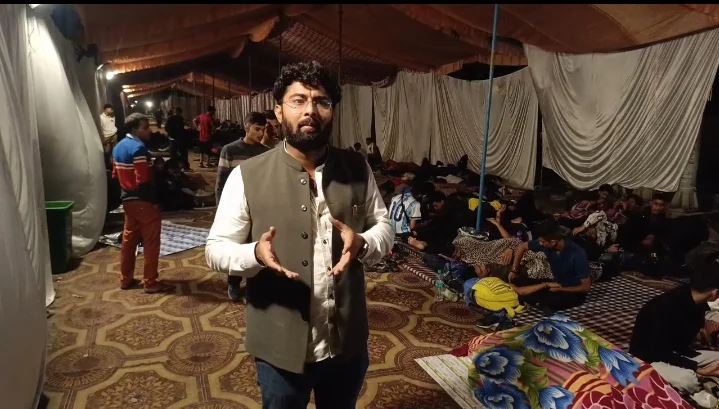
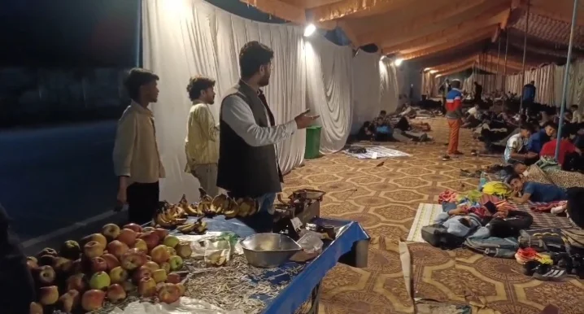
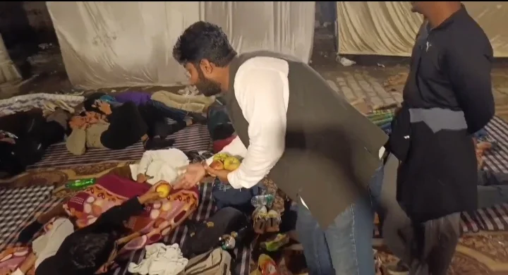

**हरिद्वार संवाददाता | आसिफ खान**

हरिद्वार। देश की सेवा करने का सपना लेकर अग्निवीर भर्ती में शामिल होने पहुंचे युवाओं को यदि रात सड़क किनारे गुजारने के लिए मजबूर होना पड़े, तो यह व्यवस्था और प्रशासन की कार्यप्रणाली पर गंभीर सवाल खड़े करता है। एक तरफ युवा देश की रक्षा करने के लिए भर्ती प्रक्रिया में शामिल होने का जज्बा लेकर घरों से निकल रहे हैं, वहीं दूसरी तरफ उनके ठहरने और सुरक्षा के पर्याप्त इंतजाम नहीं होने की शिकायत सामने आने से व्यवस्थाओं पर सवाल उठ रहे हैं। सड़क पर रात गुजारते इन अभ्यर्थियों के आसपास से गुजरते ट्रक और बस किसी भी समय बड़े हादसे का कारण बन सकते हैं। इसी मुद्दे को लेकर कांग्रेस के प्रदेश सचिव प्रणय प्रताप सिंह ने प्रदेश सरकार और प्रशासन के खिलाफ मोर्चा खोलते हुए तीखा हमला बोला।

अग्निवीर अभ्यर्थियों के बीच पहुंचे प्रणय प्रताप सिंह ने युवाओं को फलाहार वितरित किया और उनकी समस्याओं को लेकर चिंता जताई। इस दौरान उन्होंने प्रदेश सरकार की व्यवस्थाओं पर सवाल उठाते हुए कहा कि देश के लिए कुछ कर गुजरने का सपना देखने वाले युवाओं को इस तरह सड़क किनारे रात गुजारने के लिए छोड़ देना बेहद दुर्भाग्यपूर्ण है। जिन युवाओं के कंधों पर भविष्य में देश की सुरक्षा की जिम्मेदारी आ सकती है, उनकी वर्तमान सुरक्षा को लेकर ही यदि सवाल खड़े होने लगें, तो जिम्मेदार अधिकारियों और जनप्रतिनिधियों को जवाब देना चाहिए।

**सड़क पर दौड़ते भारी वाहन, फुटपाथ और सड़क किनारे सोते युवा—किसे है इनकी सुरक्षा की चिंता?**

प्रणय प्रताप सिंह ने कहा कि अग्निवीर भर्ती में शामिल होने आए ये युवा किसी सामान्य काम से नहीं, बल्कि देश की सेवा करने के उद्देश्य से यहां पहुंचे हैं। इन युवाओं के मन में सेना में भर्ती होकर मातृभूमि की रक्षा करने का सपना है। लेकिन भर्ती प्रक्रिया के दौरान उन्हें मूलभूत सुविधाओं और सुरक्षित ठहरने की व्यवस्था के लिए परेशान होना पड़े, तो यह बेहद चिंताजनक स्थिति है।

उन्होंने कहा कि सड़क पर रात गुजारना किसी भी व्यक्ति के लिए सुरक्षित नहीं है। जब सड़क पर लगातार ट्रक, बसें और दूसरे भारी वाहन गुजर रहे हों, तब सड़क किनारे सो रहे युवाओं की सुरक्षा को लेकर चिंता और बढ़ जाती है। यदि रात के अंधेरे में कोई अप्रिय घटना हो जाती है, तो इसकी जिम्मेदारी आखिर कौन लेगा? क्या प्रशासन किसी बड़े हादसे के बाद ही जागेगा, या समय रहते इन युवाओं की सुरक्षा के लिए ठोस कदम उठाए जाएंगे?

कांग्रेस प्रदेश सचिव ने सवाल उठाया कि जब भर्ती प्रक्रिया में शामिल होने वाले अभ्यर्थियों की संख्या और उनकी आवश्यकताओं का अनुमान लगाया जा सकता है, तो फिर उनके ठहरने और सुरक्षा की व्यवस्था पहले से क्यों नहीं की गई? युवाओं को इस तरह असुरक्षित परिस्थितियों में रात बिताने की नौबत क्यों आ रही है? क्या संबंधित विभागों और प्रशासनिक अधिकारियों की जिम्मेदारी केवल व्यवस्थाओं का दावा करने तक सीमित रह गई है?

**कैबिनेट मंत्री को प्रणय प्रताप सिंह की दो टूक नसीहत—ये बच्चे देश का भविष्य हैं!**

प्रणय प्रताप सिंह ने कैबिनेट मंत्री को नसीहत देते हुए कहा कि अग्निवीर भर्ती में शामिल होने आए ये बच्चे देश का भविष्य हैं। इनके भीतर देश के लिए कुछ कर गुजरने का जज्बा है। ऐसे युवाओं की सुरक्षा और सुविधाओं को प्राथमिकता देना सरकार तथा प्रशासन की जिम्मेदारी है।

उन्होंने तीखे शब्दों में कहा, "ये बच्चे देश का भविष्य हैं। आपके घर से एक कदम दूर इनकी जान जोखिम में डाली जा रही है और आप चैन से सो रहे हो। शर्म करो, शर्म!"

प्रणय प्रताप सिंह ने कहा कि जनप्रतिनिधियों का दायित्व केवल कार्यक्रमों में शामिल होना, भाषण देना या बड़ी-बड़ी घोषणाएं करना नहीं है। असली जिम्मेदारी उस समय दिखाई देती है, जब आम लोगों और युवाओं को परेशानी का सामना करना पड़ता है। यदि देश की सेवा करने के लिए आगे आने वाले युवाओं को ही सुरक्षित ठहरने की व्यवस्था नहीं मिल पा रही है, तो यह संबंधित व्यवस्थाओं की गंभीर समीक्षा का विषय है।

उन्होंने कहा कि सत्ता में बैठे लोगों को इन युवाओं की परेशानी को गंभीरता से समझना चाहिए। इन युवाओं के परिवार अपने बच्चों को उम्मीदों के साथ भर्ती प्रक्रिया में शामिल होने के लिए भेजते हैं। परिवारों को भरोसा होता है कि उनके बच्चे सुरक्षित रहेंगे, लेकिन यदि उन्हें सड़क किनारे रात बितानी पड़े, तो परिजनों की चिंता को भी समझना जरूरी है।

**फलाहार वितरण कर युवाओं के साथ खड़े नजर आए कांग्रेस प्रदेश सचिव**

अग्निवीर अभ्यर्थियों की परेशानी के बीच प्रणय प्रताप सिंह ने युवाओं को फलाहार वितरित किया। इस पहल के माध्यम से उन्होंने अभ्यर्थियों के प्रति सहयोग और संवेदना व्यक्त की। उन्होंने कहा कि भर्ती में शामिल होने वाले युवाओं का सम्मान होना चाहिए और उनकी जरूरतों का ध्यान रखा जाना चाहिए।

प्रणय प्रताप सिंह ने कहा कि इन युवाओं ने अपने भविष्य और देश की सेवा के लक्ष्य को लेकर कठिन मेहनत की है। भर्ती प्रक्रिया में शामिल होने के लिए उन्हें कई तरह की चुनौतियों का सामना करना पड़ता है। ऐसे समय में प्रशासन का दायित्व बनता है कि वह उन्हें आवश्यक सुविधाएं उपलब्ध कराए, ताकि उन्हें रहने, खाने और सुरक्षा जैसी बुनियादी जरूरतों के लिए भटकना न पड़े।

उन्होंने कहा कि फलाहार वितरण करना केवल सहयोग का एक छोटा-सा प्रयास है, लेकिन असली जरूरत स्थायी और सुरक्षित व्यवस्था की है। युवाओं को सम्मानजनक ठहराव, पेयजल, शौचालय तथा अन्य आवश्यक सुविधाएं उपलब्ध कराना संबंधित विभागों की प्राथमिकता होनी चाहिए। केवल अस्थायी मदद से समस्या का स्थायी समाधान नहीं हो सकता।

**प्रदेश सरकार पर जमकर बरसे प्रणय प्रताप सिंह, व्यवस्थाओं को लेकर उठाए सवाल**

इस पूरे मामले को लेकर प्रणय प्रताप सिंह प्रदेश सरकार पर जमकर बरसे। उन्होंने कहा कि सरकार को युवाओं के हितों और उनकी सुरक्षा को सर्वोच्च प्राथमिकता देनी चाहिए। एक ओर युवाओं को देश सेवा के लिए प्रेरित किया जाता है, वहीं दूसरी ओर भर्ती में शामिल होने के दौरान यदि उन्हें बुनियादी सुविधाओं के लिए संघर्ष करना पड़े, तो यह व्यवस्था पर सवाल खड़े करता है।

उन्होंने कहा कि सरकार और प्रशासन को यह स्पष्ट करना चाहिए कि भर्ती प्रक्रिया में शामिल होने वाले अभ्यर्थियों के लिए सुरक्षित ठहरने की व्यवस्था की जिम्मेदारी किस विभाग की है। यदि व्यवस्थाएं की गई हैं, तो युवाओं को सड़क किनारे रात बिताने की नौबत क्यों आ रही है? और यदि व्यवस्थाएं नहीं की गई हैं, तो इसके लिए जिम्मेदार अधिकारियों से जवाब क्यों नहीं मांगा जा रहा?

कांग्रेस प्रदेश सचिव ने मांग की कि प्रशासन तत्काल स्थिति का संज्ञान ले और अभ्यर्थियों की सुरक्षा सुनिश्चित करने के लिए आवश्यक कदम उठाए। सड़क किनारे सो रहे युवाओं को सुरक्षित स्थान पर ठहराने की व्यवस्था की जाए, ताकि किसी संभावित दुर्घटना या अन्य अप्रिय घटना की आशंका को कम किया जा सके।

उन्होंने कहा कि युवाओं की सुरक्षा को लेकर किसी भी प्रकार की लापरवाही स्वीकार नहीं की जानी चाहिए। प्रशासन को संवेदनशीलता दिखाते हुए मौके पर आवश्यक सुविधाएं उपलब्ध करानी चाहिए। भर्ती प्रक्रिया में शामिल होने वाले युवाओं को यह महसूस होना चाहिए कि जिस व्यवस्था के तहत वे देश की सेवा करने के लिए आगे बढ़ रहे हैं, वह व्यवस्था उनकी सुरक्षा को लेकर भी गंभीर है।

**अब सवाल—युवाओं की सुरक्षा की जिम्मेदारी आखिर किसकी?**

अग्निवीर अभ्यर्थियों के सड़क किनारे रात गुजारने का मामला केवल ठहरने की सुविधा तक सीमित नहीं है। यह युवाओं की सुरक्षा, प्रशासनिक जवाबदेही और सरकारी व्यवस्थाओं की प्राथमिकताओं से जुड़ा सवाल है। सड़क पर दौड़ते भारी वाहनों के बीच रात बिताने की स्थिति किसी भी समय गंभीर खतरा पैदा कर सकती है। ऐसे में प्रशासन के लिए जरूरी है कि वह शिकायतों का संज्ञान लेकर तत्काल आवश्यक इंतजाम करे।

प्रणय प्रताप सिंह ने अपने तीखे बयान के जरिए सरकार और प्रशासन को यह संदेश देने की कोशिश की कि युवाओं के भविष्य की बात करने से पहले उनकी वर्तमान समस्याओं का समाधान करना भी जरूरी है। देश की सेवा का सपना देखने वाले अभ्यर्थियों को सुरक्षित वातावरण उपलब्ध कराना किसी पर एहसान नहीं, बल्कि जिम्मेदार व्यवस्था का बुनियादी दायित्व है।

अब देखना यह है कि कांग्रेस प्रदेश सचिव प्रणय प्रताप सिंह के सवालों के बाद प्रशासन और संबंधित जनप्रतिनिधि अभ्यर्थियों की सुरक्षा के लिए क्या कदम उठाते हैं। क्या युवाओं को सुरक्षित ठहरने की व्यवस्था मिलेगी, या फिर उन्हें इसी तरह सड़क किनारे रात गुजारने के लिए मजबूर रहना पड़ेगा? यह सवाल अब प्रशासन और सरकार के सामने खड़ा है।
