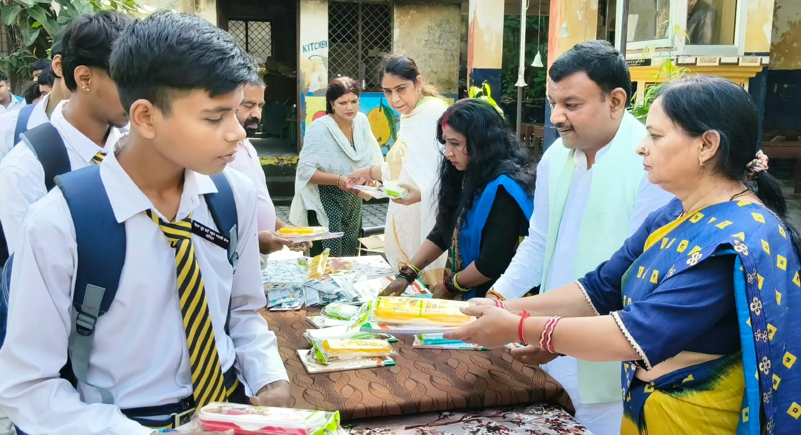
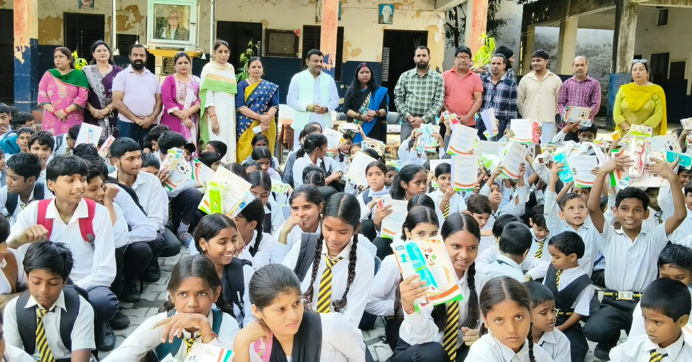
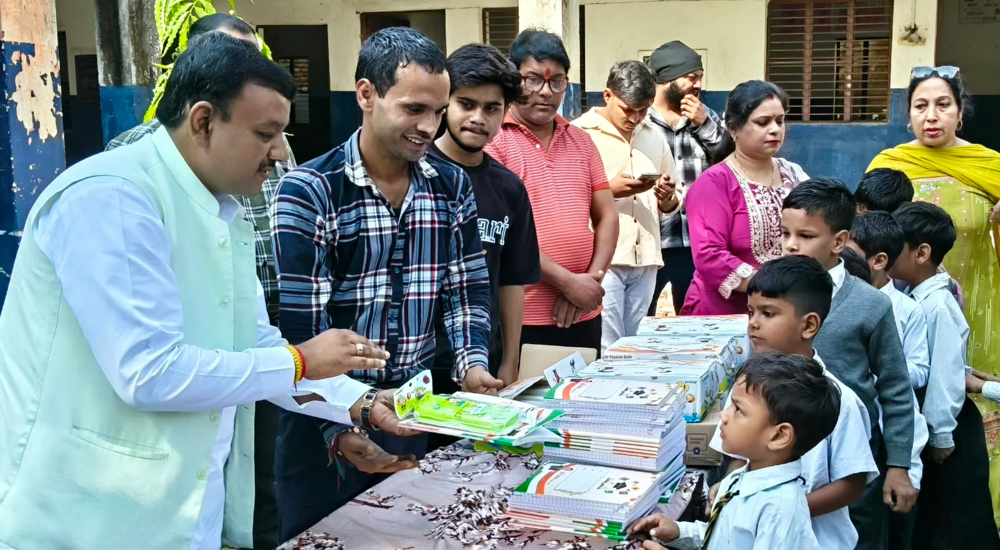

**रुड़की संवाददाता | आसिफ खान**

रुड़की। बच्चों के हाथों में किताबें और आंखों में उज्ज्वल भविष्य के सपने साकार करने की दिशा में पूर्व मेयर गौरव गोयल ने सराहनीय पहल की। रुड़की कैंट के लालकुर्ती स्थित नेहरू प्राइमरी जूनियर हाई स्कूल एवं शिल्प कला विद्यालय में उन्होंने सैकड़ों बच्चों को निःशुल्क पाठ्य सामग्री वितरित कर शिक्षा के प्रति प्रोत्साहित किया। इस दौरान उन्होंने बच्चों को मन लगाकर पढ़ाई करने और मेहनत के दम पर अपने जीवन में सफलता हासिल करने का संदेश दिया।

पूर्व मेयर गौरव गोयल ने कहा कि शिक्षा केवल किताबी ज्ञान नहीं, बल्कि बेहतर भविष्य की सबसे मजबूत नींव है। शिक्षा के माध्यम से ही बच्चों में अच्छे संस्कार विकसित होते हैं और वे समाज में अपनी अलग पहचान बना सकते हैं। उन्होंने बच्चों से पूरी मेहनत, लगन और अनुशासन के साथ पढ़ाई करने का आह्वान करते हुए कहा कि सभी बच्चे उच्च शिक्षा प्राप्त कर अपने परिवार, क्षेत्र और समाज का नाम रोशन करें।

उन्होंने कहा कि बच्चों को शिक्षा के लिए प्रोत्साहित करना और उनकी जरूरतों में सहयोग करना समाज की सामूहिक जिम्मेदारी है। यदि बच्चों को सही मार्गदर्शन और आवश्यक शैक्षणिक संसाधन उपलब्ध कराए जाएं, तो वे अपने सपनों को साकार करने की दिशा में मजबूती से आगे बढ़ सकते हैं।

**पाठ्य सामग्री से बढ़ेगा बच्चों का पढ़ाई के प्रति उत्साह**

विद्यालय की प्रधानाध्यापिका श्रीमती ममता शर्मा एवं श्रीमती रिचा तोमर ने पूर्व मेयर गौरव गोयल की पहल की सराहना करते हुए कहा कि बच्चों को निःशुल्क पाठ्य सामग्री उपलब्ध कराना उन्हें शिक्षा के प्रति प्रोत्साहित करने का महत्वपूर्ण प्रयास है। इस तरह के सहयोग से बच्चों में पढ़ाई के प्रति रुचि बढ़ती है और उन्हें आगे बढ़ने की प्रेरणा मिलती है।

उन्होंने कहा कि पूर्व मेयर गौरव गोयल पिछले कई वर्षों से क्षेत्र के विभिन्न विद्यालयों में बच्चों को प्रोत्साहित करने के लिए प्रयासरत हैं। शिक्षा के क्षेत्र में उनका यह योगदान सराहनीय है और इससे बच्चों के प्रति उनकी सकारात्मक सोच तथा शिक्षा के प्रति उनके समर्पण का परिचय मिलता है।

**पाठ्य सामग्री पाकर खिले बच्चों के चेहरे**

कार्यक्रम के दौरान निःशुल्क पाठ्य सामग्री प्राप्त कर बच्चों के चेहरे खुशी से खिल उठे। इस पहल ने बच्चों को पढ़ाई के लिए प्रोत्साहित करने के साथ ही शिक्षा के महत्व का संदेश भी दिया। कार्यक्रम में विद्यालय प्रबंधन एवं शिक्षक-शिक्षिकाओं ने भी अपनी सहभागिता निभाई।

इस अवसर पर विद्यालय की प्रबंधक श्रीमती गीता चौहान, सहायक अध्यापक कपिल कुमार त्यागी, ममता राकेश, निशा गोयल, श्रीमती पूजा, नूजहत परवीन, श्रीमती पूनम, नितिन कुमार, अजय एवं श्रीमती कोमल सहित अन्य लोग प्रमुख रूप से मौजूद रहे।
