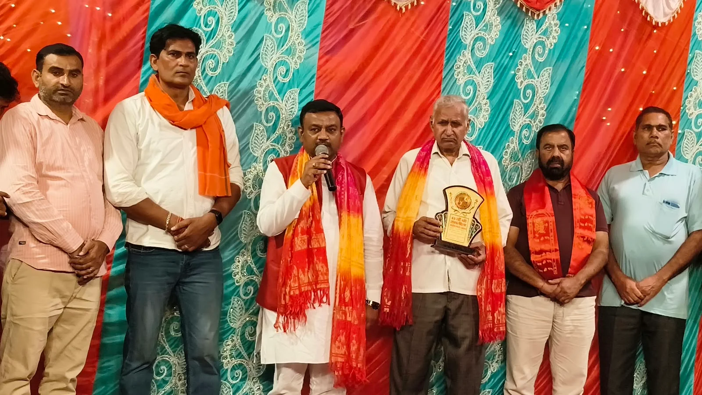
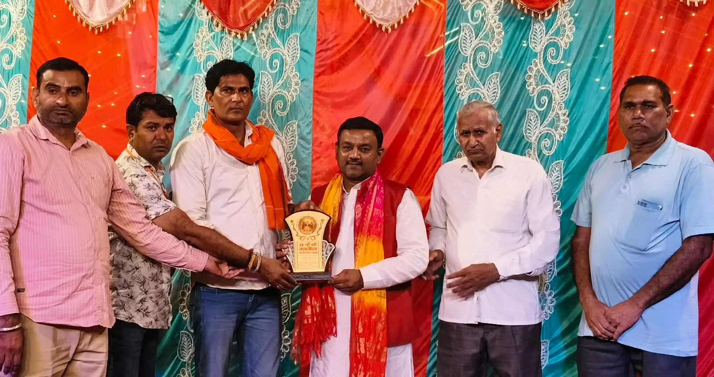

**रुड़की संवाददाता | आसिफ खान**

रुड़की। ग्राम बाजूहेड़ी में आयोजित श्री रामलीला के 43वें महोत्सव में माता सीता की विदाई का मार्मिक प्रसंग मंचित किया गया। कलाकारों की शानदार अदाकारी और भावपूर्ण संवादों ने ऐसा समां बांधा कि पूरा रामलीला परिसर भक्ति और भावनाओं से सराबोर हो उठा। माता सीता की विदाई का दृश्य देखकर श्रद्धालु भावुक हो गए और कई लोगों की आंखों से आंसू छलक पड़े। इस दौरान भगवान श्रीराम के आदर्शों और भारतीय संस्कृति की झलक ने उपस्थित लोगों को भाव-विभोर कर दिया।

रामलीला महोत्सव में पहुंचे पूर्व मेयर गौरव गोयल ने आयोजन समिति को सहयोग राशि भेंट कर धार्मिक आयोजनों को प्रोत्साहित करने का संदेश दिया। उन्होंने कहा कि भगवान श्रीराम का जीवन भाईचारे, प्रेम, त्याग, मर्यादा और कर्तव्यनिष्ठा की अनुपम मिसाल है। उनके आदर्श आज भी समाज को एकजुट रखने और परिवार व रिश्तों की गरिमा बनाए रखने की प्रेरणा देते हैं।

गौरव गोयल ने कहा कि रामलीला केवल मनोरंजन का साधन नहीं, बल्कि भारतीय संस्कृति, धार्मिक परंपराओं और भगवान श्रीराम के आदर्शों को जन-जन तक पहुंचाने का सशक्त माध्यम है। रामलीला के प्रत्येक प्रसंग में जीवन के लिए कोई न कोई महत्वपूर्ण संदेश छिपा है। भगवान श्रीराम का अपने परिवार के प्रति समर्पण, बड़ों के प्रति सम्मान और अपने कर्तव्यों के प्रति निष्ठा प्रत्येक व्यक्ति के लिए प्रेरणादायक है।

उन्होंने कहा कि रामलीला के कलाकार अपनी प्रतिभा और मेहनत से इन आदर्शों को मंच पर जीवंत करते हैं। ऐसे धार्मिक और सांस्कृतिक आयोजनों से नई पीढ़ी को अपनी परंपराओं से जुड़ने का अवसर मिलता है। इसलिए समाज के प्रत्येक व्यक्ति को इन आयोजनों में सहयोग देकर कलाकारों का उत्साह बढ़ाना चाहिए।

**आयोजक समिति ने किया गौरव गोयल का सम्मान**

रामलीला के आयोजक अरुण सैनी ने सहयोग के लिए पूर्व मेयर गौरव गोयल का आभार व्यक्त किया और उन्हें सम्मानित किया। आयोजन के दौरान श्रद्धालुओं में विशेष उत्साह देखने को मिला। माता सीता की विदाई के प्रसंग ने जहां दर्शकों को भावुक किया, वहीं कलाकारों की प्रस्तुतियों ने धार्मिक वातावरण को और भी प्रभावशाली बना दिया।

इस अवसर पर प्रधान बबलू सैनी, संरक्षक योगेश सैनी एवं अशोक सैनी, अध्यक्ष भोपाल सिंह सैनी, सुभाष सैनी, पिंटू सैनी, विपिन सैनी, नीतू सैनी, रितेश सैनी, राजू सैनी, बिट्टू सैनी, चरण सिंह सैनी, पंकज सैनी और कार्तिक सैनी सहित अनेक गणमान्य लोग एवं श्रद्धालु मौजूद रहे।
