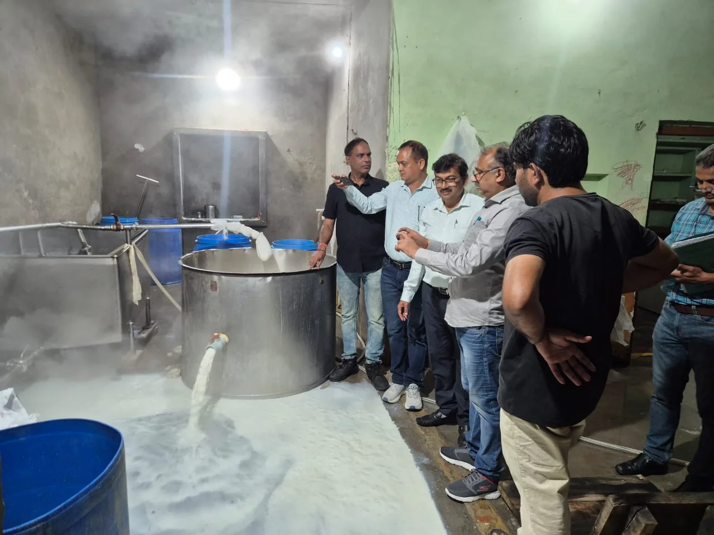
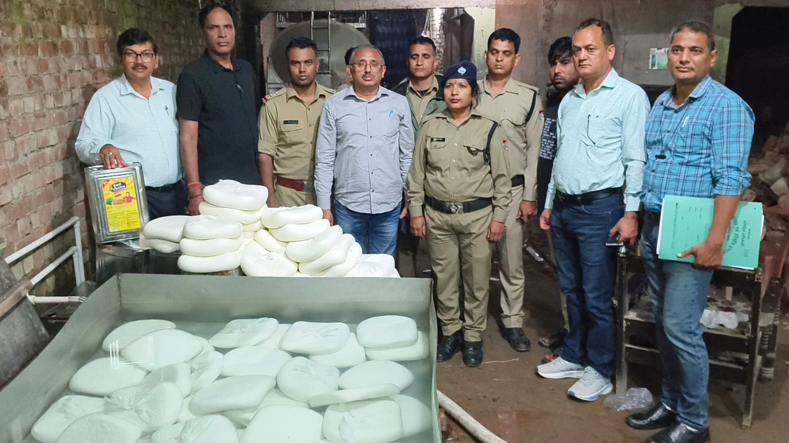
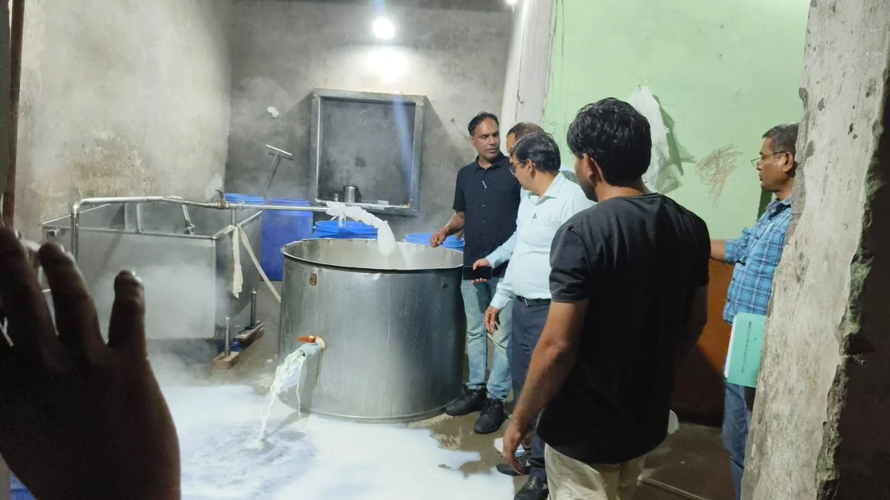

**हरिद्वार संवाददाता | आसिफ खान**

लक्सर। नवरात्र और दीपावली जैसे बड़े त्योहारों से पहले लोगों की सेहत से खिलवाड़ करने वालों के खिलाफ खाद्य सुरक्षा एवं औषधि प्रशासन ने बड़ा शिकंजा कसा है। लक्सर के संघीपुर गढ़ी में पनीर निर्माण इकाई पर आधी रात से सुबह तक चली छापेमारी में विभागीय टीम को बड़ी मात्रा में तैयार और अर्धनिर्मित पनीर के साथ पामोलीन ऑयल मिला। कार्रवाई के दौरान करीब 10 कुंतल खाद्य पदार्थ नष्ट करा दिए गए। इकाई को अग्रिम आदेशों तक बंद कराते हुए उसका खाद्य लाइसेंस भी निलंबित कर दिया गया है। वहीं, संचालक के खिलाफ खाद्य सुरक्षा एवं मानक अधिनियम, 2006 के तहत कानूनी कार्रवाई शुरू कर दी गई है।

**आधी रात को पहुंची टीम, सुबह तक चली कार्रवाई**

खाद्य पदार्थों में मिलावट पर अंकुश लगाने के लिए खाद्य सुरक्षा विभाग ने 13 अक्टूबर की मध्य रात्रि और 14 अक्टूबर की सुबह थाना कोतवाली लक्सर क्षेत्र के अंतर्गत संघीपुर गढ़ी स्थित पनीर निर्माण इकाई पर छापेमारी की। यह कार्रवाई खाद्य सुरक्षा आयुक्त विनय शंकर पांडेय और जिलाधिकारी हरिद्वार मयूर दीक्षित के निर्देशों के अनुपालन में की गई।

खाद्य सुरक्षा एवं औषधि प्रशासन के उपायुक्त गढ़वाल राजेंद्र सिंह रावत के नेतृत्व में पहुंची टीम ने निर्माण स्थल का निरीक्षण किया। कार्रवाई में सहायक आयुक्त महिमानंद जोशी, वरिष्ठ खाद्य सुरक्षा अधिकारी दिलीप जैन, योगेंद्र पांडेय और पवन कुमार शामिल रहे। पुलिस अधीक्षक ग्रामीण अभय प्रताप सिंह के सहयोग से उपलब्ध कराए गए पुलिस बल और महिला कांस्टेबल ने भी कार्रवाई में सहयोग किया।

**तैयार पनीर के साथ भारी मात्रा में अधबना पनीर बरामद**

छापेमारी के दौरान निर्माण स्थल पर एल्यूमीनियम के बड़े टब, डीप फ्रीजर और बिक्री के लिए संग्रहित करीब तीन कुंतल तैयार पनीर मिला। इसके अतिरिक्त लगभग छह कुंतल सेमी प्रोसेस्ड यानी अर्धनिर्मित पनीर तैयार किया जा रहा था।

मौके पर 15 किलोग्राम क्षमता वाले बेस्ट चॉइस रिफाइंड पामोलीन ऑयल के छह भरे हुए टिन मिले, जिनमें कुल 90 किलोग्राम तेल था। इसके अलावा 26 खाली टिन, 25 किलोग्राम क्षमता वाले स्किम्ड मिल्क पाउडर के 10 खाली बोरे और पामोलीन ऑयल के दो अन्य टिन भी पाए गए।

**स्किम्ड मिल्क पाउडर और पामोलीन ऑयल से बनाया जा रहा था पनीर**

विभागीय जांच के दौरान मौके पर स्किम्ड मिल्क पाउडर और पामोलीन ऑयल का इस्तेमाल कर पनीर का निर्माण किए जाने की बात सामने आई। खाद्य सुरक्षा विभाग के अनुसार, खाद्य सुरक्षा आयुक्त उत्तराखंड विनय शंकर पांडेय ने 7 अगस्त 2026 को एनालॉग पनीर के निर्माण, संग्रहण और विक्रय पर प्रतिबंध लगाया था। इसके बावजूद संबंधित इकाई में इन सामग्रियों का इस्तेमाल कर पनीर बनाया जा रहा था।

त्योहारों के दौरान पनीर और दूध से बने खाद्य पदार्थों की मांग बढ़ जाती है। ऐसे में खाद्य पदार्थों की गुणवत्ता और निर्माण प्रक्रिया को लेकर विभाग की यह कार्रवाई महत्वपूर्ण मानी जा रही है।

**गड्ढा खुदवाकर नष्ट कराया पनीर, बंद कराई गई इकाई**

कार्रवाई के दौरान खाद्य सुरक्षा विभाग की टीम ने मौके पर गड्ढा खुदवाकर करीब तीन कुंतल तैयार पनीर, छह कुंतल अर्धनिर्मित पनीर और 90 किलोग्राम पामोलीन ऑयल नष्ट करा दिया। इस तरह बड़ी मात्रा में खाद्य सामग्री को मौके पर ही नष्ट कराया गया, ताकि उसे बाजार में बेचने के लिए इस्तेमाल न किया जा सके।

विभाग ने पनीर निर्माण इकाई को अग्रिम आदेशों तक बंद करा दिया। मौके पर नोटिस भी चस्पा किया गया है। इसके साथ ही इकाई का खाद्य लाइसेंस निलंबित कर दिया गया।

**संचालक के खिलाफ कानूनी कार्रवाई, नमूने जांच के लिए भेजे**

पनीर निर्माण इकाई के संचालक ताजिम पुत्र फैयाज, निवासी संघीपुर गढ़ी के विरुद्ध खाद्य सुरक्षा एवं मानक अधिनियम, 2006 के तहत कानूनी कार्रवाई शुरू कर दी गई है। विभागीय टीम ने मौके से खुले पनीर और पनीर निर्माण में इस्तेमाल किए जा रहे पामोलीन ऑयल के नमूने भी लिए हैं। इन नमूनों को जांच के लिए राजकीय प्रयोगशाला, रुद्रपुर भेजा गया है। प्रयोगशाला की रिपोर्ट के आधार पर खाद्य पदार्थों की गुणवत्ता के संबंध में आगे की कार्रवाई की जा सकेगी।

**त्योहारों में मिलावट पर विभाग की सख्ती जारी**

खाद्य सुरक्षा एवं औषधि प्रशासन ने स्पष्ट किया है कि नवरात्र और दीपावली के मद्देनजर खाद्य पदार्थों की गुणवत्ता सुनिश्चित करने तथा मिलावटखोरी पर अंकुश लगाने के लिए अभियान जारी रहेगा। विभाग की इस कार्रवाई से खाद्य कारोबारियों को साफ संदेश मिला है कि प्रतिबंधित सामग्री के इस्तेमाल और खाद्य सुरक्षा नियमों के उल्लंघन पर सख्त कदम उठाए जा सकते हैं।

अब निगाहें प्रयोगशाला की जांच रिपोर्ट और आगे की कानूनी कार्रवाई पर रहेंगी। त्योहारों की खुशियों के बीच आम जनता को सुरक्षित खाद्य पदार्थ उपलब्ध कराना प्रशासन के सामने बड़ी जिम्मेदारी है।
