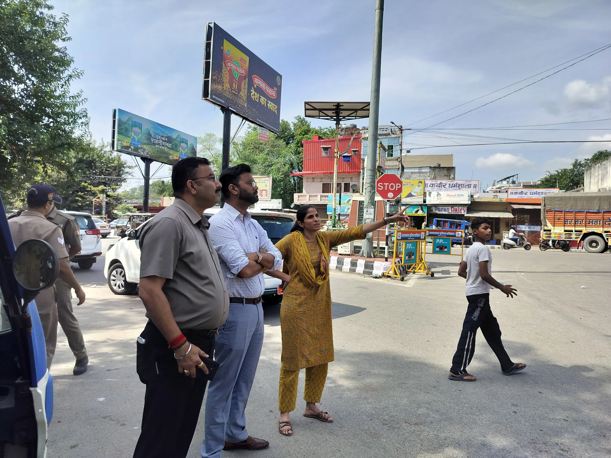
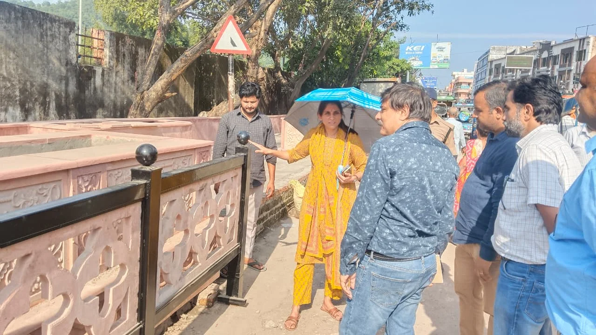
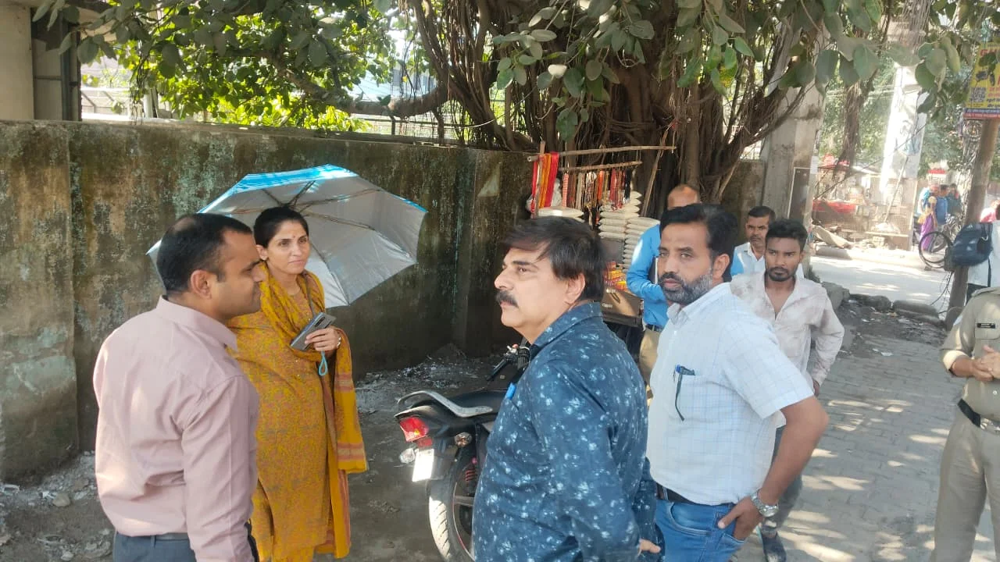
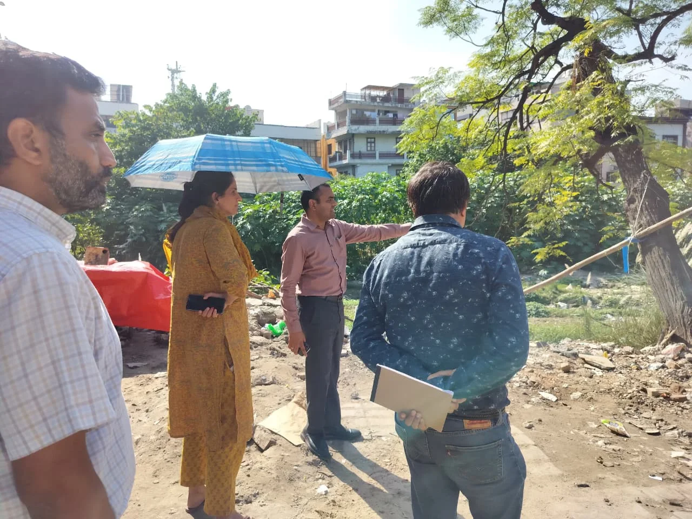
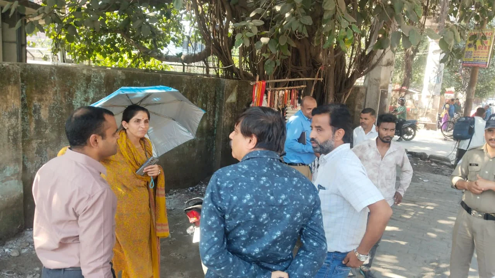

**हरिद्वार संवाददाता | आसिफ खान**

हरिद्वार। कुंभ मेला-2027 की तैयारियों को लेकर मेला प्रशासन ने निर्माण कार्यों की निगरानी तेज कर दी है। श्रद्धालुओं की सुविधा, सुरक्षित आवागमन और हरिद्वार की व्यवस्थाओं को बेहतर बनाने के लिए चल रहे विकास कार्यों में अब समयसीमा और गुणवत्ता पर विशेष जोर दिया जा रहा है। सड़कों, चौराहों, पुलों, फुटपाथों और पैदल मार्गों के निर्माण से लेकर सौंदर्यीकरण तक के कार्यों की प्रगति परखने के लिए मेलाधिकारी श्रीमती सोनिका ने बुधवार को शहर के विभिन्न क्षेत्रों का स्थलीय निरीक्षण किया। इस दौरान उन्होंने अधिकारियों से निर्माण कार्यों की वास्तविक स्थिति, निगरानी व्यवस्था और आगामी कार्ययोजना की जानकारी लेते हुए सभी कार्य निर्धारित समयसीमा में गुणवत्तापूर्ण ढंग से पूरा कराने के निर्देश दिए।

कुंभ जैसे विशाल आयोजन से पहले हरिद्वार की सड़कों, गलियों और श्रद्धालुओं के आवागमन से जुड़े मार्गों को दुरुस्त करना मेला प्रशासन के लिए बड़ी चुनौती है। ऐसे में निर्माण कार्यों में देरी, गुणवत्ता से समझौते और संसाधनों की कमी जैसी संभावित समस्याओं पर नजर रखने के लिए प्रशासन ने निगरानी व्यवस्था को मजबूत करने पर जोर दिया है। मेलाधिकारी ने स्पष्ट किया कि निर्माण कार्य केवल कागजों पर प्रगति दिखाने तक सीमित न रहें, बल्कि धरातल पर भी उनकी स्थिति और गुणवत्ता सुनिश्चित की जाए।

**शंकराचार्य चौक से मालवीय चौक तक निर्माण कार्यों की पड़ताल**

मेलाधिकारी सोनिका ने सबसे पहले शंकराचार्य चौक से मालवीय चौक तक चल रहे सड़क सुधार, चौराहों के विकास, फुटपाथ एवं मीडियन निर्माण और सौंदर्यीकरण कार्यों का निरीक्षण किया। उन्होंने मौके पर मौजूद नगर आयुक्त नंदन कुमार, एचआरडीए सचिव प्रत्यूष सिंह, लोक निर्माण विभाग के अधीक्षण अभियंता डीपी सिंह सहित संबंधित अधिकारियों से निर्माण कार्यों की प्रगति और आगामी तैयारियों की जानकारी ली।

निरीक्षण के दौरान सड़कों के बीच और अन्य स्थानों पर बेतरतीब खड़े तथा क्षतिग्रस्त पोलों को हटाने के निर्देश दिए गए। साथ ही जन-सुविधाओं को व्यवस्थित करने और यातायात व्यवस्था को सुगम बनाने पर जोर दिया गया। अधिकारियों को यह सुनिश्चित करने के निर्देश दिए गए कि निर्माण कार्यों के कारण आम लोगों और पैदल चलने वालों को अनावश्यक परेशानी का सामना न करना पड़े।

**माया देवी मंदिर से गुजरांवाला चौक तक व्यवस्थाएं दुरुस्त करने के निर्देश**

इसके बाद मेलाधिकारी ने जिलाधिकारी मयूर दीक्षित के साथ माया देवी मंदिर क्षेत्र से वाल्मीकि चौक होते हुए गुजरांवाला चौक तक का निरीक्षण किया। इस दौरान सड़क सुधार, स्वच्छता और कुंभ मेले के मद्देनजर आवश्यक व्यवस्थाओं की मौके पर समीक्षा की गई। संबंधित अधिकारियों को समय रहते कमियों को दूर करने और व्यवस्थाओं को दुरुस्त करने के निर्देश दिए गए।

गुजरांवाला धर्मशाला से शिवमूर्ति चौक तक की आंतरिक गलियों का निरीक्षण करते हुए मेलाधिकारी ने वहां आवश्यक सुधार और जन-सुविधाओं की स्थिति पर भी चर्चा की। शिवमूर्ति चौक क्षेत्र में चल रहे सड़क सुधार, फुटपाथ निर्माण और सौंदर्यीकरण कार्यों की समीक्षा करते हुए उन्होंने इस व्यस्त क्षेत्र में निर्माण कार्यों को अविलंब पूरा करने पर जोर दिया।

उन्होंने कहा कि निर्माण कार्यों की गुणवत्ता के साथ-साथ उनका स्वरूप भी कुंभ नगरी की गरिमा और जरूरतों के अनुरूप होना चाहिए। सड़कों और फुटपाथों पर अतिक्रमण रोकने के लिए संबंधित विभागों को लगातार प्रभावी कार्रवाई करने के निर्देश भी दिए गए।

**श्रद्धालुओं के पैदल मार्गों पर विशेष नजर**

भगत सिंह चौक और बिल्केश्वर क्षेत्र से मनसा देवी मार्ग तक चल रहे फुटपाथ निर्माण तथा मनसा देवी पैदल मार्ग के सुदृढ़ीकरण कार्यों का भी मेलाधिकारी ने स्थलीय निरीक्षण किया। कुंभ मेले के दौरान श्रद्धालुओं की भारी आवाजाही को देखते हुए इन मार्गों की उपयोगिता और सुरक्षा महत्वपूर्ण है।

मेलाधिकारी ने संबंधित अधिकारियों को निर्देश दिए कि इन कार्यों को निर्धारित समयसीमा में पूरा किया जाए, ताकि श्रद्धालुओं को सुरक्षित, सुगम और व्यवस्थित आवागमन की सुविधा मिल सके। उन्होंने निर्माण कार्यों में गुणवत्ता बनाए रखने और निगरानी व्यवस्था को लगातार सक्रिय रखने पर भी जोर दिया।

**रात में भी निर्माण कार्यों की होगी निगरानी, संसाधनों की उपलब्धता पर नजर**

निरीक्षण का सबसे अहम पहलू निर्माण कार्यों की बहुस्तरीय निगरानी व्यवस्था रहा। मेलाधिकारी सोनिका ने अधिकारियों को निर्देश दिए कि कार्यों की प्रगति और गुणवत्ता पर लगातार नजर रखी जाए तथा स्थलीय निरीक्षण की रिपोर्ट नियमित रूप से उपलब्ध कराई जाए।

उन्होंने कार्यदायी संस्थाओं के पास पर्याप्त मशीनरी, श्रमिक और अन्य जरूरी संसाधनों की उपलब्धता की जांच करने को कहा। इसके साथ ही रात्रिकालीन शिफ्ट में निर्माण कार्यों के संचालन और उनकी वास्तविक प्रगति की भी नियमित समीक्षा करने के निर्देश दिए गए।

प्रशासन का जोर इस बात पर है कि निर्माण कार्यों की रफ्तार के साथ गुणवत्ता से कोई समझौता न हो और तय समयसीमा के भीतर सभी जरूरी व्यवस्थाएं पूरी की जा सकें। अधिकारियों को निगरानी रिपोर्ट के माध्यम से कार्यों की स्थिति से अवगत कराने को कहा गया है, ताकि किसी भी स्तर पर सामने आने वाली कमी को समय रहते दूर किया जा सके।

निरीक्षण के दौरान पीआईयू के अधिशासी अभियंता प्रवीण कुश, लोक निर्माण विभाग के अधिशासी अभियंता योगेश कुमार सहित संबंधित विभागों के अधिकारी मौजूद रहे।

**खड़खड़ी में निर्माणाधीन पुल और सड़क कार्यों का भी निरीक्षण**

कुंभ मेला-2027 की तैयारियों के तहत अपर मेलाधिकारी दयानंद सरस्वती ने भी बुधवार को खड़खड़ी क्षेत्र में निर्माणाधीन पुल का निरीक्षण किया। इसके अलावा पुराने दिल्ली-नीति पास मार्ग पर सड़क सुधार और फुटपाथ निर्माण सहित कुंभ से संबंधित अन्य निर्माण कार्यों की प्रगति का जायजा लिया।

उन्होंने संबंधित कार्यदायी संस्थाओं के अधिकारियों को सभी निर्माण कार्य निर्धारित समयसीमा में गुणवत्तापूर्ण ढंग से पूरा करने के निर्देश दिए।

कुल मिलाकर, कुंभ-2027 की तैयारियों में अब निर्माण कार्यों की रफ्तार के साथ उनकी गुणवत्ता और निगरानी पर भी प्रशासन का विशेष जोर है। आने वाले समय में यह देखना महत्वपूर्ण होगा कि निरीक्षण के दौरान दिए गए निर्देश धरातल पर कितनी तेजी से लागू होते हैं और हरिद्वार को कुंभ से पहले बेहतर बुनियादी सुविधाएं उपलब्ध कराने का लक्ष्य किस गति से पूरा होता है।
