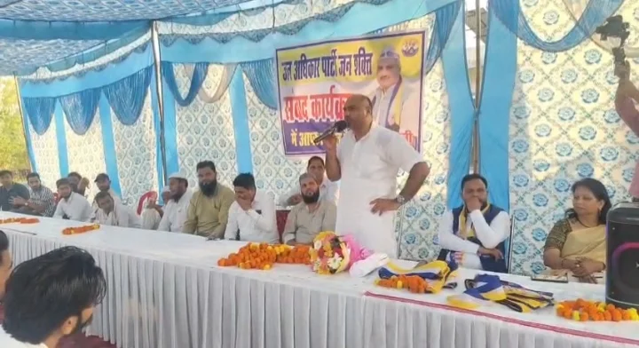
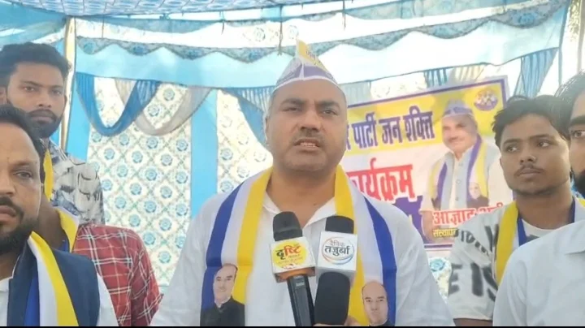
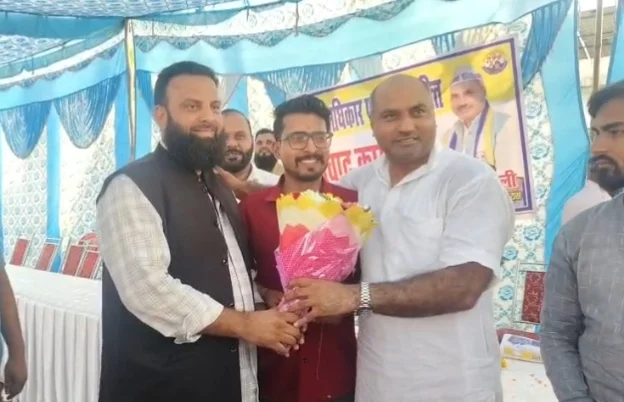
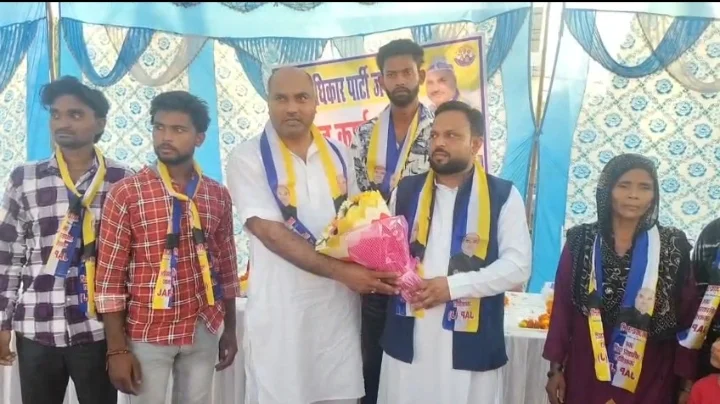

**रुड़की संवाददाता | आसिफ खान**

रुड़की। पिरान कलियर विधानसभा क्षेत्र में आगामी चुनाव को लेकर सियासी सरगर्मियां तेज होने लगी हैं। चुनावी मैदान में अपनी ताकत दिखाने की तैयारी कर रही जन अधिकार पार्टी जनशक्ति ने राजनीतिक गतिविधियां तेज करते हुए कांग्रेस और भाजपा के सामने सवालों की नई फेहरिस्त खड़ी कर दी है। बुधवार, 14 अक्टूबर को बेडपुर चौक स्थित पार्टी कार्यालय में आयोजित जन संवाद कार्यक्रम में पार्टी के राष्ट्रीय अध्यक्ष आजाद अली ने पिरान कलियर विधानसभा सीट से स्वयं चुनाव लड़ने की दावेदारी पेश कर राजनीतिक हलकों में हलचल बढ़ा दी। इसी कार्यक्रम में लोक जनशक्ति पार्टी के एससी/एसटी प्रदेश अध्यक्ष रह चुके अरविंद सिंह ने अपने सैकड़ों समर्थकों के साथ जन अधिकार पार्टी जनशक्ति का दामन थाम लिया।

इस घटनाक्रम ने पिरान कलियर की राजनीति में नई चर्चा छेड़ दी है। एक तरफ आजाद अली ने चुनावी मैदान में उतरने के संकेत देकर अपनी राजनीतिक मंशा स्पष्ट की, तो दूसरी तरफ अरविंद सिंह के पार्टी में शामिल होने को संगठन विस्तार की दिशा में अहम कदम बताया गया। जन संवाद कार्यक्रम में कांग्रेस और भाजपा पर निशाना साधते हुए आजाद अली ने विकास, जनसमस्याओं और जनप्रतिनिधियों की जवाबदेही को लेकर तीखे सवाल उठाए। उनका संदेश साफ था—राजनीति में जनता के सवालों का जवाब देना होगा और विकास के दावों को जमीन पर हुए कामों से साबित करना होगा।

**आजाद अली का चुनावी ऐलान, कलियर में सियासी मुकाबले की आहट!**

पिरान कलियर विधानसभा सीट से चुनाव लड़ने की दावेदारी पेश करते हुए आजाद अली ने साफ संकेत दिया कि जन अधिकार पार्टी जनशक्ति आगामी चुनाव में अपनी मजबूत उपस्थिति दर्ज कराने की तैयारी कर रही है। उन्होंने कहा कि उनकी पार्टी जनता के अधिकारों, सामाजिक न्याय और विकास से जुड़े मुद्दों को लेकर चुनाव मैदान में उतरेगी।

आजाद अली ने क्षेत्र की जनता के सवालों को उठाते हुए कहा कि किसी भी जनप्रतिनिधि की असली ताकत उसके काम और जनता के बीच उसकी जवाबदेही से तय होती है। केवल राजनीतिक दावों से जनता की समस्याओं का समाधान नहीं हो सकता। जनता को बेहतर सुविधाएं, विकास के अवसर और अपनी समस्याओं का ठोस समाधान चाहिए।

उन्होंने दावा किया कि पिरान कलियर की जनता के बीच नए राजनीतिक विकल्प को लेकर चर्चा हो रही है। पार्टी का प्रयास रहेगा कि जनसमस्याओं को प्रमुखता से उठाकर जनता की आवाज को मजबूत राजनीतिक मंच दिया जाए।

आजाद अली की इस दावेदारी के बाद क्षेत्र में चुनावी चर्चाओं का तेज होना स्वाभाविक है। हालांकि, चुनावी मुकाबले की वास्तविक तस्वीर आने वाले समय में राजनीतिक दलों की सक्रियता, उम्मीदवारों और जनता के रुख से स्पष्ट होगी।

**कांग्रेस और भाजपा से सीधे सवाल—विकास हुआ तो हिसाब भी सामने रखिए!**

आजाद अली ने कांग्रेस और भाजपा दोनों को निशाने पर लेते हुए कहा कि जनता को विकास के दावों का वास्तविक हिसाब मिलना चाहिए। उन्होंने भाजपा नेता मुनीश सैनी से पिरान कलियर क्षेत्र में कराए गए विकास कार्यों का विवरण सार्वजनिक करने की मांग की।

उन्होंने सवाल उठाया कि क्षेत्र की बुनियादी समस्याओं, विकास कार्यों और जनता की अपेक्षाओं पर खुलकर चर्चा होनी चाहिए। सड़क, स्वास्थ्य, शिक्षा, रोजगार और अन्य जनसुविधाओं को लेकर राजनीतिक दलों को अपनी उपलब्धियां जनता के सामने रखनी चाहिए।

आजाद अली ने कहा कि चुनाव के समय बड़े-बड़े दावे करना आसान है, लेकिन जनता के बीच जाकर समस्याओं का समाधान करना असली कसौटी है। जनप्रतिनिधियों को यह बताना चाहिए कि उन्होंने जनता के लिए क्या किया और किन समस्याओं का समाधान अभी बाकी है।

उनके इस रुख से साफ है कि जन अधिकार पार्टी जनशक्ति आगामी चुनाव में विकास और जवाबदेही के मुद्दों को प्रमुखता से उठाने की तैयारी कर रही है। अब देखना होगा कि इन सवालों पर संबंधित राजनीतिक नेताओं की ओर से क्या प्रतिक्रिया सामने आती है।

**विधायक फुरकान अहमद पर भी तीखा हमला, बोले—सवालों का जवाब काम से दीजिए!**

जन संवाद कार्यक्रम में कांग्रेस विधायक फुरकान अहमद के एक कथित बयान को लेकर भी आजाद अली ने प्रतिक्रिया दी। उन्होंने कहा कि लोकतंत्र में जनप्रतिनिधियों से सवाल पूछना जनता का अधिकार है और राजनीतिक आलोचनाओं का जवाब विकास कार्यों तथा जनहित में किए गए कामों के आधार पर दिया जाना चाहिए।

आजाद अली ने कहा कि जनता की समस्याओं को राजनीतिक बहस के केंद्र में रखा जाना चाहिए। यदि किसी क्षेत्र में विकास को लेकर सवाल उठ रहे हैं, तो उन सवालों का जवाब तथ्यों और उपलब्धियों के साथ दिया जाना चाहिए।

उन्होंने क्षेत्रीय राजनीति में जवाबदेही की आवश्यकता पर जोर देते हुए कहा कि जनता के मुद्दों को नजरअंदाज नहीं किया जा सकता। जनप्रतिनिधियों को जनता के बीच जाकर उनकी समस्याएं सुननी चाहिए और समाधान के लिए ठोस कदम उठाने चाहिए।

फुरकान अहमद को लेकर की गई टिप्पणी के संबंध में संबंधित पक्ष का जवाब सामने आने पर मामले का दूसरा पक्ष भी स्पष्ट हो सकेगा।

**अरविंद सिंह की एंट्री से बढ़ी राजनीतिक हलचल, सैकड़ों समर्थकों ने ली सदस्यता**

कार्यक्रम में सबसे चर्चित घटनाक्रम लोक जनशक्ति पार्टी के एससी/एसटी प्रदेश अध्यक्ष रह चुके अरविंद सिंह का अपने सैकड़ों समर्थकों के साथ जन अधिकार पार्टी जनशक्ति में शामिल होना रहा।

आजाद अली ने अरविंद सिंह और उनके समर्थकों का स्वागत करते हुए कहा कि पार्टी सामाजिक न्याय और वंचित वर्गों के अधिकारों को लेकर संघर्ष कर रही है। उन्होंने विश्वास जताया कि नए सदस्यों के जुड़ने से संगठन को मजबूती मिलेगी और पार्टी की गतिविधियों का विस्तार होगा।

अरविंद सिंह ने कहा कि वह आजाद अली की नीतियों और उनके संघर्ष से प्रभावित होकर पार्टी में शामिल हुए हैं। उन्होंने संगठन को बूथ स्तर तक मजबूत करने और जनता के बीच पार्टी की विचारधारा पहुंचाने का संकल्प जताया।

राजनीतिक दृष्टि से इस सदस्यता कार्यक्रम को पार्टी के संगठन विस्तार की कवायद के तौर पर देखा जा रहा है। हालांकि, इस घटनाक्रम का चुनावी असर कितना होगा, यह आने वाले समय में ही सामने आएगा।

**दलित, शोषित और वंचित समाज के मुद्दों को बनाएंगे चुनावी हथियार**

आजाद अली ने कहा कि जन अधिकार पार्टी जनशक्ति दलित, शोषित और वंचित समाज के अधिकारों की आवाज उठाने के लिए प्रतिबद्ध है। उन्होंने कहा कि सामाजिक न्याय, सम्मान और समान अवसर जैसे मुद्दों को राजनीतिक विमर्श में प्राथमिकता मिलनी चाहिए।

उन्होंने कार्यकर्ताओं से आह्वान किया कि वे जनता के बीच जाकर स्थानीय समस्याओं को समझें और उन्हें मजबूती से उठाएं। पार्टी का जोर केवल कार्यक्रम आयोजित करने तक सीमित न रहकर संगठन को जमीनी स्तर पर सक्रिय करने पर रहेगा।

आजाद अली ने हरिद्वार, देहरादून और ऊधम सिंह नगर के मैदानी क्षेत्रों में संगठन को मजबूत करने की बात भी कही। पार्टी नेतृत्व की रणनीति क्षेत्रीय स्तर पर जनसंपर्क बढ़ाने और आगामी चुनाव से पहले संगठनात्मक आधार तैयार करने की दिखाई दे रही है।

**हेमा भंडारी समेत पार्टी पदाधिकारी रहे मौजूद**

बेडपुर चौक स्थित पार्टी कार्यालय में आयोजित जन संवाद कार्यक्रम में पार्टी की राष्ट्रीय महासचिव हेमा भंडारी सहित कई पदाधिकारी और कार्यकर्ता मौजूद रहे। कार्यक्रम के दौरान नए सदस्यों का स्वागत किया गया और संगठन को मजबूत बनाने पर जोर दिया गया।

पार्टी की ओर से जनता के बीच पहुंचकर उनके मुद्दों को उठाने तथा आगामी चुनाव को ध्यान में रखते हुए संगठनात्मक गतिविधियों को तेज करने की बात कही गई।

**कलियर की राजनीति में किसका पलड़ा भारी? अब जनता के मुद्दों पर होगी परीक्षा**

आजाद अली की चुनावी दावेदारी और अरविंद सिंह की सदस्यता के बाद पिरान कलियर विधानसभा क्षेत्र में राजनीतिक चर्चाएं तेज हो गई हैं। जन अधिकार पार्टी जनशक्ति ने अपने इरादे जाहिर कर दिए हैं, लेकिन चुनावी राजनीति में केवल दावेदारी और सदस्यता कार्यक्रम ही जीत की गारंटी नहीं होते। पार्टी को अपने दावों को जमीनी सक्रियता, मजबूत संगठन और जनता के भरोसे में बदलना होगा।

दूसरी ओर कांग्रेस और भाजपा के लिए भी क्षेत्रीय मुद्दों पर अपनी उपलब्धियां और राजनीतिक पक्ष जनता के सामने रखना महत्वपूर्ण होगा। आगामी चुनाव में विकास, स्थानीय समस्याएं, सामाजिक न्याय और जनप्रतिनिधियों की जवाबदेही जैसे मुद्दे निर्णायक बहस का हिस्सा बन सकते हैं।

फिलहाल, आजाद अली ने पिरान कलियर से चुनाव लड़ने की दावेदारी पेश कर सियासी मुकाबले का संकेत दे दिया है। अरविंद सिंह की एंट्री ने इस राजनीतिक अभियान को नई चर्चा जरूर दी है। अब निगाहें इस बात पर रहेंगी कि जन अधिकार पार्टी जनशक्ति अपनी दावेदारी को जनता के समर्थन में कितना बदल पाती है और कांग्रेस-भाजपा इन राजनीतिक चुनौतियों का क्या जवाब देती हैं।
