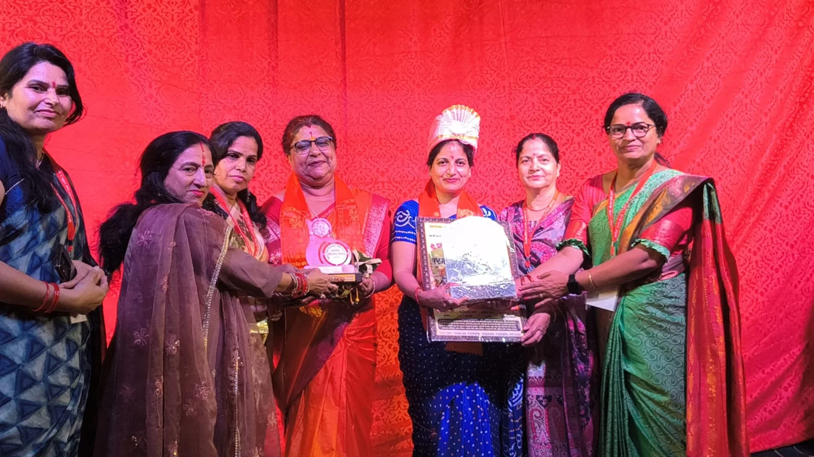
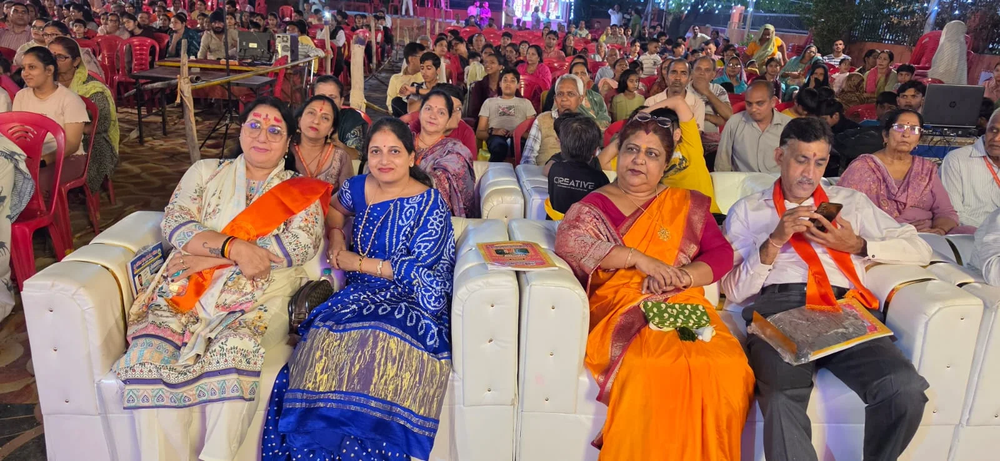

**रुड़की संवाददाता | आसिफ खान**

रुड़की। कृष्णानगर स्थित श्री राम पार्क में आयोजित श्री रामलीला समिति श्री राम पार्क (रजि.) के भव्य श्री रामलीला महोत्सव-2026 में पूजा गुप्ता ने शिरकत कर दीप प्रज्वलित किया। इस दौरान धार्मिक आयोजन में श्रद्धा और उत्साह का माहौल देखने को मिला। पूजा गुप्ता की मौजूदगी ने कार्यक्रम की गरिमा बढ़ाई।

कार्यक्रम के दौरान आयोजक समिति की ओर से पूजा गुप्ता को पगड़ी पहनाकर तथा स्मृति चिह्न भेंट कर सम्मानित किया गया। समिति के इस सम्मान पर पूजा गुप्ता ने सभी सदस्यों का आभार व्यक्त किया और महोत्सव के सफल आयोजन के लिए शुभकामनाएं दीं।

इस अवसर पर पूजा गुप्ता ने कहा कि प्रभु श्रीराम का जीवन केवल आस्था का प्रतीक नहीं, बल्कि मर्यादा, त्याग, कर्तव्य और संस्कारों की ऐसी मिसाल है, जो हर व्यक्ति को समाज और राष्ट्र के प्रति अपनी जिम्मेदारी निभाने की प्रेरणा देती है। श्रीराम के आदर्शों को अपनाकर जनसेवा, सामाजिक सद्भाव और समाज कल्याण के कार्यों को नई दिशा दी जा सकती है।

उन्होंने कहा कि श्री रामलीला जैसे धार्मिक और सांस्कृतिक आयोजन हमारी परंपराओं को जीवित रखने के साथ-साथ नई पीढ़ी को भारतीय संस्कृति और नैतिक मूल्यों से जोड़ने का महत्वपूर्ण कार्य करते हैं। ऐसे आयोजनों में समाज की भागीदारी सामाजिक एकता और सांस्कृतिक विरासत को मजबूत बनाती है।

पूजा गुप्ता ने श्री रामलीला समिति के पदाधिकारियों एवं सदस्यों के प्रयासों की सराहना करते हुए महोत्सव की सफलता की कामना की।
