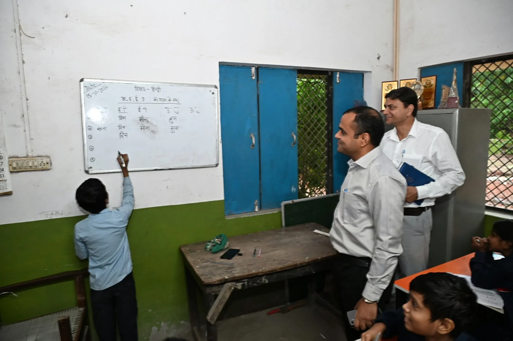
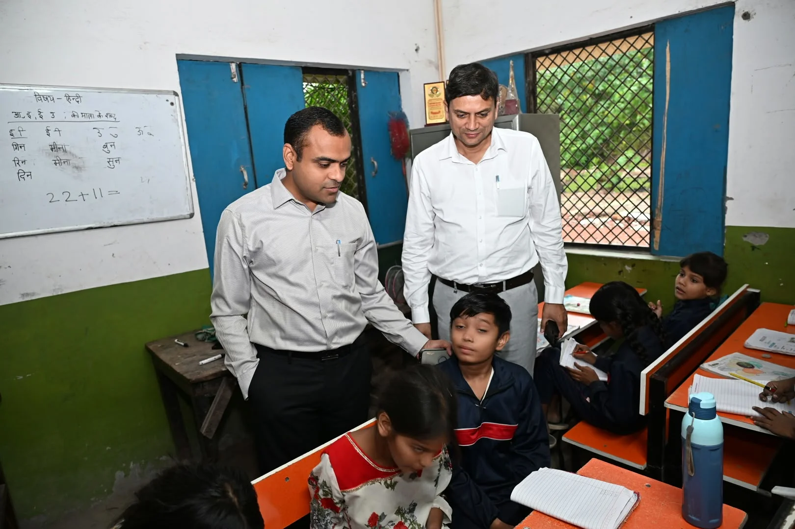

**हरिद्वार संवाददाता | आसिफ खान**

हरिद्वार। सरकारी स्कूलों में शिक्षा की गुणवत्ता और बुनियादी सुविधाओं को लेकर प्रशासन ने सक्रियता दिखाई है। मुख्यमंत्री पुष्कर सिंह धामी के निर्देशन में जिलाधिकारी मयूर दीक्षित ने अपर रोड स्थित राजकीय प्राथमिक विद्यालय का औचक निरीक्षण कर शैक्षणिक व्यवस्था का जायजा लिया। निरीक्षण के दौरान डीएम ने न केवल बच्चों से सीधे सवाल-जवाब किए, बल्कि पुराने विद्यालय भवन की स्थिति को देखते हुए नए भवन के निर्माण का प्रस्ताव तैयार करने के निर्देश भी दिए।

**बच्चों से सीधे संवाद, गणित के सवालों से परखी पढ़ाई**

निरीक्षण के दौरान जिलाधिकारी कक्षाओं में पहुंचे और छात्र-छात्राओं से पाठ्यक्रम से संबंधित प्रश्न पूछे। उन्होंने बच्चों से गणित के सवाल भी हल करवाए। विद्यार्थियों ने सवालों के सही जवाब दिए, जिस पर डीएम ने उनका उत्साहवर्धन करते हुए पढ़ाई के प्रति उनकी रुचि की सराहना की।

जिलाधिकारी ने शिक्षिकाओं को निर्देश दिए कि बच्चों को केवल किताबी ज्ञान तक सीमित न रखा जाए, बल्कि उन्हें व्यावहारिक शिक्षा भी दी जाए। उन्होंने कहा कि ऐसी शिक्षण व्यवस्था विकसित की जानी चाहिए, जिससे विद्यार्थी पढ़ाई में सीखी गई बातों को अपने दैनिक जीवन में भी इस्तेमाल कर सकें।

**पुराने भवन की जगह नए स्कूल की तैयारी, प्रस्ताव मांगा**

विद्यालय भवन की स्थिति का निरीक्षण करते हुए जिलाधिकारी ने पुराने भवन के स्थान पर नए विद्यालय भवन के निर्माण के लिए आवश्यक प्रस्ताव तैयार कर उपलब्ध कराने के निर्देश मुख्य शिक्षा अधिकारी अमित चंद को दिए। इस निर्देश के बाद विद्यालय में बुनियादी ढांचे को बेहतर बनाने की दिशा में प्रस्ताव तैयार करने की प्रक्रिया महत्वपूर्ण हो गई है।

डीएम ने स्पष्ट किया कि विद्यार्थियों को सुरक्षित, सुविधाजनक और बेहतर शैक्षणिक वातावरण उपलब्ध कराना जरूरी है। विद्यालय की जरूरतों को ध्यान में रखते हुए आवश्यक सुविधाओं के विकास पर विशेष ध्यान दिया जाना चाहिए।

**खेल मैदान भी जरूरी, बच्चों के सर्वांगीण विकास पर जोर**

जिलाधिकारी ने विद्यालय में खेल मैदान की आवश्यकता पर भी जोर दिया। उन्होंने कहा कि बच्चों के शारीरिक और मानसिक विकास के लिए पढ़ाई के साथ खेलकूद तथा रचनात्मक गतिविधियां भी बेहद जरूरी हैं। पर्याप्त खेल स्थान मिलने से विद्यार्थियों में शारीरिक क्षमता, अनुशासन, टीम भावना और आत्मविश्वास का विकास होता है।

उन्होंने शिक्षिकाओं को निर्देश दिए कि बच्चों की शिक्षा के साथ उनके सर्वांगीण विकास पर भी ध्यान दिया जाए, ताकि विद्यार्थी पढ़ाई के साथ अन्य गतिविधियों में भी आगे बढ़ सकें।

**शिक्षा व्यवस्था सुधारना प्रशासन की प्राथमिकता**

जिलाधिकारी मयूर दीक्षित ने कहा कि जनपद में शिक्षा की गुणवत्ता में सुधार लाना और विद्यार्थियों को बेहतर शैक्षणिक वातावरण उपलब्ध कराना प्रशासन की प्राथमिकता है। इसके लिए विद्यालयों में जरूरी सुविधाओं के विकास और शिक्षण व्यवस्था को मजबूत बनाने की दिशा में लगातार प्रयास किए जा रहे हैं।

निरीक्षण के दौरान मुख्य शिक्षा अधिकारी अमित चंद, प्रधानाध्यापिका श्रीमती सपना रानी, जिला सूचना अधिकारी रती लाल शाह, विद्यालय की शिक्षिकाएं तथा छात्र-छात्राएं उपस्थित रहे।
