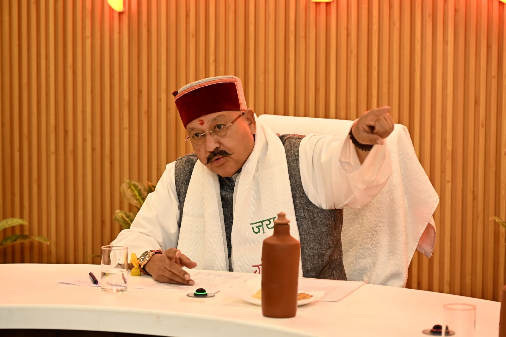
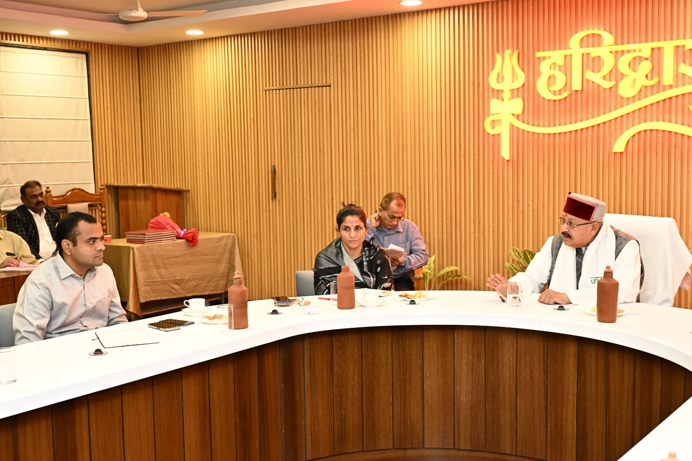
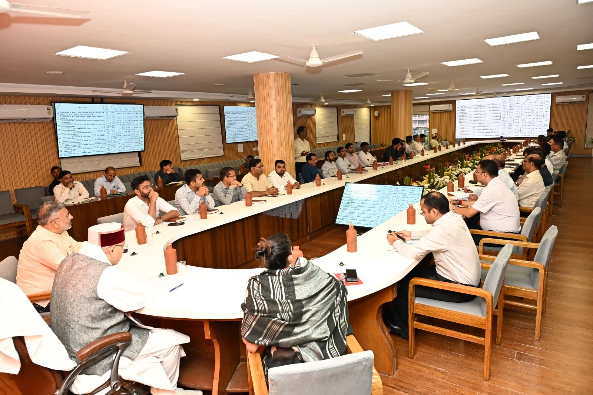
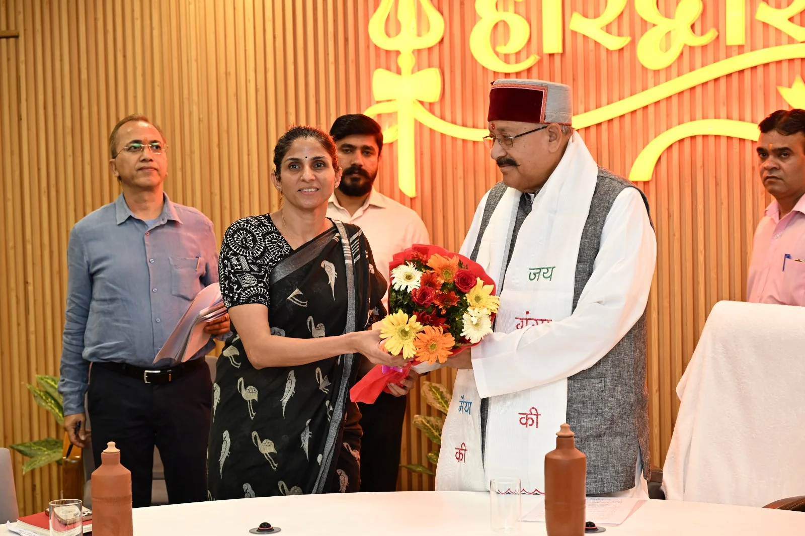

**हरिद्वार संवाददाता | आसिफ खान**

हरिद्वार। धर्मनगरी हरिद्वार में कुंभ-2027 के दिव्य एवं भव्य आयोजन को लेकर सरकार ने तैयारियों में तेजी लाने के संकेत दे दिए हैं। कैबिनेट मंत्री सतपाल महाराज ने साफ शब्दों में निर्देश दिए हैं कि कुंभ से जुड़ी सभी व्यवस्थाएं निर्धारित समयसीमा में पूरी की जाएं। श्रद्धालुओं की सुरक्षा, सुगम आवागमन और भीड़ प्रबंधन में किसी तरह की चूक न हो, इसके लिए संबंधित विभाग आपसी समन्वय के साथ काम करें। निर्माण कार्यों की गुणवत्ता से लेकर स्वास्थ्य, स्वच्छता, पेयजल और आपदा प्रबंधन तक हर व्यवस्था की गंभीरता से निगरानी करने पर जोर दिया गया है।

बृहस्पतिवार को मेला नियंत्रण भवन (सीसीआर) सभागार में आयोजित समीक्षा बैठक में सतपाल महाराज ने स्पष्ट किया कि कुंभ जैसे विशाल धार्मिक आयोजन में छोटी-सी लापरवाही भी बड़ी परेशानी का कारण बन सकती है। ऐसे में अधिकारियों को केवल कागजी योजनाओं तक सीमित रहने के बजाय धरातल पर व्यवस्थाएं मजबूत करनी होंगी। उन्होंने यह भी कहा कि कुंभ के लिए तैयार होने वाली आधारभूत सुविधाएं ऐसी हों, जिनका लाभ हरिद्वार की जनता को पूरे वर्ष मिलता रहे।

**भीड़ प्रबंधन में चूक पड़ी भारी तो बिगड़ सकते हैं हालात**

कुंभ के दौरान उमड़ने वाली संभावित भीड़ को देखते हुए कैबिनेट मंत्री ने पिछले आयोजनों के अनुभवों के आधार पर व्यापक कार्ययोजना तैयार करने के निर्देश दिए। उन्होंने कहा कि बसों और ट्रेनों के संचालन की ठोस योजना बनाई जाए तथा उसका व्यापक प्रचार-प्रसार किया जाए, ताकि श्रद्धालुओं को समय रहते आवागमन की सही जानकारी मिल सके।

भीड़भाड़ वाले दिनों में भगदड़ जैसी घटनाओं की आशंका को रोकने के लिए विशेष सतर्कता बरतने पर जोर दिया गया। मंत्री ने निर्देश दिए कि ट्रेनों के प्रस्थान से ठीक पहले प्लेटफॉर्म बदलने अथवा अन्य व्यवस्थाओं में अचानक बदलाव करने से बचा जाए। आपातकालीन परिस्थितियों में भीड़ को सुरक्षित बाहर निकालने के लिए वैकल्पिक निकासी मार्ग पहले से चिह्नित किए जाएं और उनकी व्यवस्था सुनिश्चित की जाए।

**पार्किंग से घाटों तक श्रद्धालुओं को नहीं होना चाहिए परेशान**

कुंभ में यातायात व्यवस्था को बड़ी चुनौती मानते हुए सतपाल महाराज ने पर्याप्त पार्किंग स्थल विकसित करने के निर्देश दिए। पार्किंग स्थलों और अस्थायी बस अड्डों से प्रमुख घाटों तक श्रद्धालुओं की आवाजाही आसान बनाने के लिए शटल बस सेवा संचालित करने पर जोर दिया गया।

उन्होंने कुंभ क्षेत्र की सड़कों के साथ मंदिरों और घाटों तक पहुंचने वाले मार्गों को दुरुस्त रखने के निर्देश दिए। राष्ट्रीय राजमार्ग प्राधिकरण (एनएचएआई) के अधीन आने वाली सड़कों को भी सुचारू और आवागमन के अनुकूल बनाए रखने को कहा गया। सड़क निर्माण एवं मरम्मत कार्यों की गुणवत्ता की प्रभावी जांच के साथ रोप-वे की जांच कराने के निर्देश भी दिए गए।

**सुरक्षा व्यवस्था में ढिलाई नहीं, पुलिस बल की होगी पर्याप्त तैनाती**

श्रद्धालुओं की सुरक्षा को सर्वोच्च प्राथमिकता बताते हुए कैबिनेट मंत्री ने प्रमुख घाटों, भीड़भाड़ वाले क्षेत्रों और महत्वपूर्ण आवागमन मार्गों पर पुख्ता सुरक्षा प्रबंध करने के निर्देश दिए। कुंभ के दौरान पर्याप्त पुलिस बल की तैनाती के साथ आपदा अथवा किसी आकस्मिक स्थिति से निपटने के लिए संबंधित विभागों के बीच स्पष्ट समन्वय स्थापित करने को कहा गया।

घाटों पर सुरक्षा इंतजाम मजबूत करने के अलावा वृद्धजनों और दिव्यांगजनों की सुविधा के लिए रैंप बनाने तथा पर्याप्त संख्या में चेंजिंग रूम उपलब्ध कराने के निर्देश दिए गए। संदेश साफ है कि कुंभ में आने वाले श्रद्धालुओं को सुरक्षित स्नान और सुविधाजनक आवागमन उपलब्ध कराने के लिए व्यवस्थाएं पहले से तैयार रखनी होंगी।

**अस्पताल, एंबुलेंस और दवाओं की उपलब्धता पर भी जोर**

कुंभ में लाखों श्रद्धालुओं की संभावित आवाजाही को ध्यान में रखते हुए स्वास्थ्य सेवाओं को मजबूत बनाने के निर्देश दिए गए। सतपाल महाराज ने अस्पतालों, एंबुलेंस, आवश्यक दवाओं, चिकित्सा उपकरणों और चिकित्साकर्मियों की पर्याप्त उपलब्धता सुनिश्चित करने को कहा, ताकि आपातकालीन स्थिति में तत्काल चिकित्सा सहायता मिल सके।

संक्रामक बीमारियों की रोकथाम के लिए प्रभावी मानक संचालन प्रक्रिया (एसओपी) तैयार करने और उसका कड़ाई से पालन कराने पर भी जोर दिया गया। स्वास्थ्य विभाग समेत संबंधित एजेंसियों को ऐसी व्यवस्था बनाने के निर्देश दिए गए, जिससे मेले के दौरान बीमारी फैलने की आशंका को नियंत्रित किया जा सके।

**गंदगी और दूषित पानी की समस्या रोकने के लिए निर्देश**

विशाल धार्मिक आयोजन में स्वच्छता व्यवस्था को लेकर भी मंत्री ने सख्त रुख अपनाया। उन्होंने कूड़ा प्रबंधन, सीवरेज निस्तारण और पर्याप्त संख्या में साफ-सुथरे शौचालय उपलब्ध कराने के निर्देश दिए। शौचालयों की नियमित सफाई तथा पूरे मेला क्षेत्र में स्वच्छता बनाए रखने पर विशेष ध्यान देने को कहा गया।

पेयजल व्यवस्था की समीक्षा करते हुए पानी की टंकियों की समय पर सफाई, जल की नियमित जांच और निर्बाध स्वच्छ पेयजल आपूर्ति सुनिश्चित करने के निर्देश दिए गए। साथ ही विद्युत आपूर्ति और दूरसंचार सेवाओं को भी निर्बाध बनाए रखने के लिए संबंधित विभागों को समय रहते आवश्यक इंतजाम पूरे करने को कहा गया।

**मंदिरों, पुलों और घाटों को मिलेगा आकर्षक स्वरूप**

कुंभ-2027 को धार्मिक आस्था के साथ उत्तराखंड की सांस्कृतिक पहचान से जोड़ते हुए सतपाल महाराज ने हरिद्वार के प्रमुख मंदिरों, पुलों और घाटों को आकर्षक स्वरूप देने के निर्देश दिए। इसके लिए सजावट, फसाड सुधार और आकर्षक लाइटिंग की व्यवस्था करने पर जोर दिया गया।

उन्होंने कहा कि हरिद्वार कुंभ-2027 उत्तराखंड की समृद्ध सांस्कृतिक एवं धार्मिक विरासत को देश-दुनिया के सामने प्रस्तुत करने का महत्वपूर्ण अवसर है। राज्य की सांस्कृतिक परंपराओं और धार्मिक विरासत का व्यापक प्रचार-प्रसार किया जाए। साधु-संतों की शोभायात्राओं के दौरान पुष्पवर्षा, स्वागत और अभिनंदन की समुचित व्यवस्था करने के निर्देश भी दिए गए।

**मेलाधिकारी सोनिका ने बताई तैयारियों की प्रगति**

बैठक में मेलाधिकारी सोनिका ने कुंभ मेला-2027 की तैयारियों और विभिन्न निर्माण कार्यों की प्रगति से कैबिनेट मंत्री को अवगत कराया। उन्होंने बताया कि अधिकांश कार्य निर्धारित समयसीमा के अनुरूप आगे बढ़ रहे हैं। पुलों, घाटों और सड़कों से संबंधित प्रमुख परियोजनाओं को समय पर पूरा कराने के लिए विशेष निगरानी की जा रही है।

मेलाधिकारी ने बताया कि कार्यदायी संस्थाओं को निर्माण कार्यों में तेजी लाने और निर्धारित समयसीमा के भीतर काम पूरा करने के निर्देश दिए गए हैं। अब इन निर्देशों के अनुरूप तैयारियां किस गति से धरातल पर उतरती हैं, यह कुंभ की व्यवस्थाओं के लिए महत्वपूर्ण रहेगा।

**बैठक में कई विभागों के अधिकारी रहे मौजूद**

समीक्षा बैठक में जिलाधिकारी हरिद्वार मयूर दीक्षित, नगर आयुक्त नंदन कुमार, भाजपा जिलाध्यक्ष आशुतोष शर्मा, प्रभागीय वनाधिकारी स्वप्निल अनिरुद्ध, मुख्य विकास अधिकारी डॉ. ललित नारायण मिश्र, अपर मेलाधिकारी दयानंद सरस्वती, सिटी मजिस्ट्रेट हरिद्वार हर गिरी, एचआरडीए सचिव प्रत्यूष सिंह, उप मेला अधिकारी आकाश जोशी, तकनीकी सेल के अधीक्षण अभियंता मनोज भट्ट, लोक निर्माण विभाग के अधीक्षण अभियंता डीपी सिंह, सिंचाई विभाग के अधीक्षण अभियंता मनोज कुमार सिंह, जल संस्थान के अधीक्षण अभियंता यशवीर मल्ल, पेयजल निगम के अधीक्षण अभियंता जीएस तोमर और एनएचएआई के परियोजना निदेशक पुनीत गर्ग सहित विभिन्न विभागों के अधिकारी उपस्थित रहे।

वहीं, पुलिस अधीक्षक टिहरी गढ़वाल श्वेता चौबे, अपर जिलाधिकारी टिहरी शैलेन्द्र सिंह नेगी, अपर जिलाधिकारी पौड़ी गढ़वाल फिंचा राम चौहान सहित देहरादून, पौड़ी और टिहरी जनपदों के अन्य अधिकारियों ने वीडियो कॉन्फ्रेंसिंग के माध्यम से बैठक में प्रतिभाग किया।

अब असली कसौटी धरातल पर तैयारी: कुंभ-2027 को सुरक्षित, सुव्यवस्थित और श्रद्धालु-अनुकूल बनाने के लिए समयबद्ध निर्माण, बेहतर यातायात प्रबंधन और मजबूत जनसुविधाएं सबसे अहम होंगी। समीक्षा बैठक में दिए गए निर्देशों के बाद संबंधित विभागों की जिम्मेदारी बढ़ गई है कि वे योजनाओं को समय पर पूरा कर व्यवस्थाओं को प्रभावी रूप से लागू करें।
