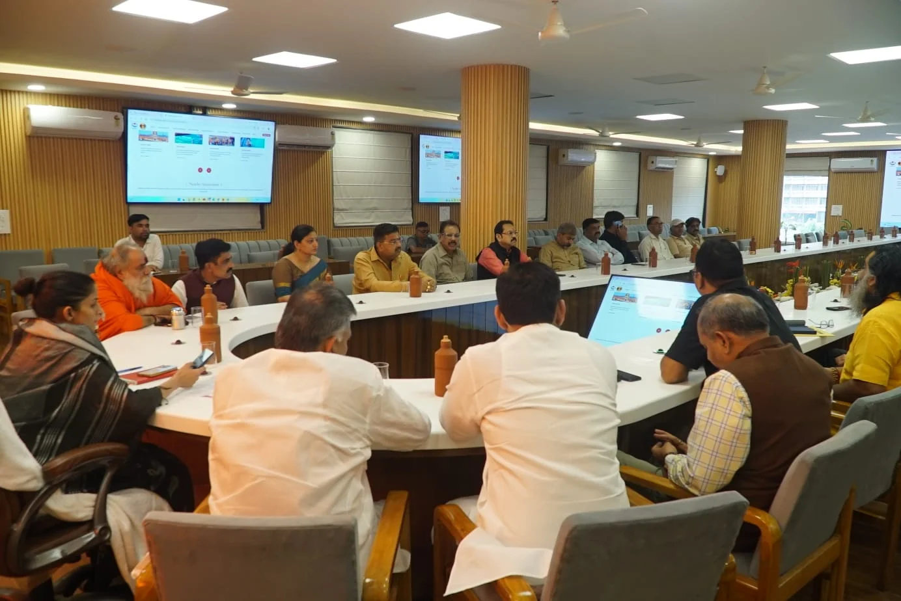

**हरिद्वार संवाददाता | आसिफ खान**

हरिद्वार। कुंभ मेला-2027 को सुव्यवस्थित, सुरक्षित और सुविधाजनक बनाने के लिए मेला प्रशासन ने तैयारियों की रफ्तार तेज कर दी है। निर्माण कार्यों से लेकर यातायात प्रबंधन, पार्किंग, घाटों की सुरक्षा, स्वच्छता और स्वास्थ्य सेवाओं तक, हर व्यवस्था को मजबूत बनाने पर मंथन शुरू हो गया है। गुरुवार को मेला नियंत्रण भवन (सीसीआर) सभागार में मेलाधिकारी श्रीमती सोनिका की अध्यक्षता में आयोजित परामर्शदात्री समिति की बैठक में विभिन्न सामाजिक, धार्मिक, व्यापारिक और नागरिक संगठनों के प्रतिनिधियों ने महत्वपूर्ण सुझाव रखे। बैठक में स्पष्ट किया गया कि कुंभ जैसे विशाल आयोजन में किसी भी स्तर पर लापरवाही की गुंजाइश नहीं होनी चाहिए और सभी तैयारियां निर्धारित समयसीमा के भीतर पूरी करने पर जोर दिया जाना चाहिए।

**कुंभ की तैयारियों में समयसीमा और गुणवत्ता से समझौता नहीं**

बैठक में मेलाधिकारी सोनिका ने कहा कि कुंभ मेला केवल धार्मिक आयोजन नहीं, बल्कि देश-विदेश से आने वाले लाखों श्रद्धालुओं की आस्था, सुरक्षा और सुविधाओं से जुड़ी बड़ी जिम्मेदारी है। इसे सफल बनाने के लिए सभी संबंधित विभागों, स्थानीय निकायों, धार्मिक संस्थाओं, सामाजिक संगठनों, व्यापारियों और आम नागरिकों के बीच बेहतर तालमेल जरूरी है।

उन्होंने कहा कि कुंभ-2027 की तैयारियों को निर्धारित समयसीमा के अनुसार आगे बढ़ाया जा रहा है। निर्माण कार्यों की गुणवत्ता, नियमित निगरानी और पारदर्शिता सुनिश्चित करने के साथ श्रद्धालुओं की सुरक्षा, सुविधा और सुगम आवागमन को प्राथमिकता दी जा रही है। परामर्शदात्री समिति के माध्यम से मिलने वाले सुझावों पर गंभीरता से विचार किया जाएगा, ताकि व्यवस्थाओं को धरातल पर अधिक प्रभावी बनाया जा सके।

**यातायात और पार्किंग से लेकर घाटों की सुरक्षा तक उठे मुद्दे**

बैठक में यातायात व्यवस्था को सुचारु रखने, पर्याप्त पार्किंग स्थल विकसित करने, घाटों की सुरक्षा मजबूत करने, चिकित्सा सेवाओं का विस्तार करने और स्वच्छता व्यवस्था को बेहतर बनाने पर चर्चा हुई। प्रतिनिधियों ने कहा कि कुंभ के दौरान श्रद्धालुओं की भारी भीड़ को देखते हुए पहले से ठोस योजना तैयार करना जरूरी है। स्थानीय नागरिकों की भागीदारी बढ़ाने और विभिन्न विभागों के बीच समन्वय मजबूत करने पर भी जोर दिया गया।

इन सुझावों का उद्देश्य यह सुनिश्चित करना है कि मेले के दौरान भीड़ का दबाव नियंत्रित रहे, श्रद्धालुओं को अनावश्यक परेशानियों का सामना न करना पड़े और हरिद्वार आने वाले लोगों को बेहतर सुविधाएं मिल सकें।

**लोगो, कुंभ गीत और वेबसाइट का किया गया प्रस्तुतिकरण**

बैठक में कुंभ-2027 के लोगो, कुंभ गीत और आधिकारिक वेबसाइट का प्रस्तुतिकरण भी किया गया। अधिकारियों ने वेबसाइट के माध्यम से उपलब्ध कराई जा रही जानकारियों के संबंध में बताया कि इस पर कुंभ से जुड़ी आवश्यक सूचनाएं, सुविधाओं, व्यवस्थाओं और निर्माण कार्यों की प्रगति का विवरण उपलब्ध कराने की व्यवस्था की गई है।

इस पहल का उद्देश्य श्रद्धालुओं, स्थानीय नागरिकों और अन्य हितधारकों तक जरूरी जानकारी आसानी से पहुंचाना है, ताकि आयोजन से संबंधित सूचनाओं के लिए लोगों को इधर-उधर भटकना न पड़े।

**सड़कों से घाटों तक बुनियादी सुविधाओं के विस्तार की तैयारी**

मेलाधिकारी ने बताया कि कुंभ क्षेत्र में अवस्थापना सुविधाओं के विकास और विस्तार के लिए व्यापक स्तर पर कार्य किए जा रहे हैं। इनमें सड़कों का चौड़ीकरण एवं सुदृढ़ीकरण, घाटों का विकास, पैदल मार्गों में सुधार, प्रकाश व्यवस्था, पेयजल आपूर्ति, स्वच्छता प्रबंधन और पार्किंग स्थलों का विकास शामिल है।

इसके अलावा प्रमुख मार्गों और महत्वपूर्ण स्थलों पर संकेतक बोर्ड, सूचना केंद्र तथा डिजिटल सूचना प्रणालियों के माध्यम से श्रद्धालुओं को आवश्यक जानकारी उपलब्ध कराने पर भी ध्यान दिया जा रहा है।

मेले के दौरान अस्थायी आवास, शौचालय, पेयजल, स्वास्थ्य सेवाएं, सहायता केंद्र, विश्राम स्थल और सुरक्षा व्यवस्था को मजबूत बनाने की तैयारी की जा रही है। सार्वजनिक स्थलों को व्यवस्थित रखने, अतिक्रमण पर नियंत्रण और नियमानुसार आवश्यक कार्रवाई करने पर भी जोर दिया गया।

**संगठनों ने की तैयारियों की सराहना, दिए सुधार के सुझाव**

बैठक में शामिल विभिन्न संगठनों के प्रतिनिधियों ने कुंभ-2027 की तैयारियों के तहत किए जा रहे कार्यों की सराहना की। उन्होंने समयबद्ध निर्माण, गुणवत्ता और पारदर्शिता को आयोजन की सफलता के लिए महत्वपूर्ण बताया। प्रतिनिधियों ने यह भी कहा कि प्रशासन और स्थानीय हितधारकों के बीच लगातार संवाद बना रहने से समस्याओं की पहचान समय रहते की जा सकती है और व्यवस्थाओं को अधिक व्यावहारिक बनाया जा सकता है।

बैठक में मुख्य विकास अधिकारी डॉ. ललित नारायण मिश्र ने कुंभ मेला-2027 से जुड़े विभिन्न कार्यों की प्रगति का विवरण प्रस्तुत किया। अपर मेलाधिकारी दयानंद सरस्वती ने तैयारियों और संबंधित व्यवस्थाओं की जानकारी दी।

**बैठक में ये प्रमुख लोग रहे मौजूद**

बैठक में नगर निगम हरिद्वार की महापौर किरण जैसल, नगर निगम ऋषिकेश के महापौर शंभू पासवान, दर्जा प्राप्त राज्य मंत्री एवं श्री गंगा सभा के अध्यक्ष नितिन गौतम, मुनिकीरेती नगर पालिका अध्यक्ष नीलम बिजल्वाण, मेला स्वास्थ्य अधिकारी डॉ. मनीष दत्त, श्री गंगा सभा के महामंत्री तन्मय वशिष्ठ, भारत माता मंदिर के स्वामी ललितानंद, भारत साधु समाज के स्वामी शिवानंद, निरंजनी अखाड़े के महंत राज गिरि, विभिन्न आश्रमों के प्रतिनिधि महंत विष्णु दास, प्रेस क्लब अध्यक्ष धर्मेंद्र चौधरी एवं महामंत्री सूर्यकांत बेलवाल, व्यापार मंडल के जिलाध्यक्ष संजीव नैयर एवं जिला महामंत्री प्रदीप कालरा, धर्मशाला समिति के अध्यक्ष महेश गौड़ एवं महामंत्री विकास तिवारी, प्रांतीय नगर उद्योग व्यापार मंडल के जिलाध्यक्ष विशाल गर्ग एवं शहर अध्यक्ष प्रवीण शर्मा, होटल एसोसिएशन के प्रतिनिधि महंत अनिल गिरि, उप मेलाधिकारी आकाश जोशी एवं मनजीत सिंह सहित विभिन्न संगठनों के पदाधिकारी और प्रतिनिधि उपस्थित रहे।

**अब चुनौती सुझावों को धरातल पर उतारने की**

कुंभ-2027 की सफलता के लिए बैठकों में बनी योजनाओं को समयबद्ध तरीके से लागू करना सबसे अहम होगा। यातायात, पार्किंग, स्वच्छता, स्वास्थ्य सेवाओं, घाटों की सुरक्षा और निर्माण कार्यों की गुणवत्ता पर निरंतर निगरानी ही श्रद्धालुओं को बेहतर अनुभव देने में निर्णायक भूमिका निभाएगी। मेला प्रशासन ने हितधारकों से मिले सुझावों पर विचार कर व्यवस्थाओं को अधिक प्रभावी बनाने का भरोसा दिया है।
