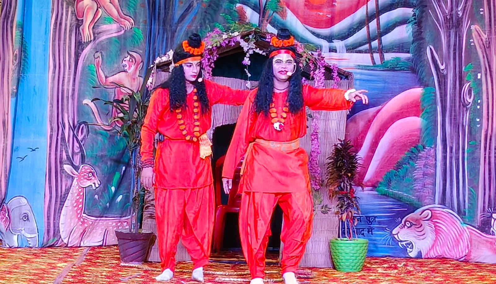
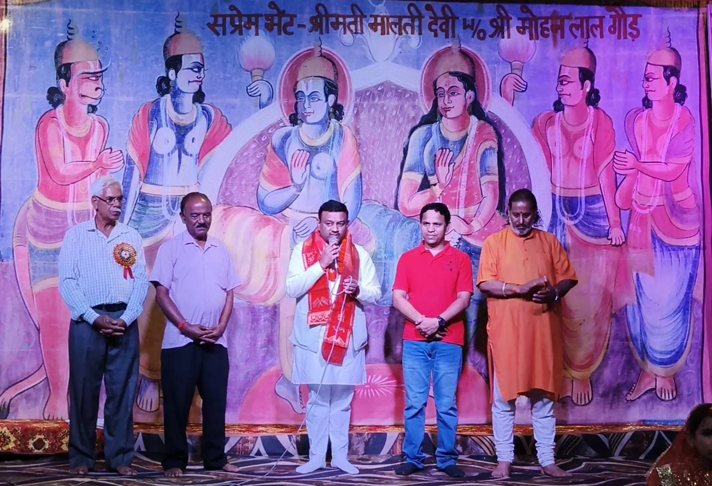
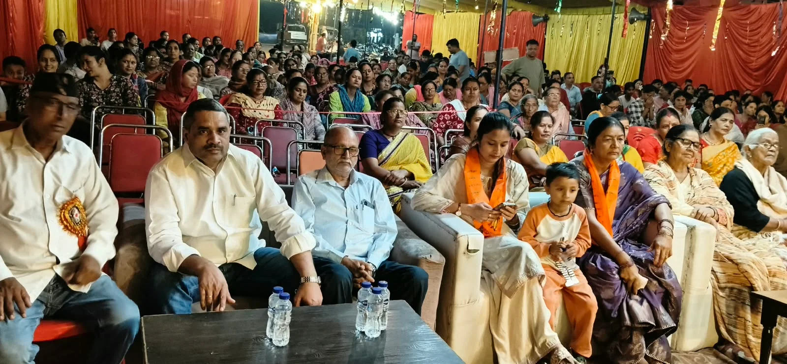

**रूडकी संवाददाता | आसिफ खान** 

रुड़की। देवभूमि श्रीराम धार्मिक एवं सांस्कृतिक ट्रस्ट रजि., डंढेरा में आयोजित रामलीला का पूर्व मेयर गौरव गोयल ने फीता काटकर विधिवत शुभारंभ किया। इस दौरान कलाकारों ने अपने शानदार अभिनय और प्रभावशाली संवादों से ऐसा समां बांधा कि श्रद्धालु देर रात तक मंचन में डूबे रहे। भगवान श्रीराम के जीवन से जुड़े प्रसंगों के माध्यम से जहां धार्मिक आस्था की झलक देखने को मिली, वहीं भारतीय संस्कृति, मर्यादा और आदर्शों का संदेश भी जन-जन तक पहुंचा।

रामलीला में माता सीता के हरण के बाद भगवान श्रीराम और लक्ष्मण द्वारा उनकी खोज में निकलने का मार्मिक प्रसंग प्रस्तुत किया गया। इसी दौरान दोनों भाइयों की मुलाकात घायल जटायु से होती है। जटायु माता सीता के अपहरण की पूरी घटना भगवान श्रीराम को बताते हैं। यह सुनकर श्रीराम भावुक हो जाते हैं और जटायु का उद्धार करते हुए माता सीता की खोज में आगे बढ़ जाते हैं। कलाकारों ने इस प्रसंग को इतनी संवेदनशीलता और जीवंतता के साथ प्रस्तुत किया कि उपस्थित श्रद्धालु भाव-विभोर हो उठे। पूरा पंडाल भगवान श्रीराम के जयकारों और भक्ति भाव से गूंज उठा।

कार्यक्रम को संबोधित करते हुए पूर्व मेयर गौरव गोयल ने भगवान श्रीराम के आदर्शों का स्मरण कराया और रामलीला के धार्मिक, सांस्कृतिक एवं सामाजिक महत्व पर विस्तार से प्रकाश डाला। उन्होंने कहा कि रामलीला केवल मनोरंजन का माध्यम नहीं, बल्कि भारतीय संस्कृति, धार्मिक परंपराओं और जीवन मूल्यों को अगली पीढ़ी तक पहुंचाने का सशक्त माध्यम है। इसके जरिए लोगों को भगवान श्रीराम के जीवन, उनके आदर्शों और मर्यादाओं को करीब से जानने का अवसर मिलता है।

उन्होंने कहा कि भगवान श्रीराम का जीवन हमें सत्य, त्याग, मर्यादा और कर्तव्य के मार्ग पर चलने की प्रेरणा देता है। प्रत्येक व्यक्ति को इन आदर्शों को अपने जीवन में अपनाने का संकल्प लेना चाहिए। रामलीला जैसे धार्मिक एवं सांस्कृतिक आयोजन समाज में आपसी प्रेम, सद्भाव और भाईचारे को मजबूत करते हैं तथा नई पीढ़ी को अपनी संस्कृति और परंपराओं से जोड़ने का काम करते हैं।

इस अवसर पर पूर्व मेयर गौरव गोयल ने क्षेत्रवासियों और संस्था के सदस्यों से मुलाकात कर उनका कुशलक्षेम जाना तथा संस्था को सहयोग राशि भी भेंट की। डंढेरा नगर पंचायत के चेयरमैन सतीश नेगी एवं संस्था के पदाधिकारियों ने गौरव गोयल का सम्मान किया।

कार्यक्रम का संचालन राजेंद्र रावत ने किया। रामलीला के दौरान श्रद्धालुओं में विशेष उत्साह देखने को मिला और आयोजन ने धार्मिक आस्था के साथ सामाजिक एकता का संदेश भी दिया।
