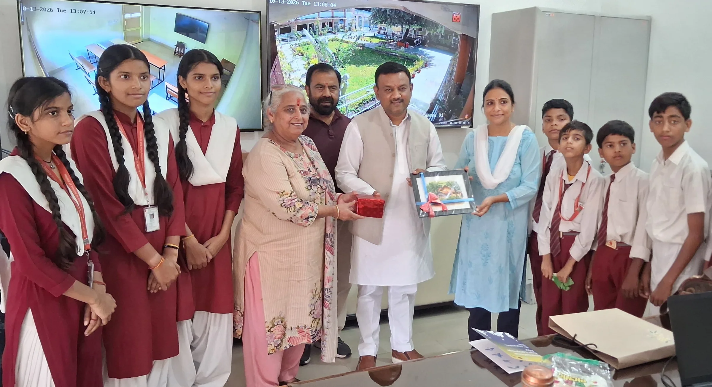
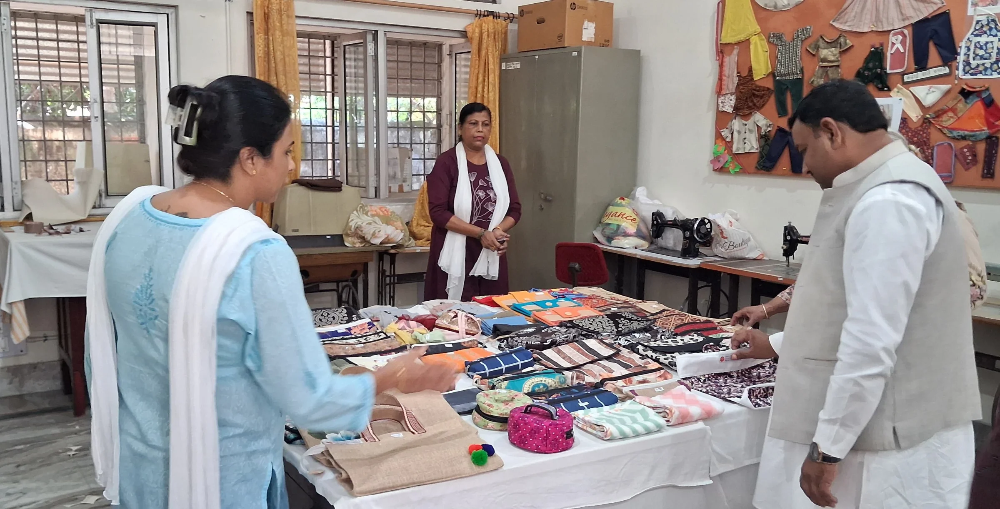

**रूडकी संवाददाता | आसिफ खान** 

रुड़की। मूकबधिर बच्चों की शिक्षा और उनकी बुनियादी जरूरतों को लेकर पूर्व मेयर गौरव गोयल ने संवेदनशील पहल की है। उन्होंने आईआईटी स्थित मूकबधिर विद्यालय का निरीक्षण कर वहां की व्यवस्थाओं और समस्याओं की जानकारी ली। साथ ही विद्यालय की आवश्यकताओं को पूरा करने के लिए निजी स्तर पर हरसंभव सहयोग देने का भरोसा दिलाया।

विद्यालय पहुंचने पर प्रधानाचार्य विभूति सैनी ने पूर्व मेयर गौरव गोयल का सम्मान किया। इस दौरान विद्यालय में मूकबधिर बच्चों को बेहतर शैक्षिक सुविधाएं उपलब्ध कराने तथा उनकी जरूरतों को पूरा करने से जुड़े विभिन्न विषयों पर चर्चा हुई।

प्रधानाचार्य विभूति सैनी ने बताया कि आईआईटी की ओर से विद्यालय की आवश्यकताओं को पूरा किया जाता है। इसके बावजूद विद्यालय में समय-समय पर कुछ अतिरिक्त शैक्षिक सामग्री की जरूरत पड़ती है और कई आवश्यक कार्य भी कराए जाने हैं। ऐसे में सामाजिक संस्थाओं और जागरूक नागरिकों का सहयोग बच्चों के लिए काफी महत्वपूर्ण साबित होता है।

**बच्चों की जरूरतों को पूरा करने का दिया भरोसा**

विद्यालय की समस्याओं और आवश्यकताओं से अवगत होने के बाद गौरव गोयल ने आश्वासन दिया कि वह अपनी ओर से निजी स्तर पर जरूरी कार्यों को पूरा कराने का प्रयास करेंगे। उन्होंने कहा कि मूकबधिर बच्चों को शिक्षा के बेहतर अवसर और आवश्यक सुविधाएं उपलब्ध कराना सामाजिक जिम्मेदारी है। ऐसे बच्चों के भविष्य को संवारने के लिए समाज के सक्षम लोगों को भी आगे आकर सहयोग करना चाहिए।

पूर्व मेयर की इस पहल से विद्यालय की आवश्यकताओं को पूरा करने की उम्मीद जगी है। अब बच्चों की शिक्षा के लिए जरूरी सामग्री और अन्य कार्यों में सहयोग मिलने से विद्यालय की सुविधाओं को बेहतर बनाने में मदद मिल सकती है।

**इस अवसर पर नीलम मधोक, राहुल राजपूत और संजय धीमान सहित अन्य लोग मौजूद रहे।**
