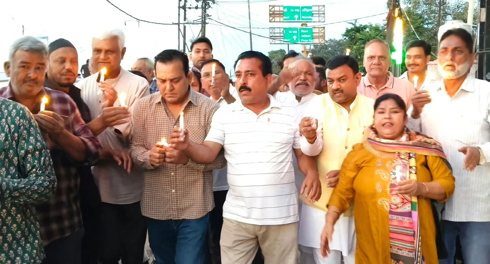
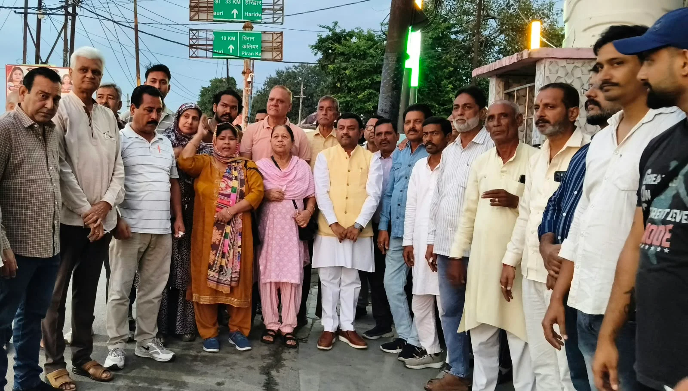

**रूडकी संवाददाता | आसिफ खान** 

रुड़की। उत्तराखंड के बहुचर्चित अंकिता भंडारी हत्याकांड को लेकर एक बार फिर सियासी उबाल देखने को मिला। मामले में कथित वीआईपी को राज्यपाल पद पर नियुक्त किए जाने के विरोध में कांग्रेस कार्यकर्ताओं ने रुड़की नगर निगम स्थित डॉ. भीमराव अंबेडकर की प्रतिमा के समक्ष जोरदार प्रदर्शन किया। कांग्रेसियों ने सरकार के फैसले पर सवाल उठाते हुए अंकिता भंडारी को न्याय दिलाने की मांग की। साथ ही दिल्ली के इंडिया गेट पर अंकिता के माता-पिता को हिरासत में लिए जाने की भी कड़ी निंदा की।

प्रदर्शन के दौरान पूर्व मेयर गौरव गोयल ने कहा कि अंकिता भंडारी मामले में कथित वीआईपी को लेकर लगातार सवाल उठते रहे हैं। उन्होंने आरोप लगाया कि सरकार ने स्वयं इस मामले में सीबीआई जांच की संस्तुति की थी, इसके बावजूद कथित वीआईपी की राज्यपाल पद पर नियुक्ति किए जाने से कई सवाल खड़े हो रहे हैं। उन्होंने मांग की कि अंकिता भंडारी को न्याय दिलाने के लिए सरकार को पारदर्शी और निष्पक्ष कार्रवाई सुनिश्चित करनी चाहिए।

ब्लॉक अध्यक्ष नीरज सैनी और मोहम्मद रिजवान ने भी सरकार पर निशाना साधते हुए नियुक्ति के फैसले पर तत्काल पुनर्विचार करने की मांग की। उन्होंने आरोप लगाया कि अंकिता भंडारी हत्याकांड के मामले में शुरुआत से ही भाजपा जनता के सवालों का संतोषजनक जवाब देने में विफल रही है। कांग्रेस नेताओं ने कहा कि अंकिता को न्याय दिलाने की मांग को राजनीतिक बयानबाजी तक सीमित नहीं रखा जाना चाहिए, बल्कि मामले से जुड़े सभी सवालों का निष्पक्ष जांच के जरिए जवाब सामने आना चाहिए।

**नगर निगम से सिविल लाइन तक निकाला कैंडल मार्च**

विरोध-प्रदर्शन के बाद कांग्रेस कार्यकर्ताओं ने नगर निगम परिसर से सिविल लाइन होते हुए कैंडल मार्च निकाला। इस दौरान अंकिता भंडारी को न्याय दिलाने की मांग उठाई गई और उसके माता-पिता के साथ किए गए व्यवहार पर नाराजगी जताई गई। कांग्रेसियों ने कहा कि न्याय की मांग करने वाले परिवार की आवाज सुनी जानी चाहिए और पूरे मामले में पारदर्शिता सुनिश्चित की जानी चाहिए।

प्रदर्शन में मनोज सैनी, अनिल पुंडीर, यास्मीन खान, पूर्व पार्षद गुड्डू चौधरी, उम्मेद गाजी सहित अनेक कांग्रेस कार्यकर्ता मौजूद रहे। कार्यकर्ताओं ने अंकिता भंडारी मामले में न्याय की मांग को प्रमुखता से उठाते हुए सरकार के फैसले पर पुनर्विचार करने की अपील की।

अंकिता भंडारी को न्याय दिलाने की मांग के बीच राज्यपाल पद पर नियुक्ति को लेकर उठे सवालों ने प्रदेश की राजनीति में एक बार फिर हलचल तेज कर दी है।
