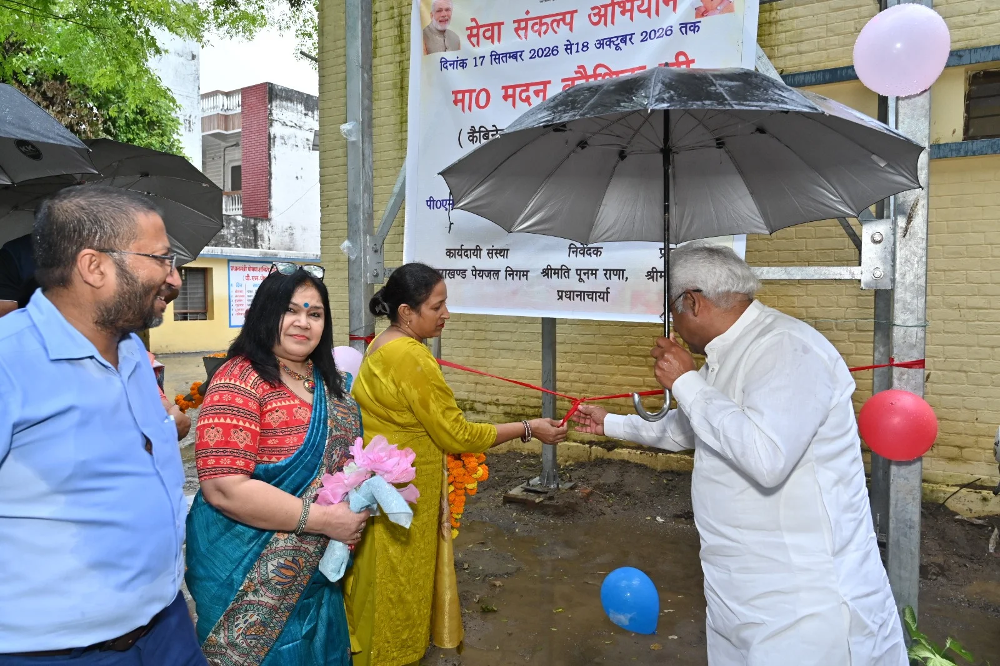
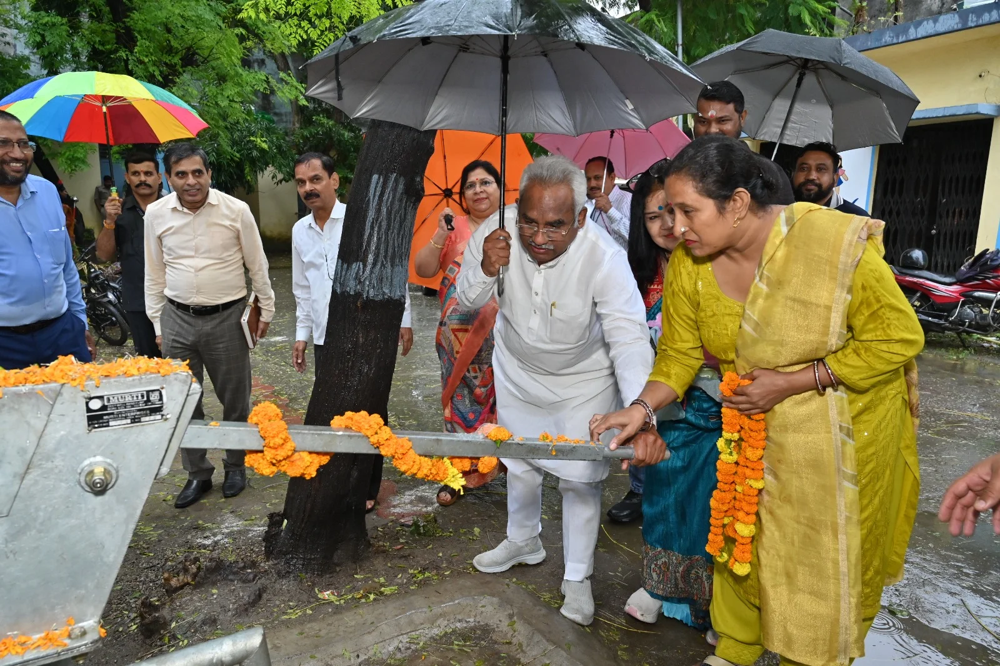
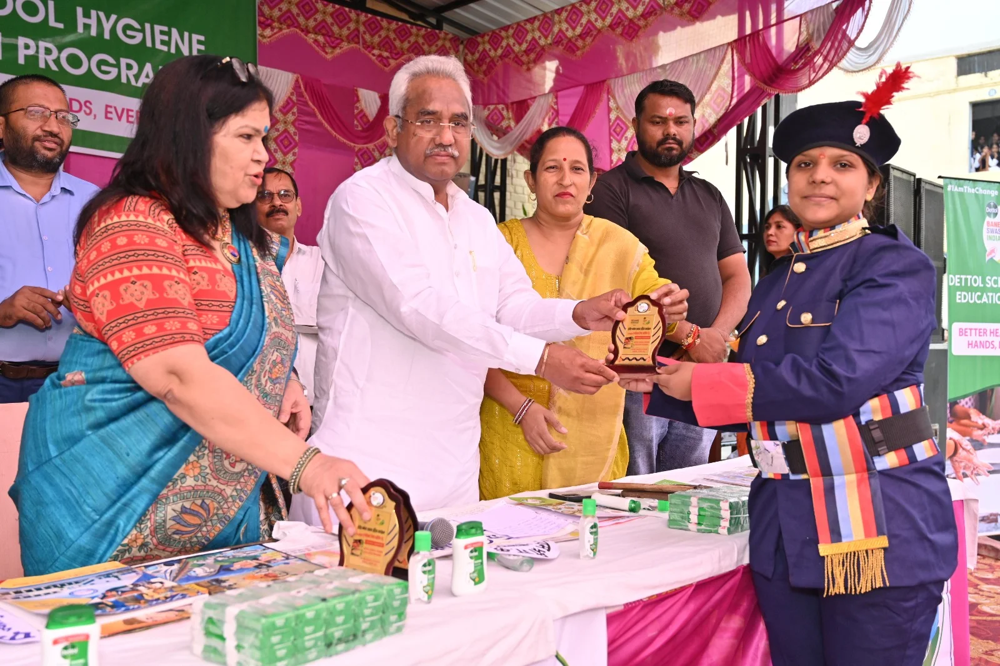

**हरिद्वार संवाददाता | आसिफ खान**

हरिद्वार/ज्वालापुर। विद्यालयों में बुनियादी सुविधाओं को मजबूत करने और छात्राओं को स्वच्छता के प्रति जागरूक बनाने की दिशा में पीएम श्री राजकीय कन्या इंटर कॉलेज, ज्वालापुर में विकास कार्यों की सौगात दी गई। उत्तराखंड सरकार के कैबिनेट मंत्री मदन कौशिक ने सेवा संकल्प अभियान (17 सितंबर से 18 अक्टूबर 2026) के अंतर्गत विद्यालय में स्थापित सोलर ड्यूल हैंडपंप और मंच शेड का लोकार्पण किया। इसके साथ ही छात्राओं को स्वच्छता एवं स्वास्थ्य के प्रति जागरूक करने के उद्देश्य से ‘डेटॉल स्कूल हाइजीन एजुकेशन प्रोग्राम’ का शुभारंभ किया गया।

**पेयजल और सांस्कृतिक कार्यक्रमों की सुविधा पर जोर**

कार्यक्रम का शुभारंभ कैबिनेट मंत्री मदन कौशिक, विद्यालय की प्रधानाचार्य पूनम राणा, स्थानीय पार्षद निशा पुंडीर और अन्य अतिथियों ने संयुक्त रूप से रिबन काटकर किया। अतिथियों ने सोलर ड्यूल हैंडपंप का संचालन कर इसके लोकार्पण की औपचारिकता पूरी की। सोलर ड्यूल हैंडपंप की स्थापना से छात्राओं को पेयजल सुविधा उपलब्ध कराने में मदद मिलेगी, जबकि मंच शेड के निर्माण से विद्यालय में सांस्कृतिक एवं अन्य शैक्षणिक कार्यक्रमों के आयोजन के लिए बेहतर व्यवस्था उपलब्ध होगी।

इस दौरान अतिथियों का पुष्पगुच्छ और फूलमालाओं से स्वागत किया गया। कार्यक्रम में विद्यालय की सुविधाओं के विकास और छात्राओं के लिए स्वच्छ एवं बेहतर वातावरण तैयार करने पर जोर दिया गया।

**हाथ धोने की आदत से दूर रहेंगी बीमारियां**

15 अक्टूबर को वैश्विक हाथ धुलाई दिवस के अवसर पर आयोजित कार्यक्रम में कैबिनेट मंत्री मदन कौशिक ने छात्राओं और शिक्षकों को संबोधित करते हुए कहा कि वर्ष 2026 की थीम ‘Be a Handwashing Hero!’ यानी ‘हाथ धोने के नायक बनें’ स्वच्छता अपनाने और स्वस्थ समाज के निर्माण का संदेश देती है।

उन्होंने कहा कि साबुन और पानी से नियमित रूप से हाथ धोना एक छोटी, लेकिन बेहद महत्वपूर्ण आदत है। इससे बच्चों को अनेक बीमारियों और संक्रमणों से बचाने में मदद मिलती है। भोजन करने से पहले और शौचालय का उपयोग करने के बाद साबुन से अच्छी तरह हाथ धोने से दस्त, डायरिया और संक्रमण से होने वाली बीमारियों का खतरा कम किया जा सकता है।

मंत्री ने छात्राओं को हाथ धोने का सही तरीका अपनाने की सलाह देते हुए हथेलियों, उंगलियों के बीच और नाखूनों की अच्छी तरह सफाई करने तथा कम से कम 20 सेकंड तक साबुन से हाथ धोने के महत्व पर जोर दिया।

**स्वच्छता को जन-आंदोलन बनाने की अपील**

कैबिनेट मंत्री मदन कौशिक ने प्रधानमंत्री नरेंद्र मोदी के नेतृत्व में संचालित स्वच्छ भारत मिशन का उल्लेख करते हुए कहा कि स्वच्छता को जन-आंदोलन बनाने के लिए प्रत्येक नागरिक की भागीदारी जरूरी है। उन्होंने छात्राओं और शिक्षकों से अपील की कि वे स्वयं स्वच्छता की आदतों को अपनाएं और अपने परिवार तथा आसपास के लोगों को भी इसके लिए प्रेरित करें।

उन्होंने कहा कि व्यक्तिगत स्वच्छता को दैनिक जीवन का हिस्सा बनाकर ही स्वस्थ समाज की दिशा में प्रभावी कदम उठाया जा सकता है। विद्यालयों में इस प्रकार के जागरूकता कार्यक्रम बच्चों में साफ-सफाई की आदत विकसित करने में महत्वपूर्ण भूमिका निभा सकते हैं।

**डेटॉल स्कूल हाइजीन एजुकेशन प्रोग्राम का शुभारंभ**

कार्यक्रम के दौरान डेटॉल इंडिया स्कूल हाइजीन एजुकेशन प्रोग्राम के बैनर और शिलापट का अनावरण भी किया गया। कार्यक्रम का संचालन श्रीमती रश्मि डबराल ने किया। इस पहल के माध्यम से छात्राओं को स्वच्छता, हाथ धोने के सही तरीके और संक्रमण से बचाव के प्रति जागरूक करने पर जोर दिया गया।

इस अवसर पर खंड शिक्षा अधिकारी विनोद कुमार, डेटॉल के जिला प्रभारी प्रकाश नेगी, मंडल अध्यक्ष राजेंद्र कटारिया, विद्यालय की प्रधानाचार्य पूनम राणा, पार्षद निशा पुंडीर सहित विद्यालय के शिक्षक-शिक्षिकाएं और बड़ी संख्या में छात्राएं मौजूद रहीं।

कार्यक्रम का समापन स्वच्छता के प्रति जागरूक रहने और साफ-सफाई की आदतों को अपने दैनिक जीवन में अपनाने के संकल्प के साथ हुआ। विद्यालय में विकास कार्यों के लोकार्पण और स्वच्छता जागरूकता कार्यक्रम को छात्राओं के लिए सुविधाएं बढ़ाने तथा स्वस्थ जीवनशैली को प्रोत्साहित करने की पहल के रूप में देखा गया।
