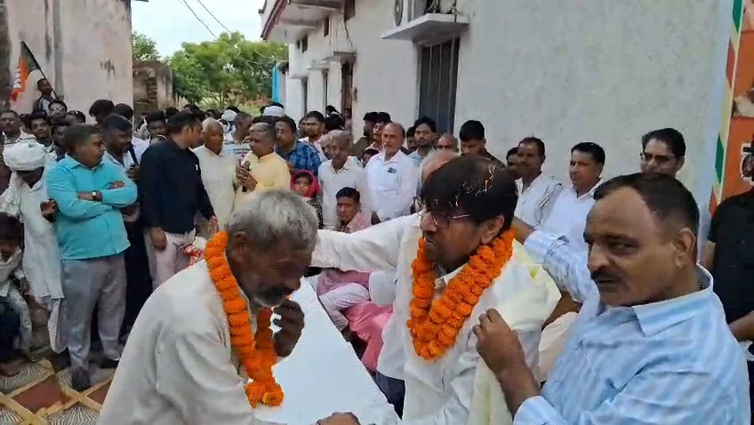
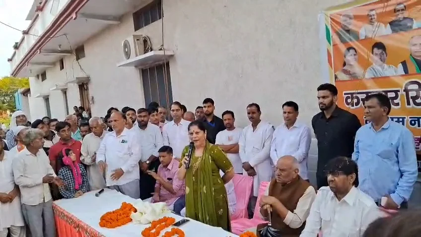
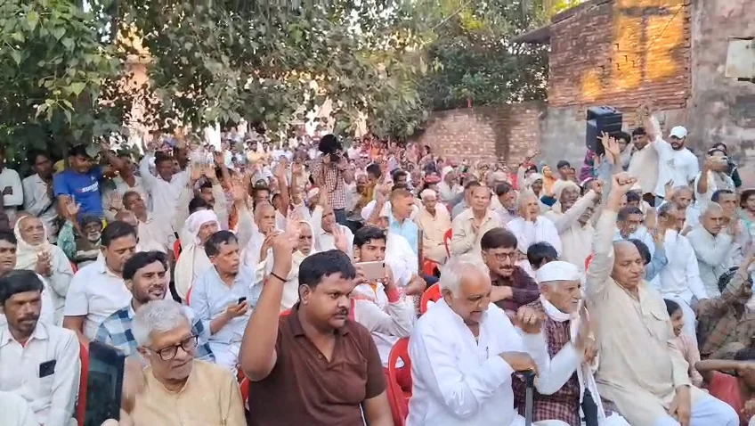

**रूडकी संवाददाता | आसिफ खान** 

मंगलौर/रुड़की। मंगलौर विधानसभा क्षेत्र में भाजपा की राजनीतिक गतिविधियां तेज होती दिखाई दे रही हैं। नारसन कला गांव में पूर्व कैबिनेट मंत्री करतार सिंह भड़ाना के स्वागत समारोह में सैकड़ों लोगों की मौजूदगी ने क्षेत्र में पार्टी की सक्रियता को चर्चा में ला दिया। ग्रामीणों ने फूल-मालाएं पहनाकर उनका स्वागत किया। कार्यक्रम के दौरान भाजपा संगठन को मजबूत बनाने, कार्यकर्ताओं को सक्रिय करने और क्षेत्रीय विकास के मुद्दों को प्राथमिकता देने पर जोर दिया गया।

स्वागत समारोह में रुड़की भाजपा जिला अध्यक्ष डॉ. मधु सिंह सहित बड़ी संख्या में पार्टी कार्यकर्ता और ग्रामीण मौजूद रहे। कार्यक्रम में कार्यकर्ताओं का उत्साह दिखाई दिया। भाजपा नेताओं ने संगठन की मजबूती को लेकर चर्चा करते हुए कार्यकर्ताओं से जनता के बीच लगातार सक्रिय रहने और पार्टी की नीतियों को आम लोगों तक पहुंचाने की अपील की।

**ढाई साल के विकास कार्यों का भड़ाना ने किया जिक्र**

पूर्व कैबिनेट मंत्री करतार सिंह भड़ाना ने कहा कि पिछले ढाई वर्षों में मंगलौर विधानसभा क्षेत्र में विकास कार्यों को आगे बढ़ाने के प्रयास किए गए हैं। उन्होंने कहा कि क्षेत्र की जनता की अपेक्षाओं के अनुरूप विकास को प्राथमिकता देना और स्थानीय समस्याओं का समाधान करना जरूरी है।

भड़ाना ने कार्यकर्ताओं से आह्वान किया कि वे जनता के बीच रहकर उनकी समस्याएं सुनें और उनके समाधान के लिए प्रयास करें। उन्होंने क्षेत्र के विकास और जनसमस्याओं को लेकर सक्रियता बनाए रखने पर जोर दिया।

**मंगलौर सीट पर भाजपा की जीत का दावा**

रुड़की भाजपा जिला अध्यक्ष डॉ. मधु सिंह ने नारसन कला को मंगलौर विधानसभा क्षेत्र का महत्वपूर्ण गांव बताते हुए कहा कि पार्टी संगठन क्षेत्र में लगातार सक्रिय है। उन्होंने कार्यकर्ताओं से आपसी समन्वय और एकजुटता के साथ काम करने तथा भाजपा की नीतियों को जन-जन तक पहुंचाने की अपील की।

डॉ. मधु सिंह ने आगामी विधानसभा चुनाव में मंगलौर सीट पर भाजपा की बड़ी जीत का भरोसा जताया। उनके इस बयान के बाद क्षेत्र की राजनीतिक गतिविधियों और चुनावी तैयारियों को लेकर चर्चाएं तेज होने की संभावना है।

**चुनावी तैयारी के बीच संगठन पर भाजपा का फोकस**

नारसन कला में आयोजित स्वागत समारोह को मंगलौर विधानसभा क्षेत्र में भाजपा की संगठनात्मक सक्रियता के संदर्भ में देखा जा रहा है। कार्यक्रम के जरिए पार्टी नेताओं ने कार्यकर्ताओं में उत्साह बढ़ाने, जनसंपर्क मजबूत करने और विकास के मुद्दों को सामने रखने का प्रयास किया।

आगामी विधानसभा चुनाव को देखते हुए क्षेत्र में राजनीतिक गतिविधियों पर नजरें रहेंगी। भाजपा नेताओं ने जीत का भरोसा जरूर जताया है, लेकिन चुनावी नतीजे जनता के समर्थन, स्थानीय मुद्दों और मतदाताओं के फैसले पर निर्भर करेंगे। ऐसे में मंगलौर विधानसभा क्षेत्र की आगामी राजनीतिक तस्वीर पर सभी की निगाहें रहेंगी।
