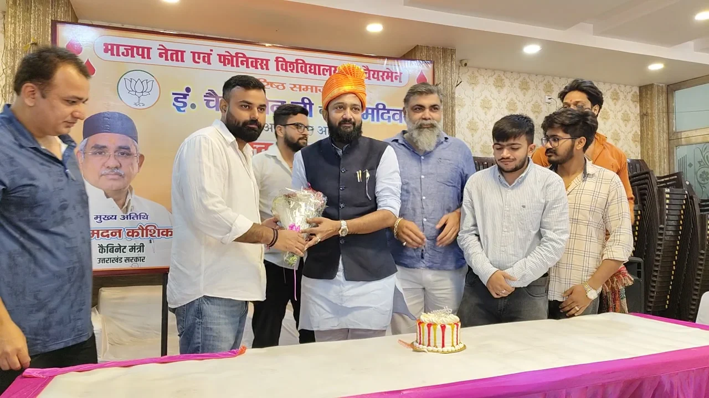
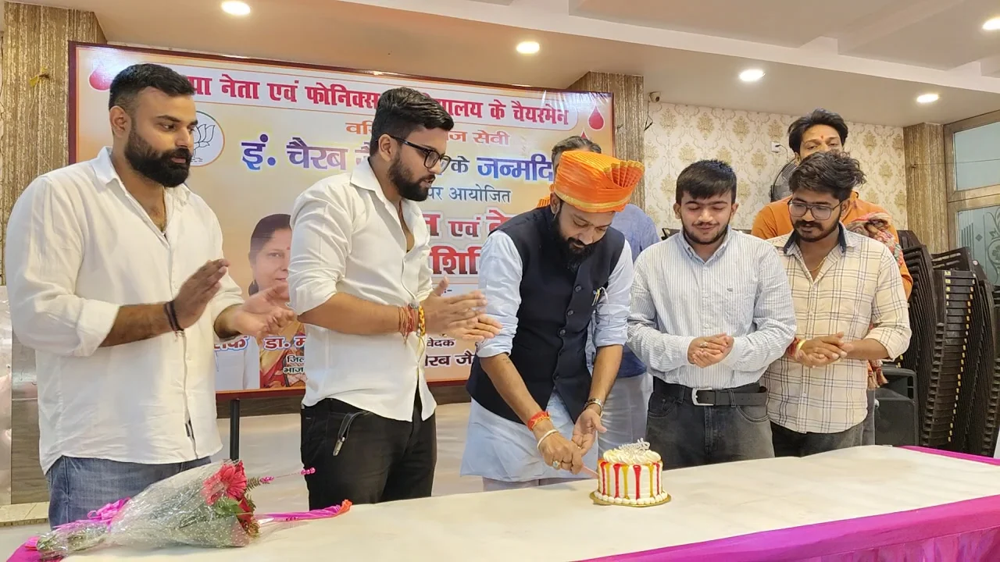

**रूडकी संवाददाता | आसिफ खान** 

रुड़की। जन्मदिन पर केक काटने और जश्न मनाने से आगे बढ़कर जरूरतमंदों की मदद का संकल्प—युवा समाजसेवी, भाजपा नेता एवं फोनिक्स विश्वविद्यालय के चेयरमैन इंजीनियर चेरब जैन ने अपने जन्मदिन को जनसेवा के नाम समर्पित कर सामाजिक सरोकारों की मिसाल पेश की। उनके जन्मदिन के अवसर पर साकेत कॉलोनी स्थित हरमिलाप धर्मशाला में रक्तदान एवं नेत्र जांच शिविर का आयोजन किया गया। शिविर में जरूरतमंद मरीजों की सहायता और लोगों को स्वास्थ्य के प्रति जागरूक करने का संदेश दिया गया।

इस अवसर पर नगर के अनेक गणमान्य लोगों, समर्थकों और शुभचिंतकों ने कार्यक्रम में पहुंचकर इंजीनियर चेरब जैन को जन्मदिन की बधाई दी और उनके उज्ज्वल भविष्य की कामना की। सामाजिक पहल की सराहना करते हुए लोगों ने कहा कि ऐसे आयोजन समाज में सेवा, सहयोग और जिम्मेदारी की भावना को मजबूत करते हैं।

**रक्तदान से जीवन बचाने और नेत्र जांच से स्वास्थ्य जागरूकता का संदेश**

आयोजित शिविर का उद्देश्य जरूरतमंद मरीजों के लिए रक्त की उपलब्धता में सहयोग करना तथा लोगों को आंखों के स्वास्थ्य के प्रति जागरूक करना रहा। रक्तदान को जीवन बचाने में महत्वपूर्ण बताते हुए जनसेवा के इस प्रयास को सराहा गया। वहीं, नेत्र जांच शिविर के माध्यम से लोगों को समय पर आंखों की जांच कराने और स्वास्थ्य के प्रति सजग रहने का संदेश दिया गया।

**“जन्मदिन सिर्फ खुशियां मनाने का नहीं, समाज के प्रति जिम्मेदारी निभाने का दिन”**

इंजीनियर चेरब जैन ने कहा कि जन्मदिन केवल खुशियां मनाने का अवसर नहीं, बल्कि समाज के प्रति अपनी जिम्मेदारी निभाने का भी दिन है। यदि किसी के प्रयास से किसी जरूरतमंद को स्वास्थ्य सुविधा मिलती है या किसी मरीज की जान बचाने में मदद मिलती है, तो इससे बड़ी खुशी कोई नहीं हो सकती।

उन्होंने कहा कि समाज के प्रत्येक व्यक्ति को अपनी क्षमता के अनुसार जनसेवा और जरूरतमंदों की सहायता के लिए आगे आना चाहिए। समाज के प्रति सकारात्मक सोच और सामूहिक सहयोग से ही ऐसे कार्यों को व्यापक स्तर पर आगे बढ़ाया जा सकता है।

इंजीनियर चेरब जैन ने शिविर के आयोजन में सहयोग करने वाले सभी लोगों का आभार व्यक्त किया। उन्होंने कहा कि समाज के लोगों का सहयोग जनहित के कार्यों को मजबूती प्रदान करता है और सेवा की भावना को नई ऊर्जा देता है।

**गणमान्य लोगों और शुभचिंतकों ने दी जन्मदिन की बधाई**

कार्यक्रम में नितिन गोयल, पंकज नंदा, गौरव मेहंदीरत्ता, हरिमोहन गुप्ता, वीरेंद्र जैन, अरविंद गुप्ता, रीना नैथानी, अनिरुद्ध गुप्ता, मनीष पांडेय, केके गौतम, महिपाल गिरी, रिंकू बत्रा, गौरव शर्मा, राहुल बंसल, सुभाष सरीन, दीपक पांडेय, अमन गुप्ता, अमोल अग्रवाल, निर्देश सैनी, सुजल कौशिक, आशीष पाल, सागर गौतम, कुशाग्र गर्ग, सरस्वती रावत और आकर्षित शर्मा सहित अनेक गणमान्य व्यक्ति एवं सामाजिक संगठनों के प्रतिनिधि मौजूद रहे।

संदेश साफ है—खुशियां तभी सार्थक हैं, जब उनका लाभ समाज और जरूरतमंदों तक पहुंचे। इंजीनियर चेरब जैन के जन्मदिन पर आयोजित रक्तदान एवं नेत्र जांच शिविर ने जनसेवा और सामाजिक सहभागिता का महत्वपूर्ण संदेश दिया।
