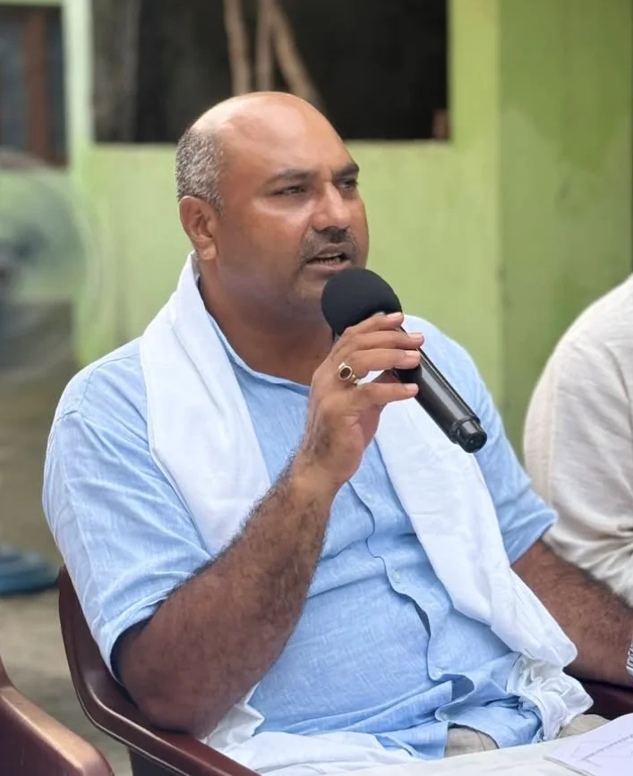

**हरिद्वार संवाददाता | आसिफ खान** 

हरिद्वार। अर्धकुंभ की तैयारियों और विकास कार्यों को लेकर अब सवालों का घेरा तेज होने लगा है। जन अधिकार पार्टी जनशक्ति ने सरकारी धन के इस्तेमाल, निर्माण कार्यों की गुणवत्ता और मेला प्रशासन की कार्यप्रणाली पर तीखे सवाल उठाते हुए कथित भ्रष्टाचार एवं अनियमितताओं की निष्पक्ष जांच की मांग की है। पार्टी ने साफ चेतावनी दी है कि यदि मामले को गंभीरता से नहीं लिया गया और शिकायत पर कार्रवाई नहीं हुई, तो वह चुप नहीं बैठेगी, बल्कि तथ्यों के साथ शिकायत दर्ज कराकर बड़े आंदोलन का बिगुल फूंकेगी।

**करोड़ों का बजट, फिर भी जवाबदेही पर सवाल!**

अर्धकुंभ जैसे बड़े धार्मिक आयोजन के नाम पर करोड़ों रुपये के बजट और विकास कार्यों को लेकर पार्टी ने जवाबदेही तय करने की मांग उठाई है। पार्टी प्रतिनिधि का कहना है कि सरकारी धन जनता की अमानत है और इसके इस्तेमाल का पूरा हिसाब सामने आना चाहिए। किन कार्यों के लिए कितनी धनराशि स्वीकृत हुई, कितना खर्च किया गया, निर्माण की गुणवत्ता कैसी है और मौके पर कितना काम हुआ—इन सभी बिंदुओं की गहन जांच होनी चाहिए।

**सवाल सीधा है**—बजट का पूरा हिसाब सार्वजनिक और पारदर्शी तरीके से सामने क्यों न आए? पार्टी ने मांग की कि कागजी प्रगति के दावों के बजाय धरातल पर हुए कार्यों का सत्यापन कराया जाए, ताकि किसी भी संभावित गड़बड़ी पर पर्दा न रह सके।

**मेला प्रशासन की चुप्पी पर सवाल, जिम्मेदारी तय करने की मांग**

जन अधिकार पार्टी जनशक्ति ने मेला अधिकारी और मेला उप-अधिकारी की कार्यप्रणाली पर सवाल उठाते हुए कहा कि अर्धकुंभ की तैयारियों में निगरानी और जवाबदेही सबसे महत्वपूर्ण हैं। पार्टी प्रतिनिधि ने अधिकारियों और ठेकेदारों के बीच कथित मिलीभगत की आशंका जताते हुए इसकी निष्पक्ष जांच कराने की मांग की है।

पार्टी का कहना है कि यदि निर्माण कार्यों में गुणवत्ता से समझौता हुआ है या सरकारी धन के इस्तेमाल में कोई अनियमितता पाई जाती है, तो जिम्मेदार लोगों को किसी भी कीमत पर जवाबदेही से बचने नहीं दिया जाना चाहिए। हालांकि, कथित मिलीभगत और भ्रष्टाचार के आरोपों की अभी स्वतंत्र पुष्टि नहीं हुई है।

**मुख्यमंत्री धामी की जीरो टॉलरेंस नीति की कसौटी पर अर्धकुंभ के कार्य**

पार्टी ने मुख्यमंत्री पुष्कर सिंह धामी से सीधे हस्तक्षेप कर मामले की निष्पक्ष जांच कराने की मांग की है। प्रतिनिधि ने प्रधानमंत्री नरेंद्र मोदी और मुख्यमंत्री की जीरो टॉलरेंस नीति का हवाला देते हुए कहा कि भ्रष्टाचार के विरुद्ध नीति केवल घोषणाओं तक सीमित नहीं रहनी चाहिए, बल्कि जहां भी अनियमितता सामने आए, वहां नियमानुसार कार्रवाई भी दिखाई देनी चाहिए।

पार्टी की मांग है कि अर्धकुंभ से जुड़े विकास कार्यों के बजट, टेंडर, भुगतान, निर्माण की गुणवत्ता और कार्यों की वास्तविक प्रगति की जांच कराई जाए। यदि जांच में गड़बड़ी सामने आती है, तो संबंधित जिम्मेदारों के खिलाफ सख्त कानूनी एवं विभागीय कार्रवाई की जाए।

**राष्ट्रीय राजमार्ग से लेकर अर्धकुंभ परियोजनाओं तक, धरातल पर हो काम की पड़ताल**

जन अधिकार पार्टी जनशक्ति ने राष्ट्रीय राजमार्ग और अन्य विकास परियोजनाओं का जिक्र करते हुए भी काम की वास्तविक स्थिति पर सवाल उठाए हैं। पार्टी प्रतिनिधि का आरोप है कि कुछ कार्यों की प्रगति दावों के अनुरूप दिखाई नहीं दे रही है। ऐसे में संबंधित विभागों के रिकॉर्ड और मौके पर हुए निर्माण का मिलान जरूरी है।

पार्टी ने मांग की कि जांच केवल फाइलों तक सीमित न रहे। निर्माण स्थलों का निरीक्षण किया जाए, स्वीकृत धनराशि और खर्च का ब्योरा जांचा जाए तथा कार्यों की गुणवत्ता का तकनीकी परीक्षण कराया जाए। इससे यह स्पष्ट हो सकेगा कि विकास के नाम पर खर्च की गई धनराशि का वास्तविक परिणाम क्या है।

**लिखित शिकायत की तैयारी, कार्रवाई नहीं तो बड़े आंदोलन की चेतावनी**

पार्टी ने दावा किया है कि उसके पास कथित अनियमितताओं से जुड़े कई तथ्य हैं, जिन्हें जल्द ही लिखित शिकायत के माध्यम से संबंधित अधिकारियों के सामने रखा जाएगा। पार्टी ने साफ कहा है कि यदि मामले में उचित कार्रवाई नहीं होती, तो वह बड़े स्तर पर प्रदर्शन करेगी और जवाबदेही तय करने की मांग को लेकर आंदोलन तेज करेगी।

**अब जवाबदेही से नहीं चलेगा काम!**

अर्धकुंभ हरिद्वार की प्रतिष्ठा और व्यवस्थाओं से जुड़ा महत्वपूर्ण आयोजन है। ऐसे में विकास कार्यों की गुणवत्ता, बजट के इस्तेमाल और प्रशासनिक निगरानी को लेकर उठ रहे सवालों की अनदेखी नहीं की जानी चाहिए। जन अधिकार पार्टी जनशक्ति ने जांच की मांग उठाकर प्रशासन के सामने जवाबदेही का मुद्दा खड़ा कर दिया है।

अब असली परीक्षा निष्पक्ष जांच की है। संबंधित प्रशासन और विभागों का पक्ष सामने आना भी जरूरी है। यदि आरोप सही पाए जाते हैं, तो जिम्मेदारों पर कार्रवाई होनी चाहिए; वहीं यदि आरोपों में तथ्य नहीं मिलते, तो जांच से स्थिति स्पष्ट हो सकेगी। फिलहाल पार्टी की चेतावनी के बाद यह मामला आगे क्या मोड़ लेता है, इस पर निगाहें टिकी हैं।
