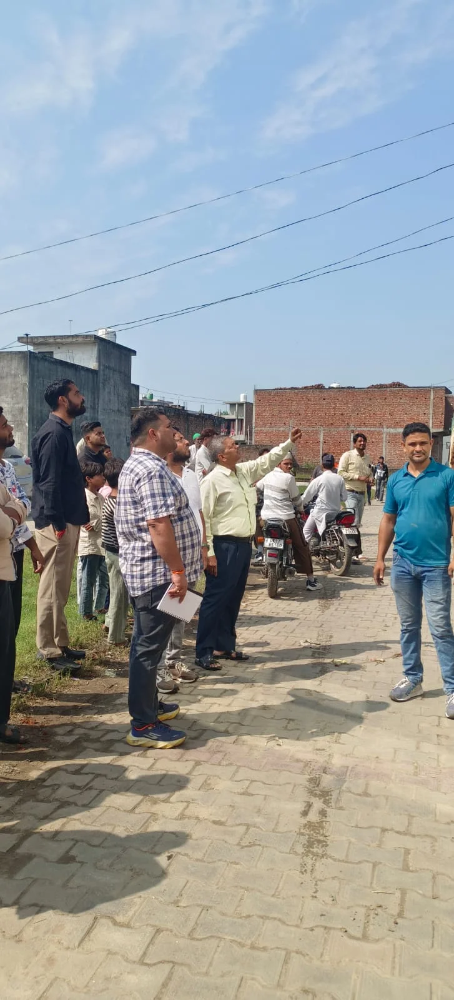

**रूडकी/मंगलौर संवाददाता | आसिफ खान** 

मंगलौर। विद्युत चोरी के खिलाफ विद्युत विभाग ने सख्त रुख अपनाते हुए मंगलौर क्षेत्र में संयुक्त चेकिंग अभियान चलाया। विभागीय टीम ने एक ही दिन में बिजली चोरी के 15 मामले पकड़े। कार्रवाई के दौरान मौके पर केबल उतरवाकर सील की गई और संबंधित व्यक्तियों के खिलाफ विभागीय कार्रवाई करते हुए एफआईआर दर्ज कराने की प्रक्रिया शुरू की गई। विभाग की इस कार्रवाई से बिजली चोरी करने वालों में हड़कंप मच गया।

विद्युत वितरण उपखंड मंगलौर के अंतर्गत बिजली चोरी की प्राप्त शिकायतों के आधार पर उपखंड मंगलौर, उपखंड रामनगर और सहायक अभियंता मापक, भगवानपुर की टीम ने संयुक्त रूप से चेकिंग अभियान चलाया। अभियान के दौरान मंगलौर के मोहल्ला ईदगाह बंदरटोल, टांडा रोड और मालापुरा में जांच की गई। विभाग के अनुसार, कार्रवाई में बिजली चोरी के कुल 15 मामले सामने आए।

**तीन टीमों की संयुक्त कार्रवाई, मौके पर उतारी गई केबल**

अभियान का नेतृत्व उपखंड अधिकारी मंगलौर अनुभव सैनी ने किया। संयुक्त टीम में उपखंड अधिकारी रामनगर ओमपाल, सहायक अभियंता मापक भगवानपुर अरुण कुमार, अवर अभियंता मंगलौर विकास कुमार और अभिषेक सहित विभाग के लाइनमैन शामिल रहे।

टीम ने चेकिंग के दौरान बिजली चोरी के मामलों में मौके पर कार्रवाई करते हुए संबंधित केबल उतरवाई और उन्हें सील कराया। विभागीय स्तर पर आवश्यक कार्रवाई करते हुए संबंधित व्यक्तियों के विरुद्ध नियमानुसार मुकदमा दर्ज कराने की प्रक्रिया भी शुरू की गई।

**बिजली चोरी पर आगे भी जारी रहेगा अभियान**

विद्युत विभाग ने स्पष्ट किया कि बिजली चोरी के मामलों को गंभीरता से लिया जा रहा है। भविष्य में भी संयुक्त टीमें गठित कर विभिन्न क्षेत्रों में सघन चेकिंग अभियान चलाया जाएगा। बिजली चोरी करते पकड़े जाने वाले व्यक्तियों के विरुद्ध नियमानुसार विभागीय कार्रवाई और मुकदमा दर्ज कराने की प्रक्रिया अपनाई जाएगी।

**भीषण गर्मी में बिजली बचाने की अपील**

विद्युत विभाग ने उपभोक्ताओं से बिजली का जिम्मेदारीपूर्वक उपयोग करने की अपील भी की है। विभाग के अनुसार, भीषण गर्मी के कारण बिजली की मांग और लोड बढ़ने से विद्युत व्यवस्था पर अतिरिक्त दबाव बना हुआ है। ऐसे में निर्बाध विद्युत आपूर्ति बनाए रखने के लिए विभाग लगातार प्रयासरत है।

विभाग ने उपभोक्ताओं से अपील की कि घरों में विद्युत उपकरणों का उपयोग आवश्यकता के अनुसार करें, कई भारी उपकरण एक साथ न चलाएं और शाम के पीक समय में बिजली का सीमित उपयोग करें। विभाग का कहना है कि उपभोक्ताओं के सहयोग से ही विद्युत व्यवस्था को सुचारू बनाए रखने में मदद मिलेगी।

विद्युत विभाग का संदेश स्पष्ट है—बिजली चोरी के विरुद्ध नियमानुसार कार्रवाई जारी रहेगी और उपभोक्ताओं से बिजली बचाने में सहयोग की अपेक्षा है।
