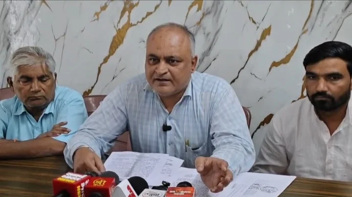
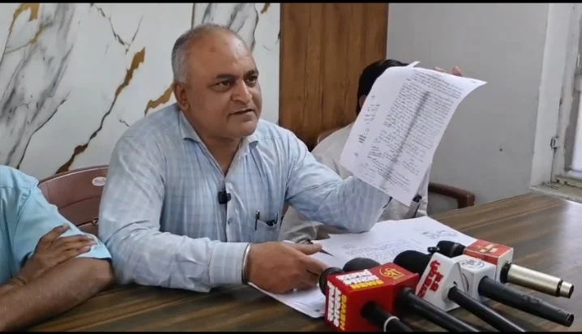
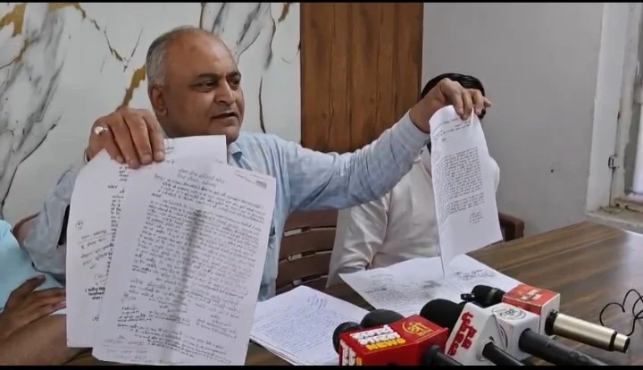

**हरिद्वार संवाददाता | आसिफ खान**

हरिद्वार। उत्तराखंड में भ्रष्टाचार के खिलाफ जीरो टॉलरेंस और आम जनता को त्वरित न्याय दिलाने के दावों के बीच भगवानपुर तहसील से सामने आया भूमि विवाद प्रशासनिक व्यवस्था की जवाबदेही पर बड़ा सवाल खड़ा कर रहा है। अपनी ही भूमि के मामले में न्याय की आस लगाए अभिषेक शर्मा का दावा है कि वह पिछले 14 वर्षों से सरकारी दफ्तरों के चक्कर काट रहे हैं, लेकिन उनकी समस्या का समाधान आज तक नहीं हुआ। पीड़ित ने प्रेस वार्ता कर तहसील प्रशासन और संबंधित अधिकारियों पर गंभीर आरोप लगाते हुए जिलाधिकारी हरिद्वार से न्याय की गुहार लगाई है।

मामला केवल जमीन की पैमाइश तक सीमित नहीं है। पीड़ित के आरोपों में कथित भूमि अधिग्रहण, सरकारी अभिलेखों में गड़बड़ी, लंबित कार्रवाई और रिश्वत मांगने का गंभीर दावा शामिल है। यदि इन आरोपों में सच्चाई है, तो यह केवल एक व्यक्ति की परेशानी नहीं, बल्कि सरकारी व्यवस्था की जवाबदेही से जुड़ा गंभीर मामला है। अब सवाल यह है कि आखिर इस पूरे प्रकरण की निष्पक्ष जांच कब होगी और जिम्मेदारी किसकी तय की जाएगी?

**सड़क बन गई, लेकिन जमीन का हिसाब अब तक साफ नहीं!**

अभिषेक शर्मा का आरोप है कि उनकी भूमि पर सड़क का निर्माण करा दिया गया, लेकिन भूमि अधिग्रहण और सरकारी रिकॉर्ड को लेकर स्थिति स्पष्ट नहीं हुई। पीड़ित का दावा है कि वह इस मामले को लेकर उच्च न्यायालय तक गए, लेकिन उनके अनुसार न्यायालय के आदेशों के बावजूद समस्या का समाधान नहीं हो सका।

सबसे बड़ा सवाल यह है कि यदि भूमि पर सड़क निर्माण हुआ, तो अधिग्रहण की प्रक्रिया क्या थी? भूमि का कितना हिस्सा लिया गया? मुआवजे और संबंधित रिकॉर्ड की स्थिति क्या है? इन सवालों का जवाब संबंधित विभागीय अभिलेखों और प्रशासन की जांच से ही सामने आ सकता है। लेकिन पीड़ित की मानें तो वर्षों बीत जाने के बाद भी उन्हें स्पष्ट जवाब और राहत का इंतजार है।

**छह हजार रुपये जमा, दो साल गुजर गए—फिर भी पैमाइश क्यों नहीं?**

पीड़ित ने बताया कि उन्होंने भूमि की पैमाइश के लिए एसडीएम भगवानपुर के यहां वाद दायर किया था। उनके अनुसार, उनसे छह हजार रुपये फीस जमा करने को कहा गया, जिसे उन्होंने करीब दो साल पहले जमा कर दिया था। इसके बावजूद उनकी भूमि की पैमाइश नहीं कराई गई। अभिषेक शर्मा का आरोप है कि बाद में उनके वाद को निस्तारित कर दिया गया।

यहां प्रशासनिक कार्यप्रणाली पर कई सवाल उठते हैं। फीस जमा होने के बाद पैमाइश क्यों नहीं हुई? यदि पैमाइश संभव नहीं थी, तो इसकी वजह क्या बताई गई? वाद निस्तारित करने का आधार क्या था? क्या पीड़ित को आदेश और कार्रवाई की स्पष्ट जानकारी दी गई?

फीस जमा कराने के बाद भी यदि वर्षों तक कार्रवाई नहीं होती, तो जवाबदेही तय करना जरूरी है। जिलाधिकारी को संबंधित फाइल, फीस की रसीद, आदेश-पत्र और कार्रवाई के रिकॉर्ड की जांच कराकर स्थिति स्पष्ट करनी चाहिए।

**एसडीएम पर पांच लाख रुपये मांगने का आरोप—जांच से खुलेगा सच!**

इस मामले का सबसे गंभीर पहलू अभिषेक शर्मा द्वारा भगवानपुर के एसडीएम देवेंद्र सिंह नेगी पर लगाया गया आरोप है। पीड़ित का दावा है कि करीब 10 से 12 दिन पहले उनका काम कराने के लिए उनसे पांच लाख रुपये मांगे गए थे। उनका आरोप है कि रुपये नहीं देने के बाद उनका मामला निस्तारित कर दिया गया।

यह आरोप सीधे प्रशासनिक पारदर्शिता और जवाबदेही से जुड़ा है। हालांकि, कथित मांग की स्वतंत्र पुष्टि नहीं हुई है और संबंधित अधिकारी का पक्ष सामने आना बाकी है। इसलिए आरोपों को जांच के माध्यम से सत्यापित किया जाना आवश्यक है।

यदि आरोप गलत हैं, तो निष्पक्ष जांच से सच्चाई सामने आनी चाहिए। और यदि आरोप सही पाए जाते हैं, तो जिम्मेदार व्यक्ति के खिलाफ नियमानुसार कठोर कार्रवाई होनी चाहिए। इतने गंभीर आरोप को बिना जांच के नजरअंदाज करना भी उचित नहीं होगा।

**खसरा संख्या 214 के रिकॉर्ड पर सवाल, मुख्यमंत्री हेल्पलाइन भी बेअसर?**

अभिषेक शर्मा ने खसरा संख्या 214 से संबंधित अभिलेखों में गड़बड़ी और भूमि अधिग्रहण की माप में अंतर होने का आरोप लगाया है। उनका कहना है कि उन्होंने अपनी शिकायत मुख्यमंत्री हेल्पलाइन नंबर 1905 पर भी दर्ज कराई, लेकिन समस्या का समाधान नहीं हुआ।

यदि शिकायत दर्ज होने के बाद भी पीड़ित को राहत नहीं मिली, तो यह जानना जरूरी है कि शिकायत पर किस अधिकारी ने कार्रवाई की, क्या जांच की गई और शिकायत का निस्तारण किस आधार पर हुआ। मुख्यमंत्री हेल्पलाइन पर दर्ज शिकायतों का उद्देश्य समस्याओं को संबंधित विभाग तक पहुंचाकर समाधान सुनिश्चित करना है। ऐसे में इस प्रकरण की शिकायत और उस पर हुई कार्रवाई के रिकॉर्ड की समीक्षा होनी चाहिए।

**जीरो टॉलरेंस के दावों की असली परीक्षा अब!**

मुख्यमंत्री की जीरो टॉलरेंस नीति के बीच अभिषेक शर्मा ने सवाल उठाया है कि जब एक व्यक्ति 14 साल तक न्याय के लिए संघर्ष करने का दावा कर रहा है, तो व्यवस्था उसकी समस्या का समाधान क्यों नहीं कर पाई? आखिर सरकारी दफ्तरों में आम नागरिक की सुनवाई की जिम्मेदारी किसकी है?

क्या जीरो टॉलरेंस केवल भाषणों और सरकारी दावों तक सीमित रहेगा, या गंभीर शिकायतों पर जवाबदेही भी तय होगी? क्या पीड़ित की भूमि से जुड़े दस्तावेजों की जांच होगी? क्या कथित रिश्वत मांगने के आरोप की स्वतंत्र जांच कराई जाएगी? और क्या वर्षों से लंबित इस विवाद में समयबद्ध कार्रवाई सुनिश्चित की जाएगी?

**ये सवाल अब जिला प्रशासन के सामने हैं।**

**जिलाधिकारी से सीधी मांग—फाइल खोलिए, रिकॉर्ड जांचिए, जवाबदेही तय कीजिए!**

अभिषेक शर्मा ने जिलाधिकारी हरिद्वार से मांग की है कि पूरे प्रकरण की निष्पक्ष और समयबद्ध जांच कराई जाए। भूमि के मूल दस्तावेजों, खसरा संख्या 214 के रिकॉर्ड, कथित अधिग्रहण, सड़क निर्माण, पैमाइश की फीस और वाद निस्तारण से संबंधित दस्तावेजों की जांच की जाए। साथ ही, एसडीएम पर लगाए गए पांच लाख रुपये मांगने के आरोप की भी निष्पक्ष जांच कराई जाए।

पीड़ित की मांग है कि यदि जांच में किसी अधिकारी या कर्मचारी की लापरवाही अथवा अनियमितता सामने आती है, तो उसके खिलाफ नियमानुसार कार्रवाई की जाए और भूमि विवाद का समाधान कर उन्हें न्याय दिलाया जाए।

अब सवाल केवल अभिषेक शर्मा की जमीन का नहीं, बल्कि सरकारी व्यवस्था पर आम जनता के भरोसे का भी है। 14 साल के संघर्ष का दावा करने वाले पीड़ित को क्या अब राहत मिलेगी? क्या जिला प्रशासन इस मामले में जवाबदेही तय करेगा? या फिर अभिषेक शर्मा को न्याय की उम्मीद में एक बार फिर दफ्तरों के चक्कर काटने पड़ेंगे?

फिलहाल, पीड़ित के आरोपों पर प्रशासनिक अधिकारियों का आधिकारिक पक्ष सामने आना बाकी है। अब देखना होगा कि जिलाधिकारी इस मामले में क्या कदम उठाते हैं और जांच के जरिए सच्चाई कब सामने आती है।
