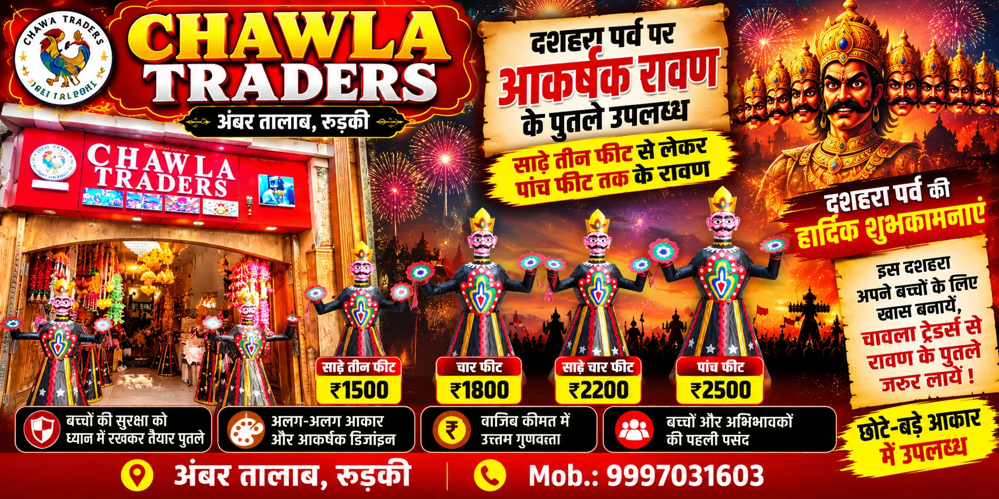
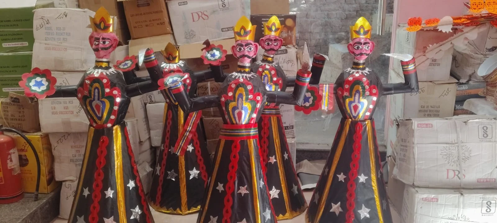
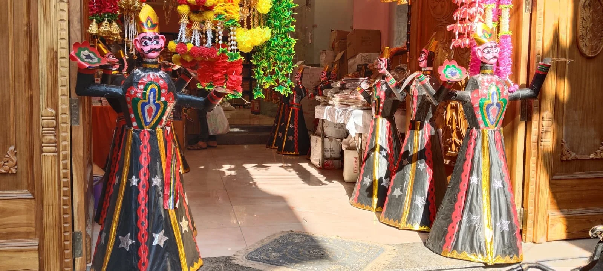

**रुड़की संवाददाता | आसिफ खान**

रुड़की। दशहरे का पर्व नजदीक आते ही रुड़की के बाजारों में त्योहार की रौनक तेज होने लगी है। कहीं खरीदारी की तैयारी है तो कहीं बच्चों में रावण दहन को लेकर उत्साह दिखाई दे रहा है। इसी बीच बाजार में रावण के पुतलों ने भी दस्तक दे दी है। इस बार साढ़े तीन फीट से लेकर पांच फीट तक के आकर्षक रावण बच्चों को अपनी ओर खींच रहे हैं। इन पुतलों की कीमत ₹1500 से शुरू होकर ₹2500 तक पहुंच रही है। अंबर तालाब स्थित चावला ट्रेडर्स पर सजे रावण के पुतले दशहरे से पहले लोगों के आकर्षण का केंद्र बन रहे हैं।

दशहरा केवल एक त्योहार नहीं, बल्कि बुराई पर अच्छाई की जीत का प्रतीक है। इस पर्व पर रावण दहन देखने के लिए बच्चों से लेकर बड़ों तक में खास उत्साह रहता है। हर साल की तरह इस बार भी परिवार अपने बच्चों के लिए दशहरे को यादगार बनाने की तैयारी में जुटे हैं। ऐसे में बाजार में उपलब्ध अलग-अलग आकार के रावण के पुतले लोगों को अपनी ओर आकर्षित कर रहे हैं।

**बच्चों की पसंद पर खास ध्यान, छोटे-बड़े आकार में रावण उपलब्ध**

अंबर तालाब स्थित चावला ट्रेडर्स पर इस बार साढ़े तीन फीट से लेकर पांच फीट तक के रावण के पुतले उपलब्ध कराए गए हैं। अलग-अलग आकार और सजावट वाले इन पुतलों को बच्चों की पसंद को ध्यान में रखकर मंगाया गया है। छोटे आकार के रावण उन परिवारों के लिए भी विकल्प बन रहे हैं, जो घर पर बच्चों के साथ दशहरे का उत्सव मनाना चाहते हैं।

दुकान पर उपलब्ध पुतलों की कीमत ₹1500 से ₹2500 तक रखी गई है। आकार और बनावट के हिसाब से कीमत तय की गई है, जिससे ग्राहक अपने बजट और पसंद के अनुसार खरीदारी कर सकते हैं। दशहरे से पहले बाजार में इन पुतलों की मौजूदगी ने त्योहार की तैयारियों को और गति दे दी है। दुकानदार को उम्मीद है कि पर्व नजदीक आने के साथ ग्राहकों की आवाजाही और बिक्री में तेजी आएगी।

**कमल चावला और रुचि चावला की दुकान पर दशहरे की रौनक**

चावला ट्रेडर्स पर कमल चावला एवं रुचि चावला की ओर से ग्राहकों की जरूरत और बच्चों की पसंद को ध्यान में रखते हुए रावण के पुतले उपलब्ध कराए गए हैं। दुकान पर अलग-अलग आकार के पुतले होने से अभिभावकों को अपनी पसंद का विकल्प चुनने में सुविधा मिल रही है। त्योहार के मौसम में ऐसे उत्पाद बाजार की रौनक बढ़ाने के साथ परिवारों को उत्सव की तैयारियों में भी मदद करते हैं।

दुकानदार रुचि चावला ने बताया कि इस बार बच्चों को आकर्षित करने के लिए अलग-अलग आकार के रावण के पुतले मंगाए गए हैं। इनकी कीमत आकार और बनावट के अनुसार रखी गई है, ताकि लोग अपनी पसंद और बजट के मुताबिक पुतले खरीद सकें। उन्होंने उम्मीद जताई कि दशहरे तक इनकी मांग में और बढ़ोतरी होगी।

**बच्चों की सुरक्षा भी अहम, जिम्मेदारी से मनाएं त्योहार**

रावण के पुतलों के साथ बच्चों की सुरक्षा को लेकर भी विशेष ध्यान देने की जरूरत है। रुचि चावला के अनुसार, पुतलों में हल्के विस्फोटक लगाए गए हैं, ताकि तेज धमाकों और पटाखों से होने वाले संभावित नुकसान को कम किया जा सके। हालांकि, विस्फोटक सामग्री की सुरक्षा और उसके इस्तेमाल को लेकर अभिभावकों को सतर्क रहना चाहिए।

विशेषज्ञ सावधानी के तौर पर रावण दहन के दौरान बच्चों को सुरक्षित दूरी पर रखने, पुतले में आग लगाने का काम केवल जिम्मेदार वयस्क से कराने और ज्वलनशील सामग्री से दूर रहने की सलाह देते हैं। त्योहार की खुशियां तभी सार्थक हैं, जब उत्साह के साथ सुरक्षा का भी पूरा ध्यान रखा जाए।

**घर पर रावण बनाने की मशक्कत से मिलेगी राहत**

दशहरे पर कई अभिभावक बच्चों के लिए घर में रावण का पुतला तैयार करते हैं। इसके लिए सामग्री जुटाने से लेकर पुतला बनाने तक काफी समय और मेहनत लगती है। अब बाजार में तैयार रावण के पुतले उपलब्ध होने से परिवारों को इस झंझट से राहत मिल सकती है। वे अपनी पसंद और बजट के अनुसार पुतला खरीदकर बच्चों के साथ पर्व का आनंद ले सकते हैं।

बच्चों के लिए रावण का पुतला केवल खिलौने जैसी आकर्षक वस्तु नहीं, बल्कि दशहरे की परंपरा और रावण दहन से जुड़ी उत्सुकता का हिस्सा भी है। यही वजह है कि त्योहार से पहले छोटे आकार के पुतलों की मांग को लेकर दुकानदारों में भी उम्मीद दिखाई दे रही है।

**दशहरे से पहले बाजार में बढ़ी हलचल**

दशहरे की तारीख नजदीक आने के साथ रुड़की के बाजारों में खरीदारी बढ़ने की उम्मीद है। रावण के पुतलों से लेकर त्योहार से जुड़ी अन्य वस्तुओं तक, दुकानदार ग्राहकों की पसंद के अनुरूप तैयारी कर रहे हैं। चावला ट्रेडर्स पर साढ़े तीन से पांच फीट तक के रावण और ₹1500 से ₹2500 तक की कीमत ने ग्राहकों के सामने अलग-अलग विकल्प रखे हैं।

अब देखना होगा कि दशहरे तक रावण के इन आकर्षक पुतलों की मांग कितनी बढ़ती है। फिलहाल, चावला ट्रेडर्स पर सजे रावण बच्चों के उत्साह और दशहरे की तैयारियों को लेकर बाजार में खास चर्चा बटोर रहे हैं।
