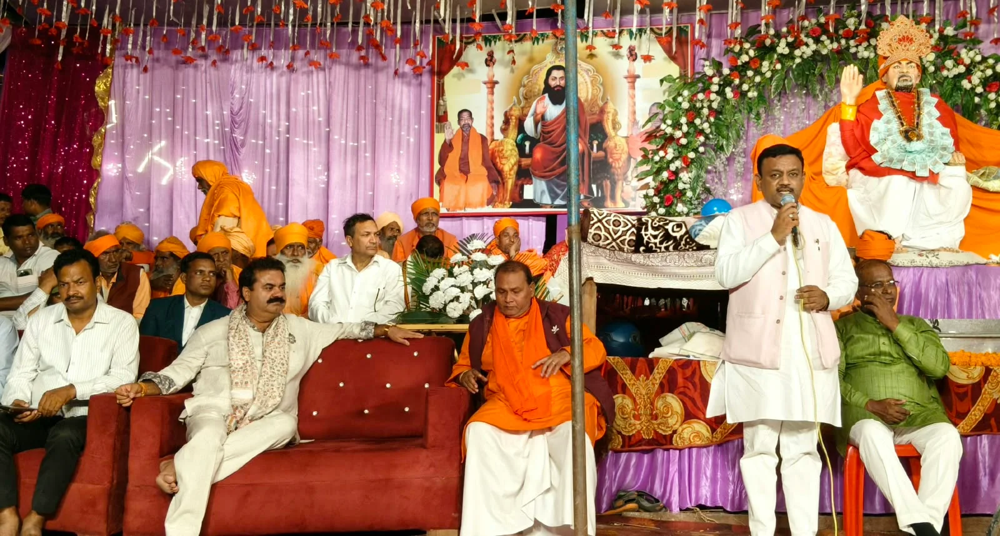
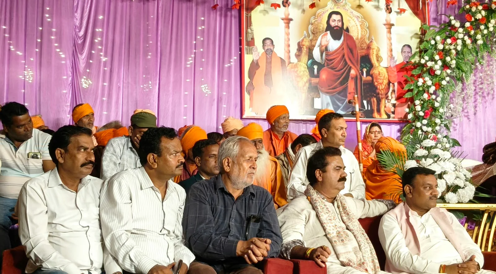

**रुड़की विशेष संवाददाता | आसिफ खान** 

रुड़की। ग्राम बाजूहेड़ी स्थित स्वामी समनदास आश्रम में स्वामी समनदास जी का जन्मोत्सव बड़े ही धूमधाम, श्रद्धा और उत्साह के साथ मनाया गया। जन्मोत्सव में दूर-दराज के क्षेत्रों से हजारों की संख्या में श्रद्धालु पहुंचे। पूरा परिसर भक्ति और आस्था के रंग में सराबोर नजर आया। देर रात तक धार्मिक भजनों की गूंज के बीच श्रद्धालु झूमते रहे और स्वामी जी के प्रति अपनी श्रद्धा प्रकट करते रहे।

जन्मोत्सव कार्यक्रम में मुख्य रूप से पहुंचे खानपुर विधायक उमेश कुमार शर्मा तथा पूर्व मेयर गौरव गोयल ने स्वामी समनदास जी को नमन करते हुए उनके जीवन और समाज के प्रति योगदान को याद किया। अतिथियों ने कहा कि स्वामी समनदास जी ने अपना संपूर्ण जीवन समाज के उत्थान और कल्याण के लिए समर्पित किया। उन्होंने समाज को नई दिशा देने के साथ ही लोगों को सद्भावना, समानता और आपसी भाईचारे का संदेश दिया। समाज के कल्याण के लिए उनके द्वारा किए गए कार्य सदैव प्रेरणास्रोत बने रहेंगे।

**शिक्षा, समानता और सामाजिक समरसता का दिया संदेश**

अतिथियों ने कहा कि स्वामी समनदास जी के विचार आज भी समाज के लिए प्रासंगिक हैं। उनके आदर्शों को केवल याद करना ही पर्याप्त नहीं है, बल्कि उन्हें अपने जीवन में अपनाना भी जरूरी है। सभी को मिलकर ऐसे समाज के निर्माण के लिए आगे आना चाहिए, जहां शिक्षा का विस्तार हो, आर्थिक संपन्नता बढ़े और प्रत्येक व्यक्ति को सम्मान तथा समान अवसर प्राप्त हों।

उन्होंने कहा कि सामाजिक समरसता, सद्भावना और समानता ही एक मजबूत समाज की आधारशिला हैं। स्वामी जी की शिक्षाओं से प्रेरणा लेकर समाज में फैली कुरीतियों को दूर करने और नई पीढ़ी को बेहतर संस्कार देने की दिशा में सामूहिक प्रयास किए जाने चाहिए।

**भजनों से भक्तिमय हुआ माहौल, भंडारे में उमड़े श्रद्धालु**

जन्मोत्सव के दौरान धार्मिक भजनों और भक्ति गीतों ने पूरे वातावरण को भक्तिमय बना दिया। श्रद्धालु देर रात तक भजनों पर झूमते नजर आए। कार्यक्रम में बड़ी संख्या में पहुंचे लोगों ने स्वामी समनदास जी को श्रद्धासुमन अर्पित किए और उनके बताए मार्ग पर चलने का संकल्प लिया।

इस अवसर पर आयोजित भंडारे में भी बड़ी संख्या में श्रद्धालुओं ने पहुंचकर प्रसाद ग्रहण किया। पूरे आयोजन में श्रद्धा, सेवा और सामाजिक एकता की भावना देखने को मिली।

कार्यक्रम में आश्रम के प्रबंधक महात्मा प्रेमदास, राजेश कुमार, अभिषेक कुमार, तेजपाल मौर्य, सोमपाल सिंह, चंद्रशेखर जाटव सहित अनेक गणमान्य व्यक्ति एवं श्रद्धालु प्रमुख रूप से उपस्थित रहे।

संदेश स्पष्ट रहा—स्वामी समनदास जी के आदर्शों को आत्मसात कर शिक्षा, समानता, सद्भावना और सामाजिक समरसता से परिपूर्ण समाज का निर्माण करना ही उनके प्रति सच्ची श्रद्धांजलि है।
