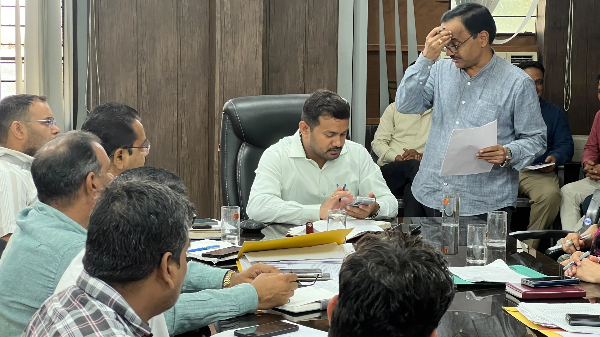
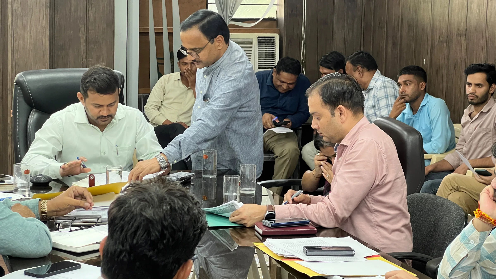
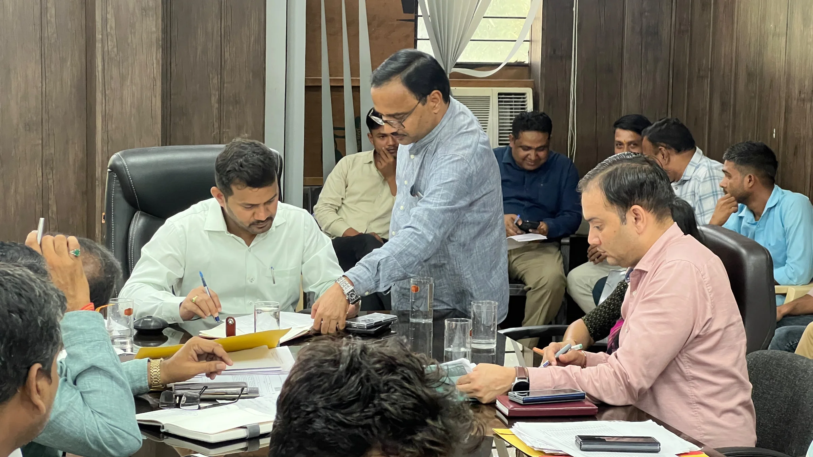

**हरिद्वार संवाददाता | आसिफ खान**

रुड़की। आगामी जनगणना की तैयारियों को लेकर प्रशासन ने कमर कसनी शुरू कर दी है। जनगणना से जुड़ी प्रत्येक गतिविधि को प्रभावी, पारदर्शी और समयबद्ध तरीके से पूरा कराने के लिए संयुक्त मजिस्ट्रेट रुड़की दीपक रामचंद्र शेट की अध्यक्षता में महत्वपूर्ण बैठक आयोजित की गई। बैठक में संबंधित विभागों के अधिकारियों, चार्ज अधिकारियों और डेटा ऑपरेटरों को जनगणना की तैयारियां निर्धारित समयसीमा के भीतर पूरी करने तथा शासन के दिशा-निर्देशों का सख्ती से पालन सुनिश्चित करने के निर्देश दिए गए।

बैठक में जनगणना तहसीलदार रुड़की, खंड शिक्षा अधिकारी (बीईओ) रुड़की, नगर पालिका मंगलौर, पाडली गुर्जर एवं पिरान कलियर के अधिशासी अधिकारियों सहित विभिन्न विभागों के चार्ज अधिकारी और डेटा ऑपरेटर शामिल हुए। बैठक का मुख्य उद्देश्य जनगणना संबंधी कार्यों की तैयारियों की समीक्षा करना, विभागों के बीच बेहतर तालमेल स्थापित करना और आगामी प्रक्रिया को व्यवस्थित ढंग से आगे बढ़ाना रहा।

**डेटा में गलती की गुंजाइश नहीं, जिम्मेदारी से करना होगा काम**

बैठक के दौरान जनगणना के अंतर्गत होने वाली विभिन्न गतिविधियों, कार्मिकों की जिम्मेदारियों, डेटा संकलन, डिजिटल प्रविष्टि और अभिलेखों के सुव्यवस्थित रखरखाव पर विस्तार से चर्चा की गई। अधिकारियों को निर्देशित किया गया कि वे अपने-अपने क्षेत्रों में आवश्यक व्यवस्थाओं की समय रहते समीक्षा करें और जनगणना कार्य में किसी भी प्रकार की अव्यवस्था से बचने के लिए पहले से तैयारी सुनिश्चित करें।

डेटा ऑपरेटरों को विशेष रूप से निर्देश दिए गए कि आंकड़ों की प्रविष्टि करते समय शुद्धता का पूरा ध्यान रखा जाए। अभिलेखों को व्यवस्थित रखा जाए और निर्धारित प्रक्रिया के अनुसार ही सभी कार्य संपादित किए जाएं, ताकि आंकड़ों में त्रुटियों की आशंका कम हो और सूचनाओं का संकलन विश्वसनीय तरीके से किया जा सके।

**राष्ट्रीय महत्व का कार्य है जनगणना**

संयुक्त मजिस्ट्रेट दीपक रामचंद्र शेट ने कहा कि जनगणना एक महत्वपूर्ण राष्ट्रीय कार्य है। इससे प्राप्त आंकड़े भविष्य की विकास योजनाओं, नीतियों और विभिन्न प्रशासनिक आवश्यकताओं के निर्धारण में अहम भूमिका निभाते हैं। ऐसे में सभी संबंधित अधिकारियों और कर्मचारियों की जिम्मेदारी है कि वे इस कार्य को गंभीरता, तत्परता और जवाबदेही के साथ पूरा करें।

उन्होंने अधिकारियों को आपसी समन्वय बनाए रखने, आवश्यक संसाधनों एवं व्यवस्थाओं की समय रहते समीक्षा करने तथा जनगणना से संबंधित दायित्वों का प्रभावी ढंग से निर्वहन करने के निर्देश दिए।

**संभावित समस्याओं का तत्काल समाधान करने पर जोर**

बैठक में यह भी स्पष्ट किया गया कि जनगणना कार्य के दौरान सामने आने वाली संभावित समस्याओं का त्वरित समाधान किया जाए। विभिन्न विभागों के बीच सूचनाओं का आदान-प्रदान समयबद्ध तरीके से हो, ताकि किसी भी स्तर पर कार्य प्रभावित न हो। अधिकारियों को निर्देशित किया गया कि शासन और जनगणना निदेशालय की ओर से जारी दिशा-निर्देशों का अनुपालन सुनिश्चित करते हुए तैयारियों को प्राथमिकता के आधार पर पूरा करें।

प्रशासन का जोर इस बात पर है कि जनगणना से जुड़ी सभी गतिविधियां सुव्यवस्थित, पारदर्शी और निर्धारित समयसीमा के भीतर संपन्न हों। बैठक में संबंधित विभागों के अधिकारियों, चार्ज अधिकारियों और डेटा ऑपरेटरों ने प्रतिभाग किया।
