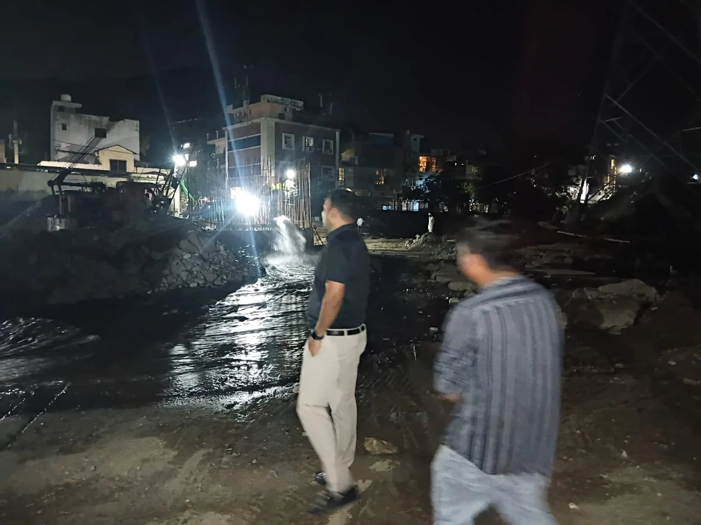
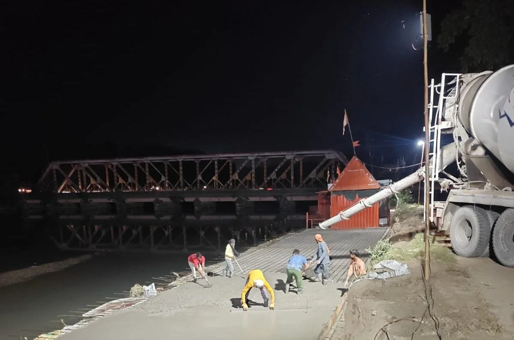
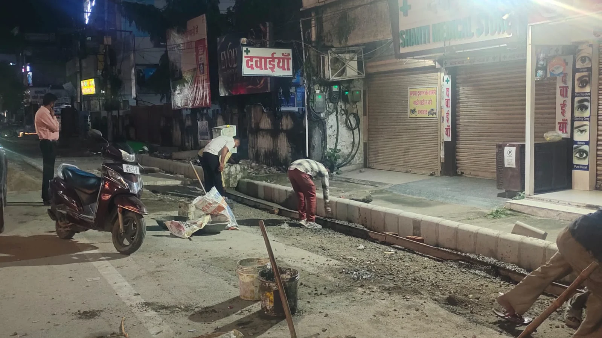

**हरिद्वार संवाददाता | आसिफ खान**

हरिद्वार। कुंभ मेला-2027 की तैयारियों को लेकर मेला प्रशासन ने निगरानी का दायरा बढ़ा दिया है। निर्माण कार्यों में देरी रोकने और निर्धारित समयसीमा के भीतर गुणवत्ता के साथ काम पूरा कराने के लिए अब दिन ही नहीं, रात की पाली में भी निर्माण स्थलों का निरीक्षण किया जा रहा है। इसी क्रम में मेलाधिकारी श्रीमती सोनिका के निर्देश पर अपर मेलाधिकारी दयानंद सरस्वती ने पिछली मध्य रात्रि विभिन्न निर्माण स्थलों पर पहुंचकर कार्यों की प्रगति का जायजा लिया और संबंधित अधिकारियों को जरूरी निर्देश दिए।

कुंभ जैसे बड़े आयोजन की तैयारियों में किसी भी स्तर पर अनावश्यक विलंब न हो, इसके लिए मेला प्रशासन कंट्रोल रूम की रिपोर्ट, ऑनलाइन निगरानी और मौके पर निरीक्षण के जरिए निर्माण कार्यों की वास्तविक स्थिति पर नजर रख रहा है। अधिकारियों को स्पष्ट निर्देश दिए जा रहे हैं कि जहां श्रमिकों की कमी है, वहां श्रमबल बढ़ाया जाए और उपलब्ध संसाधनों का पूरा उपयोग करते हुए कार्यों को निर्धारित गति से आगे बढ़ाया जाए।

**खड़खड़ी से भूपतवाला-जटवाड़ा तक निर्माण कार्यों की पड़ताल**

निरीक्षण के दौरान अपर मेलाधिकारी दयानंद सरस्वती ने खड़खड़ी में सूखी नदी पर निर्माणाधीन पुल की प्रगति देखी। इसके साथ ही भूपतवाला से जटवाड़ा पुल तक पुरानी दिल्ली-नीति पास मार्ग पर सड़क चौड़ीकरण, फुटपाथ निर्माण और अन्य संबंधित कार्यों की स्थिति का जायजा लिया। उन्होंने घाटों पर चल रहे निर्माण कार्यों की जानकारी भी ली और संबंधित अधिकारियों को आवश्यक दिशा-निर्देश दिए।

निरीक्षण के दौरान कार्यों की रफ्तार बनाए रखने के साथ गुणवत्ता और सुरक्षा मानकों का पालन सुनिश्चित करने पर जोर दिया गया। अधिकारियों को निर्देश दिए गए कि निर्माण स्थलों पर जरूरत के मुताबिक श्रमिकों की संख्या बढ़ाई जाए, संसाधनों का प्रभावी इस्तेमाल हो और काम में ऐसी कोई कमी न रहे, जिससे निर्धारित समयसीमा प्रभावित हो।

**कंट्रोल रूम से हर दिन की प्रगति पर नजर**

कुंभ-2027 के निर्माण कार्यों की निगरानी के लिए रोशनाबाद स्थित जिला आपातकालीन परिचालन केंद्र (डीडीएमए) में स्थापित कंट्रोल रूम का भी इस्तेमाल किया जा रहा है। यहां से मेला क्षेत्र में चल रहे कार्यों की दैनिक प्रगति और अलग-अलग पालियों में किए जा रहे काम की जानकारी जुटाई जा रही है। ऑनलाइन माध्यमों से मिलने वाले विवरण और शिफ्टवार रिपोर्ट के आधार पर संबंधित विभागों तथा कार्यदायी संस्थाओं को जरूरी निर्देश दिए जा रहे हैं।

मेला प्रशासन कार्यस्थलवार समीक्षा कर यह सुनिश्चित करने में जुटा है कि हर निर्माण स्थल पर पर्याप्त श्रमिक उपलब्ध हों और काम निर्धारित योजना के अनुसार आगे बढ़े। जिन स्थलों पर श्रमिकों की तैनाती कम पाई जाती है या प्रगति संतोषजनक नहीं होती, वहां सुधार करने और श्रमबल बढ़ाने के निर्देश दिए जा रहे हैं। दैनिक रिपोर्ट उपलब्ध नहीं होने पर संबंधित विभागों से समन्वय कर जानकारी जुटाने पर भी ध्यान दिया जा रहा है।

**निर्माण की गुणवत्ता पर भी रहेगी तीसरी एजेंसी की नजर**

मेला प्रशासन ने स्पष्ट किया है कि निर्माण कार्यों में केवल तेजी ही नहीं, बल्कि गुणवत्ता और सुरक्षा मानकों का पालन भी जरूरी है। इसी उद्देश्य से निर्माण कार्यों की नियमित तृतीय पक्ष जांच कराने पर जोर दिया गया है। कंट्रोल रूम से प्राप्त रिपोर्ट और ऑनलाइन विवरण के आधार पर दर्ज प्रगति का स्थलीय निरीक्षण के दौरान सत्यापन भी किया जा रहा है, ताकि काम की वास्तविक स्थिति का आकलन किया जा सके।

इस व्यवस्था के जरिए निर्माण स्थलों पर सामने आने वाली कमियों और बाधाओं को समय रहते चिह्नित कर उनके समाधान के लिए कदम उठाने पर जोर दिया जा रहा है। संबंधित अधिकारियों और कार्यदायी संस्थाओं को निर्देश हैं कि कार्यों की गुणवत्ता से समझौता किए बिना निर्धारित समयसीमा का पालन सुनिश्चित करें।

**सूचना बोर्ड पर लागत से लेकर ठेकेदार का नंबर तक होगा दर्ज**

निर्माण कार्यों में पारदर्शिता और जवाबदेही सुनिश्चित करने के लिए मेलाधिकारी श्रीमती सोनिका ने सभी कार्यस्थलों पर सूचना बोर्ड अनिवार्य रूप से लगाने के निर्देश दिए हैं। इन बोर्डों पर कार्य का नाम, स्वीकृत लागत, कार्य प्रारंभ होने की तिथि, निर्धारित पूर्णता तिथि तथा संबंधित ठेकेदार और अभियंताओं के दूरभाष नंबर स्पष्ट रूप से अंकित किए जाने हैं।

इससे निर्माण कार्यों से जुड़ी बुनियादी जानकारी उपलब्ध रहेगी और संबंधित कार्यों की जिम्मेदारी तय करने में भी मदद मिलेगी। मेला प्रशासन की कोशिश है कि निगरानी व्यवस्था केवल कागजी रिपोर्ट तक सीमित न रहे, बल्कि निर्माण स्थलों पर वास्तविक प्रगति और गुणवत्ता भी सुनिश्चित हो।

**कुंभ से पहले सड़क, पुल और घाटों के काम पूरे करना प्राथमिकता**

कुंभ मेला-2027 को देखते हुए सड़कों, पुलों, घाटों और अन्य आधारभूत सुविधाओं से जुड़े निर्माण कार्यों को समयबद्ध तरीके से पूरा करना मेला प्रशासन की प्राथमिकताओं में शामिल है। इसके लिए विभागीय समन्वय, संसाधनों की उपलब्धता, नियमित निरीक्षण और गुणवत्ता जांच पर विशेष ध्यान दिया जा रहा है।

रात में निरीक्षण, ऑनलाइन निगरानी और कंट्रोल रूम से समीक्षा के जरिए प्रशासन निर्माण कार्यों की प्रगति पर लगातार नजर बनाए हुए है। अब इन व्यवस्थाओं की असली कसौटी यह होगी कि निर्धारित समयसीमा के भीतर सभी जरूरी कार्य गुणवत्ता और सुरक्षा मानकों के अनुरूप पूरे हों, ताकि कुंभ के दौरान देश-विदेश से आने वाले श्रद्धालुओं को बेहतर सुविधाएं उपलब्ध कराई जा सकें।
