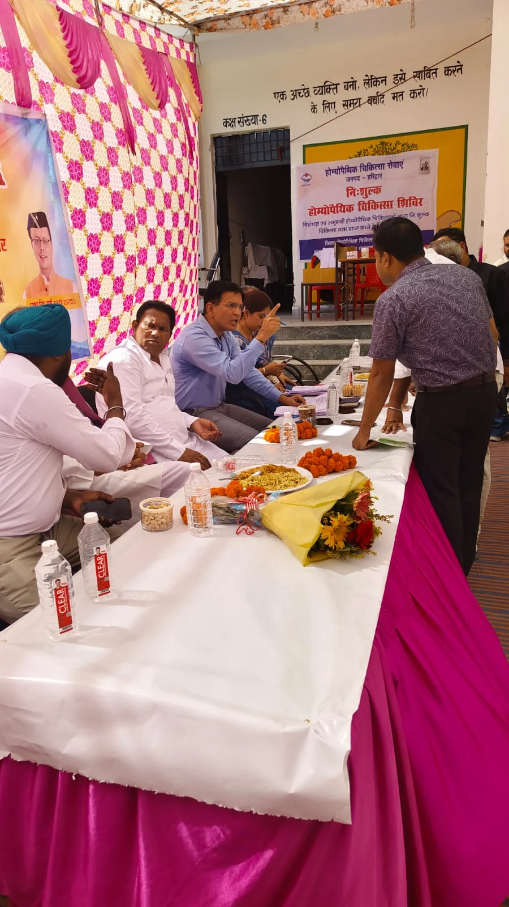
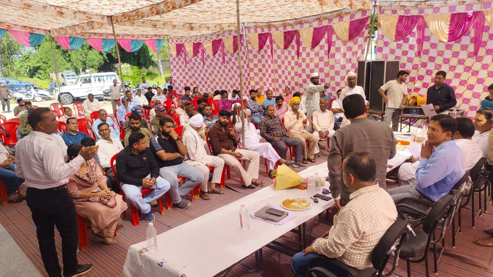
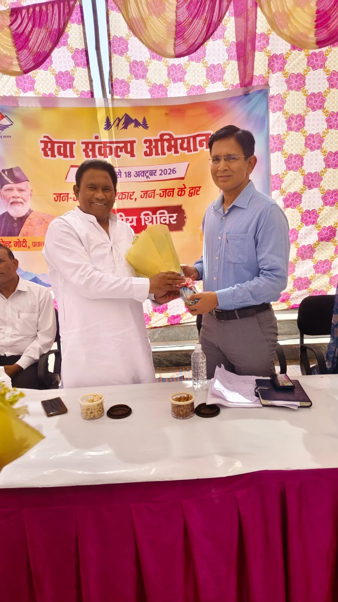

**हरिद्वार संवाददाता | आसिफ खान**

बुग्गावाला। सरकारी योजनाओं का लाभ लेने के लिए अब ग्रामीणों को दफ्तरों के चक्कर न काटने पड़ें, इसी उद्देश्य से सेवा संकल्प अभियान ‘जन-जन की सरकार, जन-जन के द्वार’ के तहत विकासखंड भगवानपुर के अटल उत्कर्ष कन्या इंटर कॉलेज, बुग्गावाला में बहुद्देशीय शिविर आयोजित किया गया। राज्य मंत्री श्यामवीर सैनी की अध्यक्षता में आयोजित शिविर में 675 नागरिकों ने प्रतिभाग किया, जबकि 615 लाभार्थियों को विभिन्न सरकारी योजनाओं का लाभ प्रदान किया गया। शिविर में 25 विभागों ने स्टॉल लगाकर लोगों को सरकारी योजनाओं की जानकारी दी और पात्र लाभार्थियों के आवेदन प्राप्त किए।

**जनसमस्याओं के समाधान पर जोर, अधिकारियों को समयसीमा में कार्रवाई के निर्देश**

उत्तराखंड शासन के निर्देशों तथा जिलाधिकारी मयूर दीक्षित के निर्देशन में आयोजित शिविर में राज्य मंत्री श्यामवीर सैनी ने कहा कि प्रदेश सरकार जनहित को सर्वोच्च प्राथमिकता दे रही है। सरकार का प्रयास है कि गांवों में ही लोगों को विभिन्न विभागों की सेवाएं उपलब्ध हों और पात्र व्यक्तियों को जनकल्याणकारी योजनाओं का लाभ मिल सके। उन्होंने कहा कि ऐसे शिविर ग्रामीणों की समस्याओं को सुनने और उनके समाधान की दिशा में महत्वपूर्ण भूमिका निभाते हैं।

उन्होंने कहा कि ‘जन-जन की सरकार, जन-जन के द्वार’ अभियान का उद्देश्य सरकारी सुविधाओं को आमजन तक पहुंचाना और लोगों को अनावश्यक रूप से सरकारी कार्यालयों के चक्कर लगाने से राहत दिलाना है। शिविरों के माध्यम से लोगों की शिकायतें सुनकर उनका त्वरित निस्तारण सुनिश्चित किया जा रहा है।

**56 शिकायतें पहुंचीं, 39 का मौके पर निस्तारण**

शिविर में विभिन्न समस्याओं को लेकर कुल 56 शिकायतें प्राप्त हुईं। इनमें से 39 शिकायतों का मौके पर ही निस्तारण किया गया, जबकि शेष शिकायतें संबंधित अधिकारियों को आवश्यक कार्रवाई के लिए भेजी गईं। अधिकारियों को निर्देश दिए गए कि लंबित शिकायतों को गंभीरता से लेते हुए निर्धारित समयसीमा के भीतर उनका निस्तारण सुनिश्चित किया जाए।

राज्य मंत्री देशराज कर्णवाल ने भी अधिकारियों को जनसमस्याओं के समाधान में किसी प्रकार की लापरवाही नहीं बरतने के निर्देश दिए। उन्होंने कहा कि आमजन की शिकायतों और आवेदनों पर गंभीरता से कार्रवाई की जाए तथा सभी विभाग आपसी समन्वय के साथ कार्य करते हुए लोगों को राहत पहुंचाएं। उन्होंने यह भी कहा कि सरकारी योजनाओं का लाभ प्रत्येक पात्र व्यक्ति तक पहुंचना चाहिए और जनहित से जुड़े मामलों में अनावश्यक देरी नहीं होनी चाहिए।

**25 विभागों ने लगाए स्टॉल, एक ही छत के नीचे मिली योजनाओं की जानकारी**

शिविर में 25 विभागों की ओर से स्टॉल लगाए गए। इन स्टॉलों के माध्यम से क्षेत्रवासियों को विभिन्न सरकारी योजनाओं, विभागीय सेवाओं और पात्रता संबंधी जानकारी उपलब्ध कराई गई। साथ ही, पात्र लोगों के आवेदन प्राप्त कर उन्हें योजनाओं से जोड़ने की प्रक्रिया भी अपनाई गई। शिविर में 615 लाभार्थियों को विभिन्न सरकारी योजनाओं का लाभ दिया गया।

इस पहल से ग्रामीणों को एक ही स्थान पर विभिन्न विभागों से संबंधित जानकारी और सेवाएं प्राप्त करने का अवसर मिला। अभियान के माध्यम से प्रशासन की ओर से जनसमस्याओं के समाधान और सरकारी योजनाओं की पहुंच बढ़ाने पर जोर दिया गया।

**एसडीएम ने दिया त्वरित कार्रवाई का भरोसा**

उप जिलाधिकारी भगवानपुर देवेंद्र सिंह नेगी ने राज्य मंत्री को आश्वस्त किया कि उनके निर्देशों के अनुरूप संबंधित अधिकारियों को आवश्यक कार्रवाई के लिए निर्देशित किया जाएगा। उन्होंने कहा कि ग्रामीणों एवं स्थानीय नागरिकों की समस्याओं का नियमानुसार प्राथमिकता के आधार पर निस्तारण किया जाएगा। इसके साथ ही विभिन्न विभागों के बीच समन्वय स्थापित कर योजनाओं का प्रभावी क्रियान्वयन सुनिश्चित करने का प्रयास किया जाएगा।

शिविर में वरिष्ठ भाजपा नेता सुशील त्यागी, खंड विकास अधिकारी राजेंद्र जोशी सहित संबंधित विभागों के अधिकारी, जनप्रतिनिधि और बड़ी संख्या में क्षेत्रीय नागरिक मौजूद रहे।

**आंकड़ों में शिविर की उपलब्धि**

675 नागरिकों ने शिविर में प्रतिभाग किया।

615 लाभार्थियों को विभिन्न सरकारी योजनाओं का लाभ मिला।

25 विभागों ने स्टॉल लगाकर योजनाओं की जानकारी दी।

56 शिकायतें प्राप्त हुईं।

39 शिकायतों का मौके पर निस्तारण किया गया।

शेष शिकायतें संबंधित अधिकारियों को कार्रवाई के लिए भेजी गईं।
