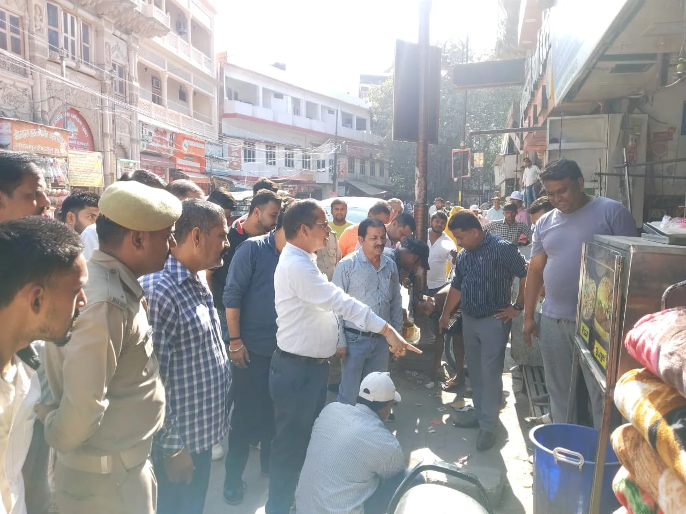

**हरिद्वार संवाददाता | आसिफ खान**

हरिद्वार। कुंभ मेला-2027 की तैयारियों को लेकर जिला प्रशासन ने शहर में अवैध अतिक्रमण के खिलाफ कार्रवाई तेज कर दी है। जिलाधिकारी मयूर दीक्षित के निर्देशन में शनिवार को सिटी मजिस्ट्रेट हर गिरी के नेतृत्व में वाल्मीकि चौक से मंशा देवी मार्ग तक अतिक्रमण हटाओ अभियान चलाया गया। जिला प्रशासन, नगर निगम और पुलिस की संयुक्त टीम ने सड़क किनारे किए गए अतिक्रमण को हटाने की कार्रवाई की। अभियान के जरिए स्पष्ट संदेश दिया गया कि शहर की सड़कों पर अनधिकृत कब्जे और निर्धारित सीमा से बाहर सामान रखने की अनुमति नहीं दी जाएगी।

**सड़क किनारे अतिक्रमण पर कार्रवाई, आवागमन सुचारु करने पर जोर**

कुंभ मेले के दौरान हरिद्वार में श्रद्धालुओं की बढ़ती आवाजाही को देखते हुए सड़कों को अतिक्रमण मुक्त रखने की कवायद तेज की जा रही है। वाल्मीकि चौक से मंशा देवी मार्ग तक चलाए गए अभियान में प्रशासनिक टीम ने सड़क किनारे किए गए अतिक्रमण को हटाने की कार्रवाई की। प्रशासन का उद्देश्य मार्गों पर आवागमन सुचारु बनाए रखना और यातायात व्यवस्था को बेहतर करना है, ताकि कुंभ मेले के दौरान श्रद्धालुओं और स्थानीय लोगों को अनावश्यक परेशानी का सामना न करना पड़े।

**पीली पट्टी के बाहर सामान रखा तो होगी कार्रवाई**

सिटी मजिस्ट्रेट हर गिरी ने दुकानदारों और फड़-ठेली संचालकों को स्पष्ट चेतावनी दी कि प्रशासन द्वारा निर्धारित पीली पट्टी के बाहर किसी भी प्रकार का फड़, ठेली या अन्य सामान रखने पर संबंधित सामान जब्त किया जा सकता है। साथ ही नियमानुसार आवश्यक कार्रवाई भी की जाएगी।

उन्होंने सभी दुकानदारों और फड़-ठेली संचालकों से निर्धारित सीमा के भीतर ही अपना सामान रखने तथा प्रशासन के निर्देशों का पालन करने की अपील की। उन्होंने स्पष्ट किया कि नियमों का उल्लंघन करने वालों के विरुद्ध नियमानुसार कार्रवाई की जाएगी।

**कुंभ की तैयारियों के बीच अभियान जारी रखने के निर्देश**

जिला प्रशासन की ओर से स्पष्ट किया गया है कि शहर में अवैध अतिक्रमण के खिलाफ अभियान लगातार जारी रहेगा। कुंभ-2027 के मद्देनजर सड़कों, प्रमुख मार्गों और आवागमन व्यवस्था को व्यवस्थित रखने पर विशेष ध्यान दिया जा रहा है।

प्रशासन की इस कार्रवाई से अतिक्रमण करने वालों को साफ संदेश दिया गया है कि निर्धारित सीमाओं का उल्लंघन करने पर कार्रवाई का सामना करना पड़ सकता है। अब अभियान की निरंतरता और नियमों के पालन से ही शहर की यातायात व्यवस्था को सुचारु बनाए रखने की चुनौती पूरी हो सकेगी।
