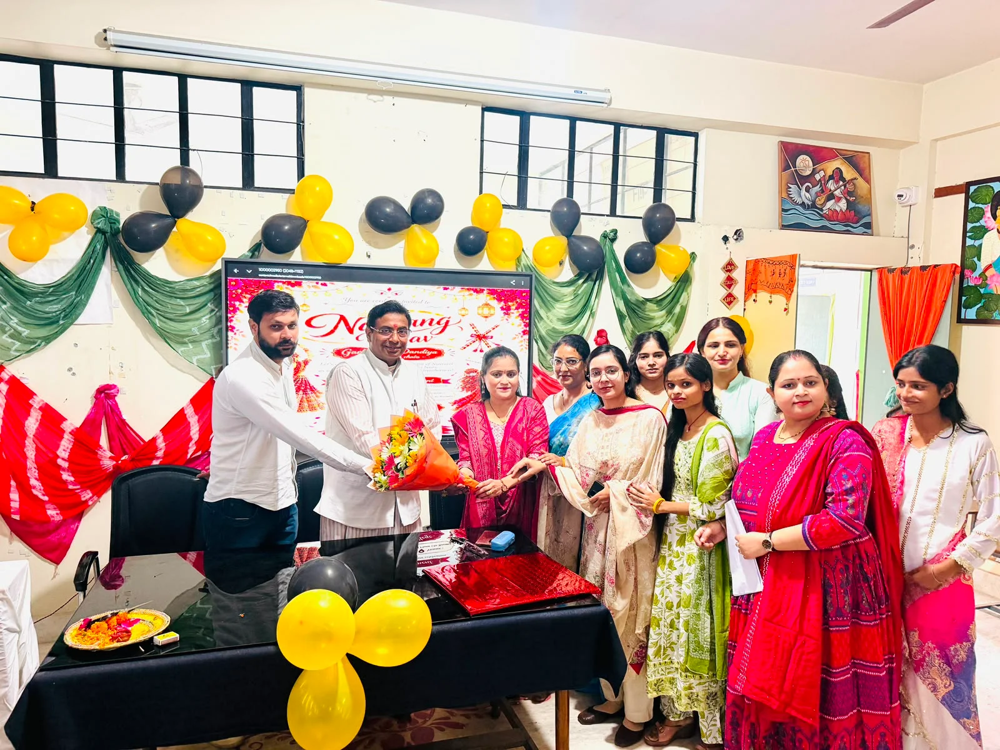
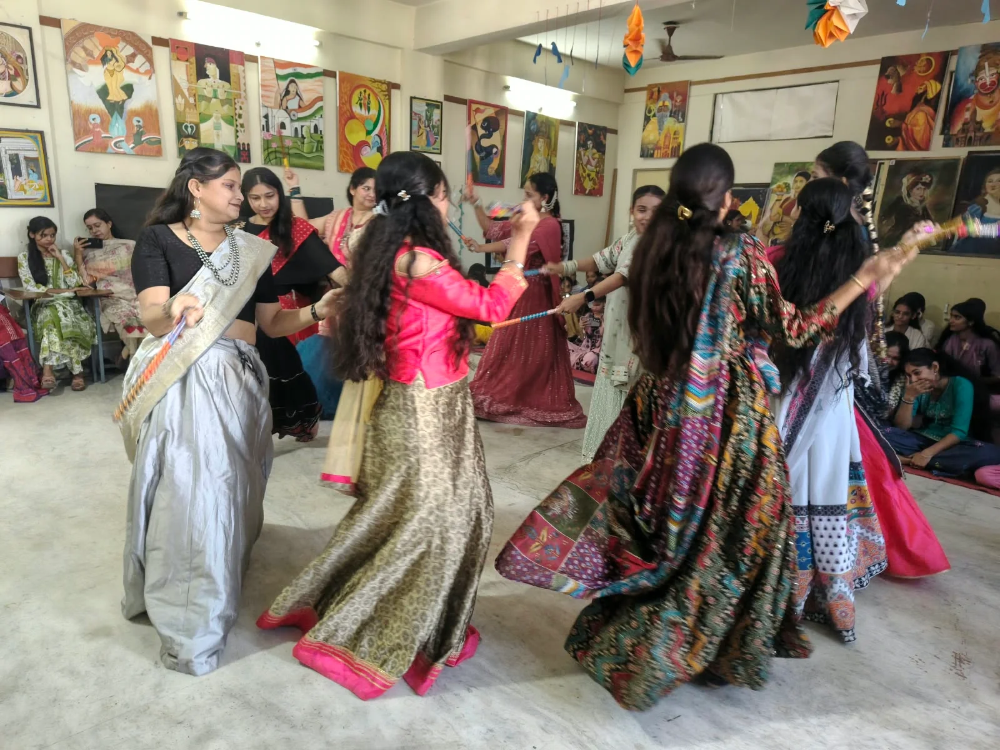
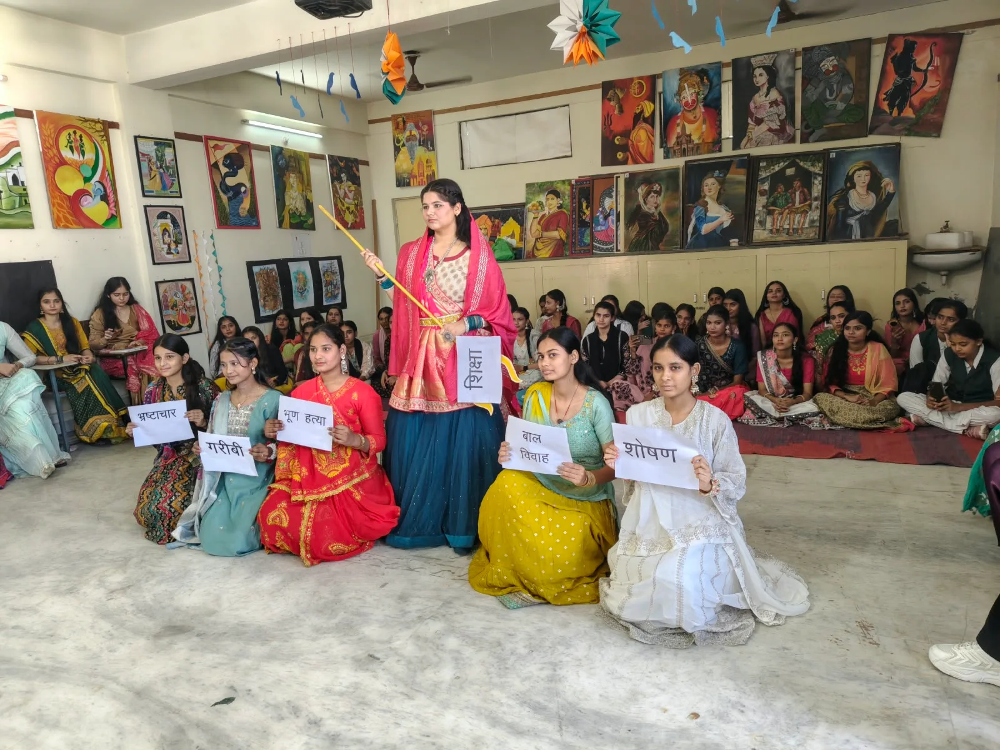

**रुड़की/हरिद्वार संवाददाता | आसिफ खान**

रुड़की। नवरात्रि के पावन पर्व पर श्री सनातन धर्म प्रकाश चंद्र कन्या स्नातकोत्तर महाविद्यालय में भक्ति, संस्कृति और नारी शक्ति का अनूठा संगम देखने को मिला। महाविद्यालय की बीएससी एवं एमए की छात्राओं ने ‘शक्ति आराधना: नवरात्रि उत्सव’ के अंतर्गत भव्य गरबा एवं डांडिया कार्यक्रम आयोजित कर पूरे परिसर को भक्तिमय और उत्साहपूर्ण माहौल से सराबोर कर दिया। रंग-बिरंगे पारंपरिक परिधानों में सजी छात्राओं की शानदार प्रस्तुतियों ने भारतीय संस्कृति और परंपराओं की जीवंत झलक पेश की।

कार्यक्रम का शुभारंभ महाविद्यालय के सचिव सौरभ भूषण शर्मा ने मां सरस्वती के समक्ष दीप प्रज्वलित कर किया। इसके बाद छात्राओं ने मां दुर्गा की स्तुति एवं आराधना के साथ गरबा और डांडिया नृत्य की आकर्षक प्रस्तुतियां दीं। तालबद्ध कदमों, पारंपरिक नृत्य और भक्तिमय संगीत ने कार्यक्रम में चार चांद लगा दिए। छात्राओं ने अपनी प्रस्तुतियों के माध्यम से भारतीय सांस्कृतिक विरासत के साथ नारी शक्ति के महत्व को भी प्रभावशाली ढंग से उजागर किया।

**नारी शक्ति, आत्मविश्वास और सकारात्मक ऊर्जा का संदेश**

महाविद्यालय के सचिव सौरभ भूषण शर्मा ने छात्राओं को आशीर्वाद देते हुए मां दुर्गा के नौ स्वरूपों का स्मरण किया। उन्होंने नारी शक्ति, आत्मविश्वास और सकारात्मक ऊर्जा को जीवन में सफलता का महत्वपूर्ण आधार बताते हुए छात्राओं को निरंतर आगे बढ़ने के लिए प्रेरित किया। उन्होंने कहा कि छात्राओं को शिक्षा के साथ सांस्कृतिक एवं रचनात्मक गतिविधियों में भी बढ़-चढ़कर भाग लेना चाहिए, जिससे उनके व्यक्तित्व का सर्वांगीण विकास हो सके।

**सांस्कृतिक आयोजन से बढ़ता है आत्मविश्वास**

कार्यक्रम की अध्यक्षता कर रहीं स्ववित्तपोषित प्रभारी डॉ. मधु मेहरा ने छात्राओं की प्रस्तुतियों की सराहना करते हुए उनका उत्साहवर्धन किया। उन्होंने कहा कि इस प्रकार के सांस्कृतिक आयोजन छात्राओं में आत्मविश्वास, एकता, रचनात्मकता और नेतृत्व क्षमता को विकसित करने में महत्वपूर्ण भूमिका निभाते हैं। उन्होंने नवरात्रि की शुभकामनाएं देते हुए नारी शक्ति के सम्मान, सशक्तीकरण और आत्मनिर्भरता का संदेश दिया।

**शिक्षिकाओं की मौजूदगी ने बढ़ाई कार्यक्रम की गरिमा**

कार्यक्रम में महाविद्यालय की प्रवक्तागण श्रीमती प्रियंका, श्रीमती संदीपा, श्रीमती राधा, सुश्री फिरदौस, सुश्री आंचल, सुश्री अंजलि, सुश्री तनु, श्रीमती अमिता, श्रीमती काजल एवं सुश्री ज्योति सहित अन्य शिक्षिकाएं उपस्थित रहीं। सभी ने छात्राओं की प्रस्तुतियों की सराहना की और आयोजन को सफल बनाने में सहयोग दिया।

अंत में गरबा एवं डांडिया कार्यक्रम भक्ति, उल्लास और सांस्कृतिक चेतना के साथ सफलतापूर्वक संपन्न हुआ। आयोजन ने यह संदेश दिया कि भारतीय संस्कृति की मजबूती, नारी शक्ति का सम्मान और युवाओं की रचनात्मक भागीदारी समाज को सकारात्मक दिशा देने में अहम भूमिका निभाती है।

