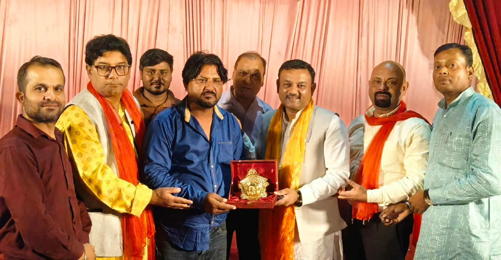
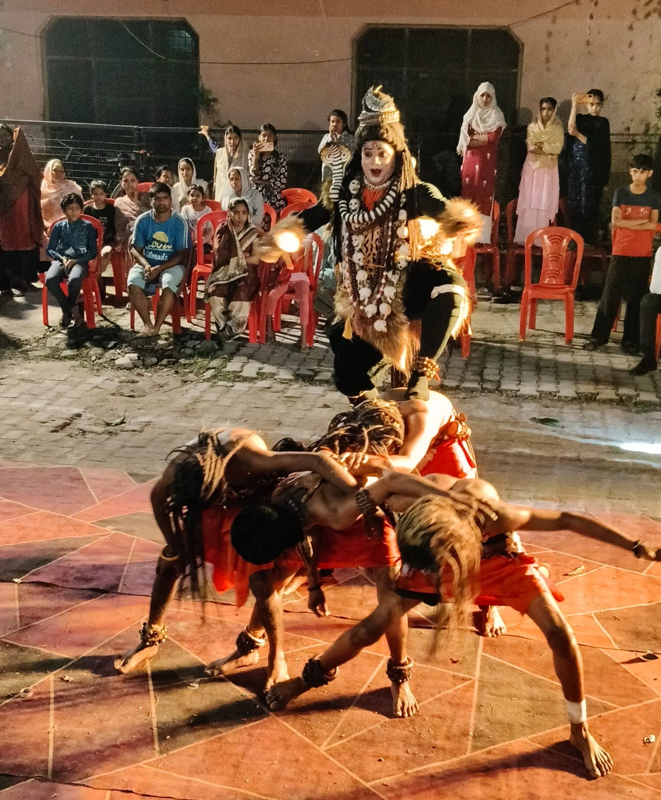
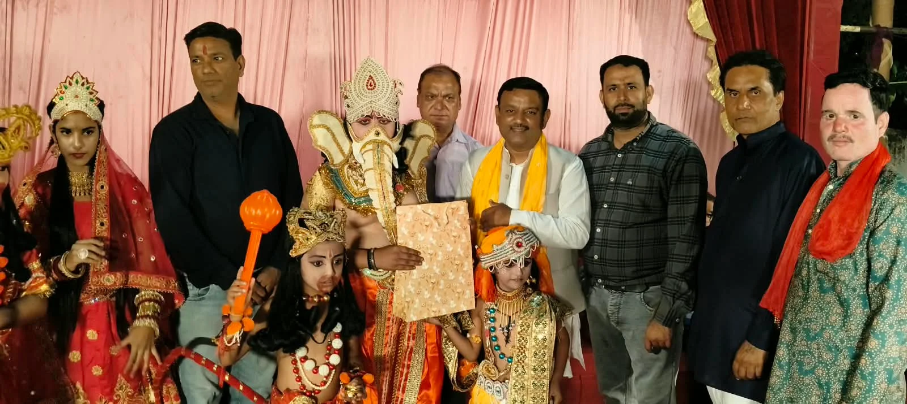

**रूडकी संवाददाता | आसिफ खान** 

रुड़की। लालकुर्ती कैंट में यूनाइटेड परिवार के तत्वावधान में 23वें वार्षिकोत्सव के अवसर पर मां दुर्गा की दिव्य एवं भव्य शोभायात्रा धूमधाम और श्रद्धा के साथ निकाली गई। माता रानी के जयकारों से पूरा क्षेत्र भक्तिमय हो उठा। बैंड-बाजों की गूंज, मधुर भजनों की प्रस्तुति, आकर्षक धार्मिक झांकियों और श्रद्धालुओं के उत्साह ने शोभायात्रा को यादगार बना दिया। मार्ग में जगह-जगह श्रद्धालुओं ने पुष्पवर्षा कर माता रानी की शोभायात्रा का जोरदार स्वागत किया।

शोभायात्रा में अतिथि के रूप में पहुंचे पूर्व मेयर गौरव गोयल ने माता रानी के दर्शन कर आशीर्वाद प्राप्त किया और मां दुर्गा की महिमा का गुणगान किया। उन्होंने कहा कि माता रानी अपने भक्तों पर असीम कृपा बरसाती हैं और उनकी आराधना से जीवन में सुख, शांति एवं सकारात्मक ऊर्जा का संचार होता है। उन्होंने यूनाइटेड परिवार द्वारा लगातार 23 वर्षों से जागरण और भव्य शोभायात्रा के आयोजन को धार्मिक आस्था एवं सामाजिक एकता का सराहनीय उदाहरण बताया।

**23 वर्षों से कायम है श्रद्धा और भक्ति की परंपरा**

यूनाइटेड परिवार के अध्यक्ष नीरज राव ने बताया कि परिवार की ओर से विगत 23 वर्षों से लगातार माता रानी के जागरण एवं भव्य शोभायात्रा का आयोजन किया जा रहा है। प्रत्येक वर्ष बड़ी संख्या में श्रद्धालु इस धार्मिक आयोजन में शामिल होकर माता रानी का आशीर्वाद प्राप्त करते हैं। उन्होंने कहा कि इस आयोजन का उद्देश्य धार्मिक आस्था को मजबूत करना और समाज में आपसी प्रेम, सद्भाव एवं एकता की भावना को बढ़ावा देना है।

उन्होंने बताया कि इस वर्ष भी शोभायात्रा में बड़ी संख्या में भक्तों ने भाग लिया। शोभायात्रा क्षेत्र के विभिन्न मार्गों से होकर गुजरी, जहां श्रद्धालुओं ने पुष्पवर्षा कर माता रानी के प्रति अपनी श्रद्धा प्रकट की। जगह-जगह हुए स्वागत से आयोजन की भव्यता और श्रद्धालुओं का उत्साह देखते ही बना।

**मनमोहक झांकियों और शिव-अघोरी नृत्य ने मोहा मन**

शोभायात्रा में प्रस्तुत की गई आकर्षक धार्मिक झांकियां विशेष आकर्षण का केंद्र रहीं। कलाकारों ने मां दुर्गा की झांकी को बेहद सुंदर ढंग से सजाया, जिसे देखकर श्रद्धालु भावविभोर हो उठे। वहीं, योगेश जमानिया की ओर से प्रस्तुत भोले शंकर एवं अघोरी नृत्य ने दर्शकों का मन मोह लिया। बैंड-बाजों की धुनों और भजनों के बीच श्रद्धालु माता रानी के जयकारे लगाते हुए आगे बढ़ते रहे।

कार्यक्रम के समापन पर पूर्व मेयर गौरव गोयल ने शोभायात्रा में शामिल कलाकारों और यूनाइटेड परिवार के सदस्यों को स्मृति चिह्न भेंट कर सम्मानित किया। आयोजन में धार्मिक उत्साह के साथ सामाजिक सहभागिता भी देखने को मिली।

इस अवसर पर यूनाइटेड परिवार के संरक्षक वीरेंद्र पांडेय, उपाध्यक्ष मोनू गुप्ता, दीपक अरोड़ा, आशीष कनौजिया, प्रदीप कुमार, अमन, सागर, हर्षित, अंकुश, नितिन, संदीप, प्रकाश बिष्ट, विशेष त्यागी, सुमित गौतम, कन्हैया, नवीन, अभिषेक, आकाश, आशीष, दीपक अघाना, रवि आहूजा और शिव कुमार सहित अनेक श्रद्धालु एवं गणमान्य लोग मौजूद रहे।

यूनाइटेड परिवार का 23वां वार्षिकोत्सव धार्मिक आस्था, भक्ति और सामाजिक एकजुटता का संदेश देकर संपन्न हुआ।
