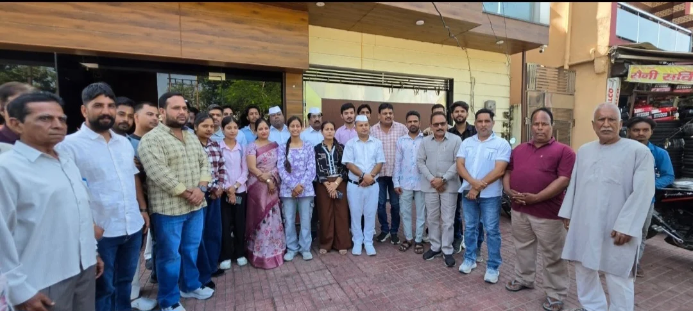

**रूडकी संवाददाता | आसिफ खान** 

**रुड़की।** कन्हैया लाल डीएवी डिग्री कॉलेज के छात्र संघ चुनाव में NSUI के नवनिर्वाचित पदाधिकारियों की जीत के बाद रुड़की में कांग्रेस कार्यकर्ताओं के बीच उत्साह देखने को मिला। रुड़की महानगर सेवादल एवं रुड़की ग्रामीण सेवादल के संयुक्त तत्वावधान में मलकपुर चुंगी स्थित कांग्रेस कार्यालय पर सम्मान समारोह आयोजित किया गया। कार्यक्रम में छात्र संघ के विजेता प्रत्याशियों एवं NSUI के जिला अध्यक्ष मनीष परमार का माल्यार्पण कर जोरदार स्वागत किया गया। साथ ही मिठाई खिलाकर जीत की खुशी साझा की गई।

समारोह में छात्र संघ अध्यक्ष आर्यन चौधरी, उपाध्यक्ष मयंक करनवाल, सह सचिव खुशी धीमान एवं कोषाध्यक्ष अंजली शर्मा को सम्मानित किया गया। इस दौरान कार्यकर्ताओं ने नवनिर्वाचित पदाधिकारियों को बधाई देते हुए छात्र हितों की आवाज मजबूती से उठाने और कॉलेज में विद्यार्थियों की समस्याओं के समाधान के लिए सक्रिय भूमिका निभाने की अपेक्षा जताई।

कार्यक्रम में रुड़की महानगर की वरिष्ठ समाजसेविका एवं पूर्व मेयर प्रत्याशी श्रीमती पूजा गुप्ता, उत्तराखंड प्रदेश कांग्रेस कमेटी के पूर्व प्रदेश महामंत्री एवं वरिष्ठ समाजसेवी सचिन गुप्ता, वरिष्ठ कांग्रेसी नेता सुभाष सैनी, बेनी प्रसाद सैनी, प्रवीण मित्तल तथा रुड़की ग्रामीण के जिला अध्यक्ष सुशील कश्यप सहित अनेक कांग्रेस नेता एवं कार्यकर्ता मौजूद रहे।

इसके अलावा उमेश देव, सुनील कश्यप, मोंटू कश्यप, रिमझिम सैनी, नितिन कश्यप, नीरज ठाकुर, ग्रेटर शर्मा, कमलेश कुमार उर्फ पप्पू भैया, दीपक चंचल, समीर मलिक, आशीष गोयल, तंजीम फारुकी, विशाल गोपी, सनी, जाकिर हुसैन, मनीष राणा, अमन, शकील अहमद, हसन, दीपक वर्मा, राजेश कुमार, गुरदीप चौधरी, शिवम चौधरी, यश कुमार, जानी चौधरी, अंकुर चौधरी, मोहित वशिष्ठ, नितिन राठी, शिवकुमार चौधरी, उदय कुमार सहित अन्य गणमान्य लोग उपस्थित रहे।

समारोह के दौरान छात्र संघ के नवनिर्वाचित पदाधिकारियों को शुभकामनाएं देते हुए युवाओं की भागीदारी को संगठन की मजबूती के लिए महत्वपूर्ण बताया गया। कार्यक्रम में कांग्रेस एवं सेवादल के कार्यकर्ताओं ने एकजुटता का संदेश देते हुए छात्र राजनीति में युवाओं की सक्रिय भूमिका पर जोर दिया।
