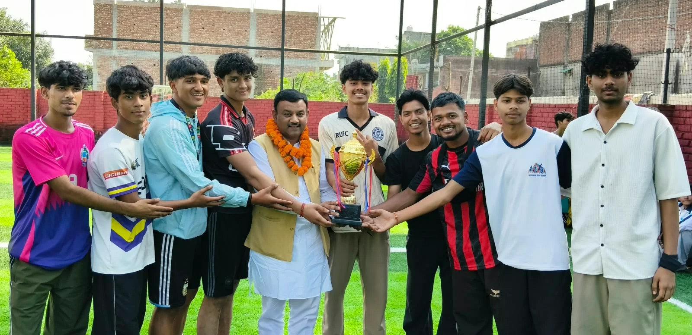
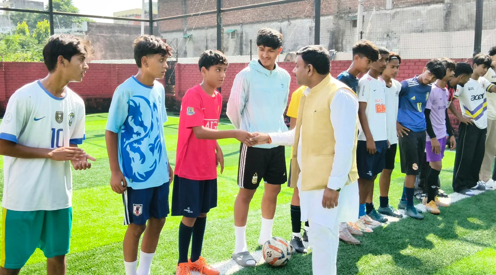
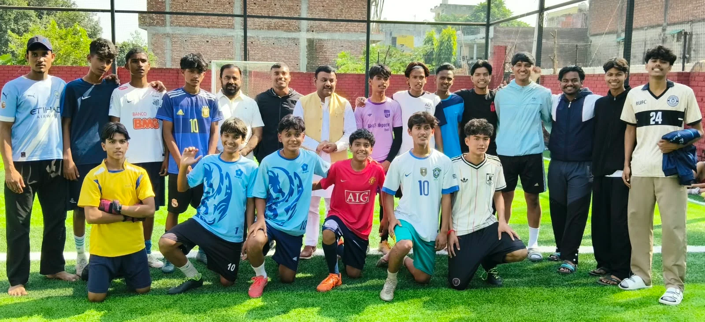

**रूडकी संवाददाता | आसिफ खान** 

**रुड़की।** शहर में खेल प्रतिभाओं को प्रोत्साहित करने और युवाओं को खेलों के प्रति जागरूक करने की दिशा में मंगलौर रोड स्थित मैदान में आयोजित फुटबॉल प्रतियोगिता में खिलाड़ियों ने अपनी प्रतिभा और खेल भावना का शानदार प्रदर्शन किया। प्रतियोगिता के दौरान पूर्व मेयर गौरव गोयल ने कार्यक्रम का शुभारंभ करते हुए खिलाड़ियों का उत्साहवर्धन किया और रुड़की एवं हरिद्वार के खिलाड़ियों के बीच हुए रोमांचक मुकाबले में विजेता टीम को सम्मानित कर उनका हौसला बढ़ाया।

इस अवसर पर पूर्व मेयर गौरव गोयल ने कहा कि फुटबॉल आज के युवाओं की पहली पसंद बनता जा रहा है। इस खेल के प्रति युवाओं का बढ़ता रुझान इस बात का प्रमाण है कि नई पीढ़ी खेलों को केवल मनोरंजन का साधन नहीं, बल्कि अपनी प्रतिभा को पहचान दिलाने और भविष्य संवारने के एक मजबूत माध्यम के रूप में भी देख रही है। उन्होंने कहा कि फुटबॉल जैसे खेल युवाओं में अनुशासन, मेहनत, टीम भावना, आत्मविश्वास और नेतृत्व क्षमता विकसित करने में महत्वपूर्ण भूमिका निभाते हैं।

**खेल के मैदान से राष्ट्रीय स्तर तक पहुंचने का युवाओं के पास सुनहरा अवसर**

गौरव गोयल ने कहा कि रुड़की और हरिद्वार क्षेत्र में प्रतिभाशाली खिलाड़ियों की कोई कमी नहीं है। जरूरत है तो उन्हें उचित मंच, बेहतर मार्गदर्शन और निरंतर अभ्यास के अवसर उपलब्ध कराने की। उन्होंने खिलाड़ियों से आह्वान किया कि वे पूरे समर्पण और मेहनत के साथ अपने खेल को निखारें तथा अपनी प्रतिभा के दम पर क्षेत्रीय और राष्ट्रीय स्तर पर पहचान बनाएं। उन्होंने कहा कि जब कोई खिलाड़ी अपनी मेहनत से सफलता हासिल करता है, तो उससे न केवल उसका और उसके परिवार का नाम रोशन होता है, बल्कि पूरे शहर और क्षेत्र का गौरव भी बढ़ता है।

उन्होंने कहा कि आज के दौर में युवाओं के लिए खेलों में आगे बढ़ने की अपार संभावनाएं हैं। फुटबॉल जैसे लोकप्रिय खेल में लगातार अभ्यास, शारीरिक फिटनेस, अनुशासन और टीम के साथ बेहतर तालमेल बनाकर खिलाड़ी बड़ी उपलब्धियां हासिल कर सकते हैं। युवाओं को चाहिए कि वे अपने लक्ष्य निर्धारित करें और उन्हें पूरा करने के लिए पूरी ईमानदारी से प्रयास करें।

**खिलाड़ियों से किया परिचय, विजेता टीम का बढ़ाया उत्साह**

प्रतियोगिता के शुभारंभ के दौरान पूर्व मेयर गौरव गोयल ने मैदान में मौजूद खिलाड़ियों से परिचय प्राप्त किया और उनके खेल के प्रति समर्पण की सराहना की। रुड़की एवं हरिद्वार के खिलाड़ियों के बीच हुए मुकाबले में दोनों टीमों ने अपनी-अपनी क्षमता के अनुसार प्रदर्शन किया। मैच के समापन पर उन्होंने विजेता टीम को सम्मानित करते हुए खिलाड़ियों का उत्साह बढ़ाया और भविष्य में भी इसी लगन के साथ खेलते रहने के लिए प्रेरित किया।

उन्होंने कहा कि खेल प्रतियोगिताएं युवाओं को अपनी प्रतिभा दिखाने का अवसर प्रदान करती हैं। ऐसे आयोजनों से खिलाड़ियों के बीच स्वस्थ प्रतिस्पर्धा की भावना विकसित होती है और विभिन्न क्षेत्रों के युवाओं को एक-दूसरे से सीखने का मौका मिलता है। फुटबॉल जैसे टीम आधारित खेल में प्रत्येक खिलाड़ी की भूमिका महत्वपूर्ण होती है। मैदान पर एकजुटता, आपसी तालमेल और अंतिम क्षण तक संघर्ष करने की भावना ही टीम को सफलता की ओर ले जाती है।

**युवाओं को खेलों से जोड़ना समय की जरूरत**

पूर्व मेयर गौरव गोयल ने कहा कि वर्तमान समय में युवाओं को खेल गतिविधियों से जोड़ना बेहद जरूरी है। खेल न केवल शारीरिक रूप से स्वस्थ रहने में मदद करते हैं, बल्कि मानसिक मजबूती और सकारात्मक सोच को भी बढ़ावा देते हैं। उन्होंने कहा कि क्षेत्र में इस प्रकार की प्रतियोगिताओं का आयोजन लगातार होना चाहिए, ताकि स्थानीय खिलाड़ियों को अपनी प्रतिभा प्रदर्शित करने के अधिक अवसर मिल सकें।

उन्होंने आयोजकों के प्रयासों की सराहना करते हुए कहा कि खेलों को बढ़ावा देने के लिए समाज के सभी वर्गों को आगे आना चाहिए। स्थानीय स्तर पर आयोजित होने वाली प्रतियोगिताएं ही भविष्य में बड़े स्तर पर अपनी पहचान बनाने वाले खिलाड़ियों की नींव तैयार करती हैं।

कार्यक्रम के दौरान खिलाड़ियों में उत्साह देखने को मिला। विजेता टीम को सम्मानित किए जाने से खिलाड़ियों का मनोबल बढ़ा। प्रतियोगिता ने एक बार फिर यह संदेश दिया कि यदि युवाओं को उचित अवसर और प्रोत्साहन मिले, तो वे अपनी प्रतिभा के दम पर खेल जगत में नई उपलब्धियां हासिल कर सकते हैं।

**संदेश साफ—मैदान में मेहनत, अनुशासन और जुनून ही सफलता की असली पहचान है।**
