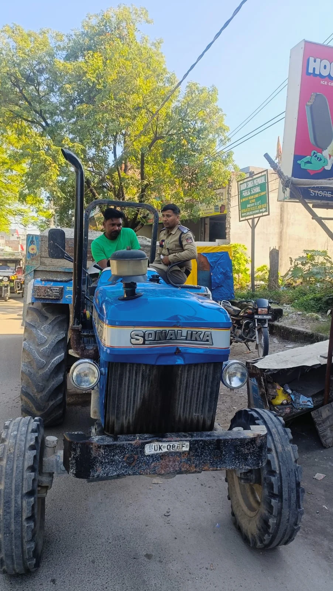
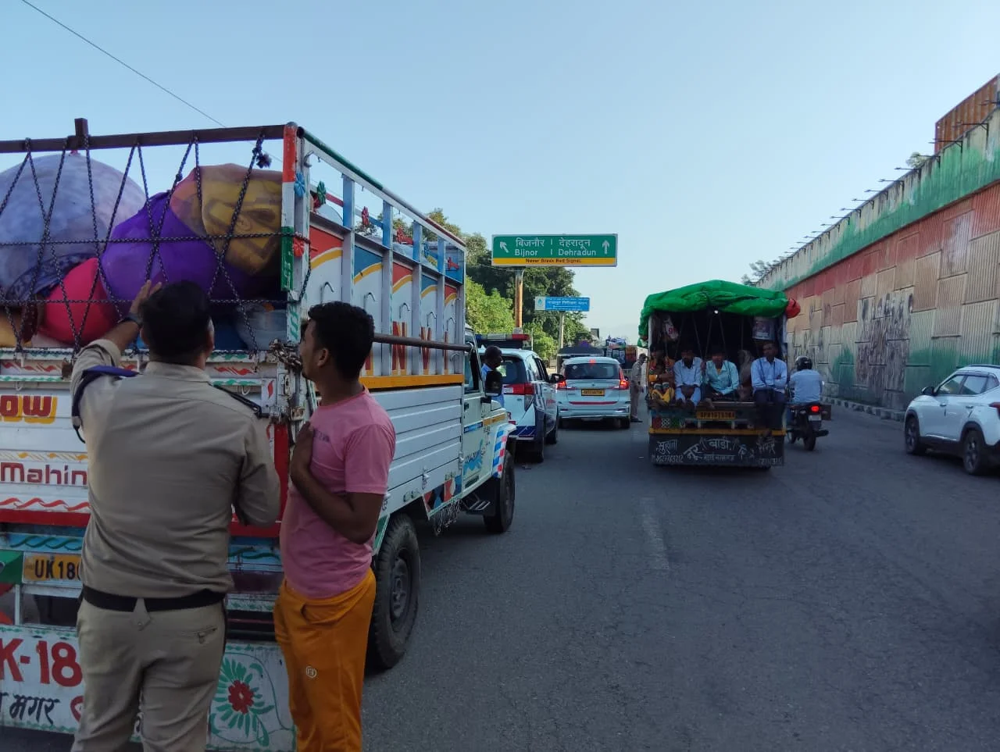

**हरिद्वार संवाददाता | आसिफ खान**

हरिद्वार। त्योहारों के दौरान सड़कों पर बढ़ने वाली भीड़ और सड़क हादसों की आशंका को देखते हुए परिवहन विभाग ने नियमों का उल्लंघन करने वाले वाहन चालकों के खिलाफ सख्ती शुरू कर दी है। जिलाधिकारी मयूर दीक्षित के निर्देश पर रविवार को चलाए गए विशेष प्रवर्तन अभियान में विभाग ने ओवरलोडिंग और परमिट नियमों के उल्लंघन पर कार्रवाई करते हुए 4 वाहनों को सीज किया, जबकि 25 वाहनों के चालान काटे गए। कार्रवाई के दायरे में परमिट की निर्धारित शर्तों का उल्लंघन करने वाली 5 बसें भी आईं।

**ओवरलोडिंग पर सीधी कार्रवाई, ट्रैक्टर-ट्रॉली भी सीज**

सहायक संभागीय परिवहन अधिकारी (प्रवर्तन) नेहा झा के नेतृत्व में जनपद के विभिन्न मार्गों पर वाहनों की सघन जांच की गई। अभियान के दौरान विशेष रूप से ओवरलोडिंग, परमिट की शर्तों और मोटर वाहन नियमों के पालन की पड़ताल की गई।

मीडिया के माध्यम से प्राप्त सूचनाओं का संज्ञान लेते हुए जमालपुर कलां क्षेत्र में विशेष चेकिंग अभियान चलाया गया। यहां निर्धारित क्षमता से अधिक भार लेकर चल रहे चार वाहनों को सीज कर दिया गया। सीज किए गए वाहनों में एक ट्रैक्टर-ट्रॉली भी शामिल है।

ओवरलोडिंग को सड़क सुरक्षा के लिए गंभीर खतरा मानते हुए विभाग ने संबंधित वाहनों के विरुद्ध कार्रवाई की। निर्धारित क्षमता से अधिक भार लेकर चलने वाले वाहन न केवल दुर्घटनाओं की आशंका बढ़ाते हैं, बल्कि सड़क पर चलने वाले अन्य लोगों की सुरक्षा को भी प्रभावित कर सकते हैं।

**25 वाहनों के चालान, पांच बसों पर भी गिरी कार्रवाई**

विशेष अभियान के दौरान कुल 25 वाहनों के चालान किए गए। वहीं यात्री वाहनों की जांच में परमिट की निर्धारित शर्तों का उल्लंघन पाए जाने पर पांच बसों के विरुद्ध भी चालानी कार्रवाई की गई।

विभाग ने बस संचालकों को स्पष्ट निर्देश दिए कि परमिट में निर्धारित शर्तों का पालन सुनिश्चित किया जाए और यात्रियों की सुरक्षा से किसी प्रकार का समझौता न किया जाए। नियमों की अनदेखी करने वाले वाहन संचालकों के विरुद्ध नियमानुसार कार्रवाई की चेतावनी भी दी गई।

**त्योहारों में बढ़ेगी निगरानी, नियम तोड़े तो होगी कार्रवाई**

त्योहारों के दौरान सड़कों पर यातायात का दबाव बढ़ने की संभावना को देखते हुए परिवहन विभाग ने निगरानी तेज कर दी है। मालवाहक वाहनों में निर्धारित क्षमता से अधिक भार ढोने, यात्री वाहनों में परमिट नियमों का उल्लंघन करने और सड़क सुरक्षा से जुड़ी अन्य अनियमितताओं पर विशेष नजर रखी जा रही है।

सहायक संभागीय परिवहन अधिकारी (प्रवर्तन) नेहा झा ने बताया कि जिलाधिकारी के निर्देशानुसार त्योहारों के दौरान विशेष चेकिंग अभियान लगातार जारी रहेगा। ओवरलोड वाहनों और नियमों का उल्लंघन करने वाले यात्री वाहनों के खिलाफ नियमानुसार कार्रवाई की जाएगी।

उन्होंने वाहन स्वामियों और चालकों से निर्धारित भार क्षमता, परमिट की शर्तों तथा मोटर वाहन अधिनियम के प्रावधानों का पालन करने की अपील की।

अब सवाल साफ है—जब सड़क सुरक्षा के नियम तय हैं, तो उनकी अनदेखी क्यों? त्योहारों के दौरान परिवहन विभाग की इस कार्रवाई से नियमों का उल्लंघन करने वाले वाहन संचालकों को स्पष्ट संदेश दिया गया है कि यातायात नियमों की अनदेखी पर कार्रवाई का सामना करना पड़ सकता है। अब देखना होगा कि अभियान के लगातार जारी रहने से ओवरलोडिंग और परमिट उल्लंघन पर कितनी प्रभावी रोक लग पाती है।
