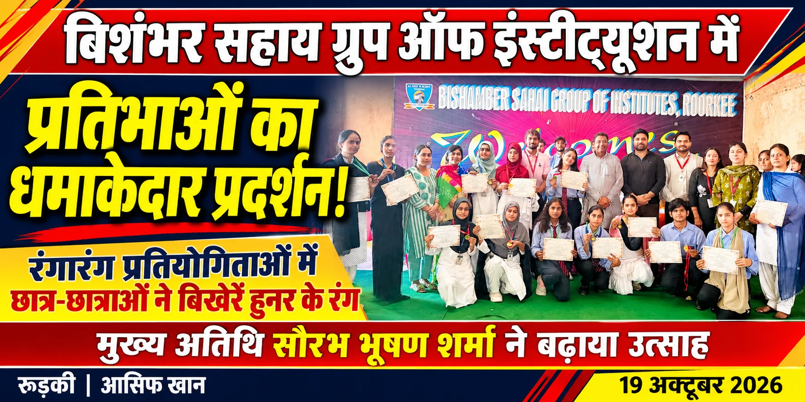
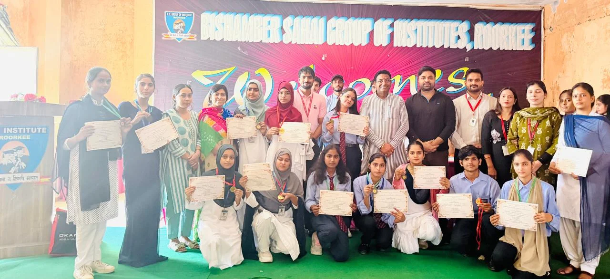

**रुड़की संवाददाता | आसिफ खान**

रुड़की। बिशंभर सहाय ग्रुप ऑफ इंस्टीट्यूशन में रचनात्मकता, कला और प्रतिभा का शानदार संगम देखने को मिला। संस्थान के अंतर्गत रूपचंद शर्मा एजुकेशन के सभागार में आयोजित विभिन्न रंगारंग प्रतियोगिताओं में छात्र-छात्राओं ने अपनी प्रतिभा का दमदार प्रदर्शन करते हुए सभी का ध्यान आकर्षित किया। टी-शर्ट पेंटिंग, खानपान, दीपावली साज-सज्जा और पोस्टर प्रतियोगिताओं में विद्यार्थियों ने बढ़-चढ़कर हिस्सा लिया और अपनी कल्पनाशीलता, कलात्मक कौशल तथा नवाचार से कार्यक्रम को यादगार बना दिया।

कार्यक्रम का शुभारंभ मुख्य अतिथि भारतीय जनता पार्टी के व्यावसायिक प्रकोष्ठ के सह-संयोजक सौरभ भूषण शर्मा ने रिबन काटकर किया। प्रतियोगिताओं के दौरान विद्यार्थियों में खासा उत्साह देखने को मिला। किसी ने रंगों के माध्यम से अपनी कल्पनाओं को साकार किया, तो किसी ने आकर्षक साज-सज्जा और लजीज व्यंजनों के जरिए अपनी रचनात्मक क्षमता का परिचय दिया।

**पाठ्येतर गतिविधियां व्यक्तित्व निर्माण का मजबूत आधार : सौरभ भूषण शर्मा**

मुख्य अतिथि सौरभ भूषण शर्मा ने विद्यार्थियों का उत्साहवर्धन करते हुए कहा कि शिक्षा का उद्देश्य केवल पुस्तकीय ज्ञान हासिल करना नहीं, बल्कि विद्यार्थियों का सर्वांगीण विकास करना भी है। इस प्रकार की पाठ्येतर गतिविधियां युवाओं के व्यक्तित्व को निखारने, आत्मविश्वास बढ़ाने और उनकी छिपी प्रतिभा को मंच प्रदान करने में महत्वपूर्ण भूमिका निभाती हैं।

उन्होंने कहा कि दीपावली जैसे पावन पर्व पर आयोजित साज-सज्जा, टी-शर्ट पेंटिंग और पोस्टर प्रतियोगिताओं के माध्यम से विद्यार्थियों ने भारतीय संस्कृति, परंपराओं और अपनी रचनात्मक सोच का सुंदर प्रदर्शन किया है। आज के युवा ही देश का भविष्य हैं। ऐसे आयोजन उन्हें आत्मनिर्भर, आत्मविश्वासी और बहुमुखी प्रतिभा का धनी बनाने में सहायक होते हैं।

उन्होंने संस्थान प्रबंधन को इस शानदार आयोजन के लिए बधाई देते हुए सभी विजेता और प्रतिभागी विद्यार्थियों के उज्ज्वल भविष्य की कामना की।

**विद्यार्थियों के सर्वांगीण विकास के लिए प्रतिबद्ध संस्थान**

संस्थान के सचिव चंद्र भूषण शर्मा और मैनेजिंग डायरेक्टर गौरव भूषण शर्मा ने विद्यार्थियों का मार्गदर्शन करते हुए कहा कि संस्थान शिक्षा के साथ-साथ विद्यार्थियों के सर्वांगीण विकास के लिए निरंतर प्रयासरत है। इस तरह के आयोजनों से छात्रों को अपनी प्रतिभा प्रदर्शित करने, नई चीजें सीखने और अपनी क्षमताओं को पहचानने का अवसर मिलता है।

वहीं, महाविद्यालय के प्राचार्य शाहजी आलम, डीन ऑफ एकेडमिक दिवाकर जैन, विभागाध्यक्ष मोहम्मद जागीर और फार्मेसी विभागाध्यक्ष प्रणव शर्मा ने कहा कि रचनात्मक प्रतियोगिताएं विद्यार्थियों के भीतर छिपी प्रतिभा को सामने लाने के साथ-साथ उनमें टीम वर्क, सहयोग और व्यावहारिक कौशल की भावना विकसित करती हैं। ये गुण विद्यार्थियों के भविष्य और व्यावहारिक जीवन में महत्वपूर्ण साबित होते हैं।

**प्रतियोगिताओं में इन प्रतिभागियों ने मारी बाजी**

आयोजित प्रतियोगिताओं में विद्यार्थियों ने शानदार प्रदर्शन किया। विभिन्न श्रेणियों में स्थान प्राप्त करने वाले प्रतिभागियों के नाम इस प्रकार रहे—

1. पोस्टर प्रतियोगिता

प्रथम स्थान — एरिन

द्वितीय स्थान — अफसा

2. खानपान प्रतियोगिता

प्रथम स्थान — जिगरा एवं गुलफरीन

द्वितीय स्थान — सिदरा

तृतीय स्थान — सानिया

3. दीपावली साज-सज्जा प्रतियोगिता

प्रथम स्थान — प्रगति कौशिक

द्वितीय स्थान — एरिन

तृतीय स्थान — गुलफरीन

4. टी-शर्ट पेंटिंग प्रतियोगिता

प्रथम स्थान — उजरा

द्वितीय स्थान — साजिया

तृतीय स्थान — निशा

**प्रमाण-पत्र और मेडल देकर किया सम्मानित**

कार्यक्रम के समापन पर मुख्य अतिथि सौरभ भूषण शर्मा एवं अन्य अतिथियों ने विभिन्न प्रतियोगिताओं में प्रथम, द्वितीय और तृतीय स्थान प्राप्त करने वाले विद्यार्थियों को प्रमाण-पत्र और मेडल प्रदान कर सम्मानित किया। सम्मान मिलने पर विजेता विद्यार्थियों के चेहरे खिल उठे, जबकि अन्य प्रतिभागियों ने भी अपने प्रदर्शन से आयोजन को सफल बनाया।

पूरे कार्यक्रम के दौरान संस्थान परिसर में उत्साह, उमंग और उत्सव का माहौल बना रहा। आयोजन ने यह संदेश दिया कि शिक्षा के साथ कला, संस्कृति और रचनात्मक गतिविधियों को बढ़ावा देना विद्यार्थियों के उज्ज्वल भविष्य की दिशा में एक महत्वपूर्ण कदम है।
