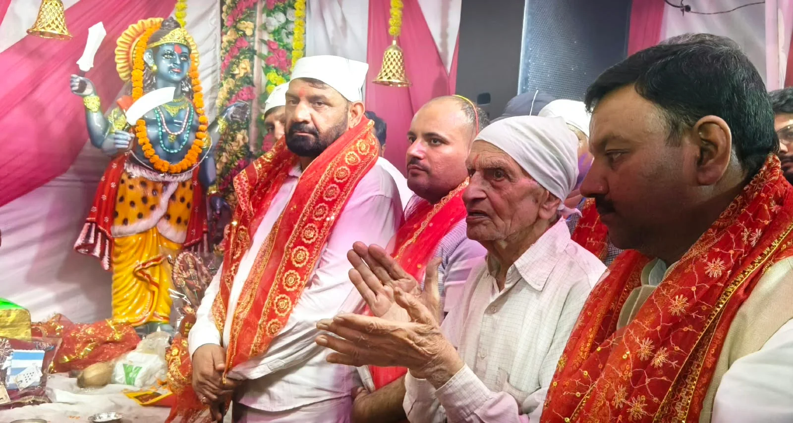
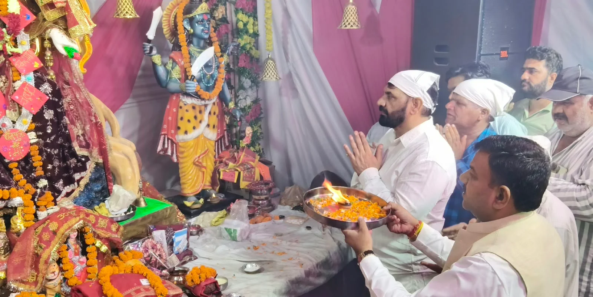
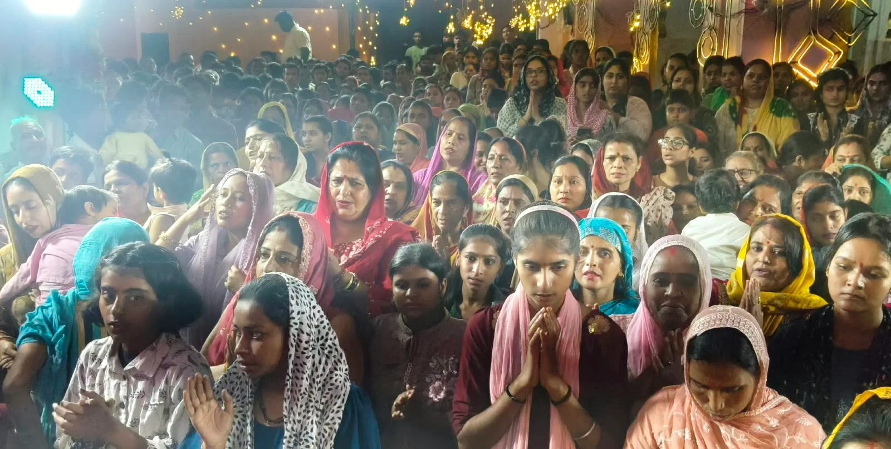

**रुड़की संवाददाता | आसिफ खान**

रुड़की। शारदीय नवरात्रि के पावन अवसर पर मंगलौर स्थित देवी मंदिर में श्रद्धा और भक्ति का अद्भुत नजारा देखने को मिला। मां के दर्शन और पूजा-अर्चना के लिए श्रद्धालुओं की भारी भीड़ उमड़ी। मंदिर परिसर भक्तिमय माहौल से सराबोर रहा। श्रद्धालुओं ने विधि-विधान से मां की आराधना कर परिवार की सुख-शांति, खुशहाली और समृद्धि की कामना की।

इस अवसर पर पूर्व मेयर गौरव गोयल, भाजपा जिला महामंत्री अक्षय प्रताप सिंह तथा भाजपा जिला उपाध्यक्ष संजय अरोड़ा भी देवी मंदिर पहुंचे। उन्होंने मां के चरणों में शीश नवाकर पूजा-अर्चना की और आशीर्वाद प्राप्त किया। इस दौरान उन्होंने कहा कि सनातन संस्कृति में नवरात्रि का विशेष आध्यात्मिक महत्व है। यह पर्व शक्ति की आराधना, आस्था और सकारात्मक ऊर्जा का प्रतीक है। सच्ची श्रद्धा और भक्ति के साथ मां की उपासना करने से मन को शांति मिलती है और भक्तों में नई ऊर्जा का संचार होता है।

**आस्था और भक्ति में लीन दिखे श्रद्धालु**

नवरात्रि के दौरान मंदिर में दर्शन के लिए पहुंचे भक्तों में खासा उत्साह दिखाई दिया। श्रद्धालुओं ने मां के समक्ष अपनी मनोकामनाएं रखीं और सुख-समृद्धि की प्रार्थना की। मंदिर में पूजा-अर्चना के बाद श्रद्धालुओं ने प्रसाद ग्रहण किया। पूरे आयोजन के दौरान धार्मिक उत्साह और भक्तिभाव का वातावरण बना रहा।

इस मौके पर पंडित आकाशदीप, मनीष कुमार, सचिन सबरवाल, मूलचंद गर्ग, प्रियम गर्ग, अस्वती चौधरी, अंकित गुप्ता, लवकुश, पिंकी गुप्ता, दिव्या तायल, उमेश बंसल, मयंक बंसल, तरुण सिंघल, आदेश सिंघल, रजनी शर्मा, मधुर शर्मा, ऋषिपाल, विनोद कुमार सहित बड़ी संख्या में श्रद्धालु मौजूद रहे। अंत में सभी भक्तों ने प्रसाद ग्रहण किया और मां से परिवार एवं समाज की सुख-समृद्धि की कामना की।

