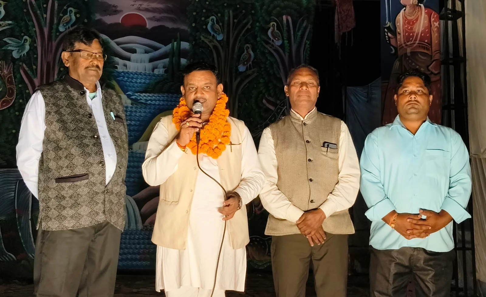
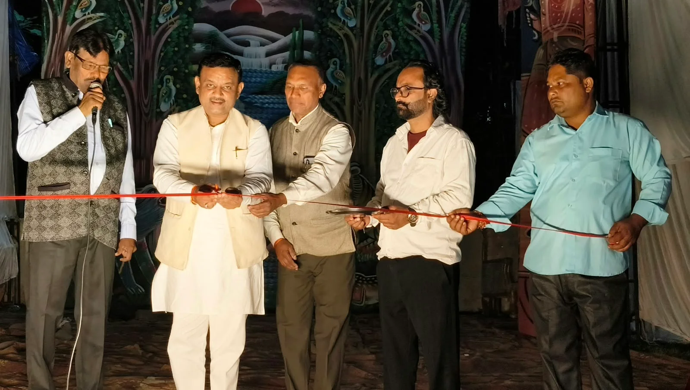
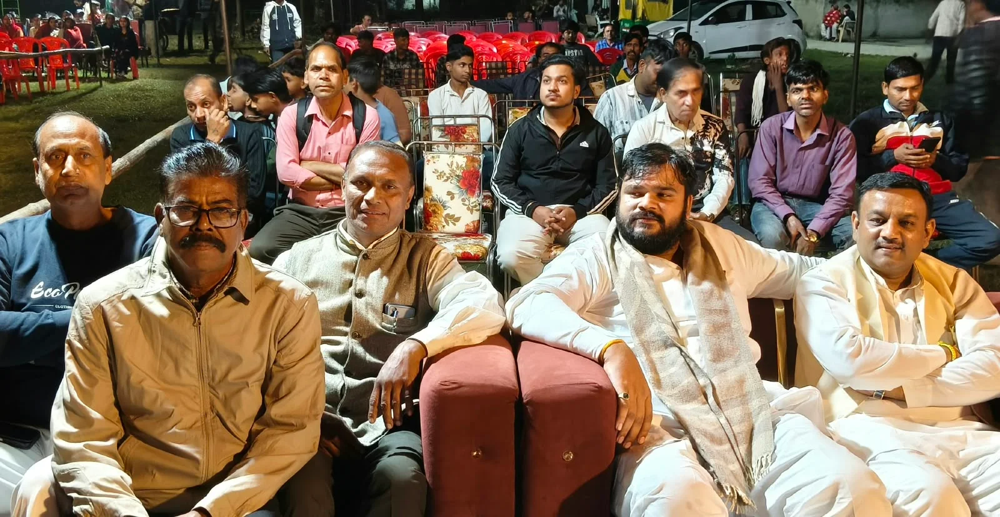

**रुड़की संवाददाता | आसिफ खान**

रुड़की। लालकुर्ती में भगवान वाल्मीकि रामलीला कमेटी के तत्वावधान में आयोजित रामलीला में रावण-हनुमान संवाद की लीला का भव्य मंचन किया गया। मंच पर जब अहंकार में चूर रावण और भगवान श्रीराम के परम भक्त हनुमान जी के बीच तीखे संवाद और युद्ध का दृश्य प्रस्तुत हुआ, तो पूरा पंडाल जय श्रीराम के गगनभेदी जयकारों से गूंज उठा। कलाकारों के सशक्त अभिनय और प्रभावशाली संवादों ने श्रद्धालुओं को भावविभोर कर दिया। धार्मिक उत्साह और भक्ति के माहौल में दर्शक देर तक लीला का आनंद लेते रहे।

कार्यक्रम का शुभारंभ पूर्व मेयर गौरव गोयल ने फीता काटकर किया। मंचन के दौरान रावण अपने बल, पराक्रम और शक्तिशाली योद्धा होने के अहंकार में डूबा दिखाई दिया, वहीं हनुमान जी ने प्रभु श्रीराम की भक्ति, साहस और अटूट विश्वास का परिचय दिया। दोनों के बीच हुए संवाद ने दर्शकों को अधर्म के विरुद्ध संघर्ष और सत्य की शक्ति का संदेश दिया। जैसे-जैसे लीला आगे बढ़ी, पंडाल में जय श्रीराम के नारों की गूंज और तेज होती गई।

**अहंकार का अंत और सत्य की विजय निश्चित: गौरव गोयल**

मुख्य अतिथि के रूप में पूर्व मेयर गौरव गोयल ने कहा कि अहंकार का अंत सदैव निश्चित है। अधर्म और बुराई चाहे कितनी भी शक्तिशाली क्यों न दिखाई दें, अंततः विजय सत्य और धर्म की ही होती है। भगवान श्रीराम का जीवन हमें मर्यादा, सत्य, त्याग और सदाचार के मार्ग पर चलने की प्रेरणा देता है। उन्होंने कहा कि रामलीला जैसे धार्मिक एवं सांस्कृतिक आयोजन समाज में अच्छे संस्कारों का संचार करते हैं और नई पीढ़ी को भारतीय संस्कृति तथा धार्मिक परंपराओं से जोड़ने का महत्वपूर्ण कार्य करते हैं।

**भारतीय संस्कृति और नैतिक मूल्यों का प्रतीक हैं ऐसे आयोजन: सचिन पंवार**

खानपुर क्षेत्र के वरिष्ठ भाजपा नेता सचिन पंवार गोवर्धनपुर ने विशिष्ट अतिथि के रूप में कहा कि रामलीला केवल मनोरंजन का माध्यम नहीं, बल्कि भारतीय संस्कृति, धार्मिक आस्था और नैतिक मूल्यों को जन-जन तक पहुंचाने का सशक्त मंच है। ऐसे आयोजन युवा पीढ़ी के सर्वांगीण विकास में महत्वपूर्ण भूमिका निभाते हैं तथा उन्हें अपनी सांस्कृतिक विरासत से परिचित कराते हैं।

उन्होंने कहा कि रावण का अहंकार और हनुमान जी की प्रभु श्रीराम के प्रति अटूट निष्ठा हमें जीवन की महत्वपूर्ण सीख देते हैं। मनुष्य को कभी अपनी शक्ति और पद का अहंकार नहीं करना चाहिए, क्योंकि अंततः सत्य, धर्म और अच्छाई की ही विजय होती है।

**कमेटी पदाधिकारी रहे मौजूद, हुआ कार्यक्रम का संचालन**

इस अवसर पर भगवान वाल्मीकि रामलीला कमेटी के अध्यक्ष रवि पंवार, प्रबंधक देवेंद्र कुमार, सचिव विनोद गुजराल और कोषाध्यक्ष सूरज कांगड़े सहित कमेटी के अन्य पदाधिकारी एवं श्रद्धालु मौजूद रहे। कार्यक्रम का संचालन रविंदर कुमार ने किया।

लालकुर्ती में आयोजित इस रामलीला ने एक बार फिर श्रद्धालुओं को भगवान श्रीराम के आदर्शों, हनुमान जी की भक्ति और अहंकार के विनाश का संदेश दिया। जय श्रीराम के जयकारों के बीच धार्मिक आयोजन ने क्षेत्र में भक्ति और उत्साह का माहौल बना दिया।
